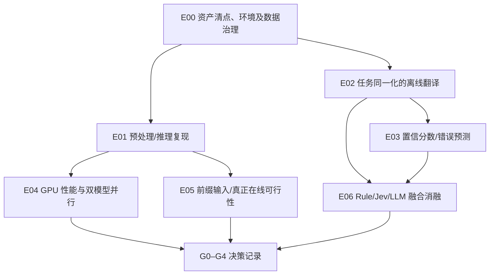

# PLAN — P-1 模型适配与多模型融合预实验

**项目**：SignLanguage-Bridge  
**承接**：已确认的后端架构 V3.0  
**目标**：在大规模修改后端前，确定哪些现有模型可以直接适配、融合是否有实质收益、流式部署条件是否具备、调度是否值得开发。  
**执行对象**：模型/后端开发人员、开发 Agent、人工评审人员。  
**本文件是计划，不是实验报告。**

## 0. 为什么先做 P-1

- 当前 1086 条 CSL-Daily 的 Uni-Sign 视频模式 BLEU-4 ≈ 24.82；Uni-Sign released pose BLEU-4 ≈ 25.58；SLRT Gloss WER ≈ 30.18%。它们分别衡量译文与 Gloss，不可直接比大小。
- 在 1086 条中，按旧分析阈值有 243 条 Uni-Sign 字符相似度 `<0.5` 且 SLRT WER `<=0.2`；75 条 Uni-Sign 字符相似度 `<0.5` 且 SLRT Gloss 完全正确。仅为**可调查的互补候选**。
- 旧 627 条样本全部出现在新表中；旧采集模板的三路历史预测与新表逐条比对 **0 条不一致**。因此统一升级数据台账即可，历史原始数据不得二次计算为独立测试。
- 目前缺少：同一任务下 SLRT 完整译文、校准的置信信号、逐样本分段计时、目标 GPU 的双模型实际开销、因果流式输出证据、Libras 对照数据。

## 1. 研究问题与要作出的工程决策

| 编号 | 核心研究问题 | 对应工程决定 |
|---|---|---|
| RQ1 | 已有模型权重与参考预处理能否在目标运行环境复现？ | 是否允许创建正式 ModelAdapter / Worker |
| RQ2 | Uni-Sign RGB/Pose 与 SLRT HRNet/视频输入能否接入统一视频源？ | 预处理适配器边界与关键点缓存策略 |
| RQ3 | SLRT Gloss→Text、SLRT 自带 SLT、双模型融合能否提高最终译文质量？ | 是否启用双模型 Late Fusion、是否复用已有 SLT 权重 |
| RQ4 | 模型分数能否可靠指示当前样本出错风险？ | 是否可以进入规则/学习式级联调度 |
| RQ5 | 相同 GPU 上串行、并行、级联的真实成本如何？ | 模型是否常驻、能否并行、调度首选模型 |
| RQ6 | 在线代码是否能在无未来信息时产生可用的 Partial？ | P2 实时后端选择和预期时延 |
| RQ7 | Jev/LLM 能否帮助纠错而不覆盖正确答案？ | Jev 插件、LLM Fusion Engine 是否进主链路 |

## 2. 开发边界

**本阶段要做**：验证模型、输入和评估逻辑；建立数据合约、离线回放工具、性能测量工具、基础 Agent 任务与验收文件。

**本阶段不做**：迁移整个 Streamlit/Tkinter UI；重构全部服务为微服务；把当前 CSL 权重直接用于 Libras；训练 CSL/Libras 自动分类器；默认修改模型内部网络做 Early Exit；上线无真实证据支持的自动接受逻辑。

架构仍然为 `视频管理 -> SignSystemRouter -> ModelAdapter / Worker -> EvidenceNormalizer -> FusionController -> Rule/Jev/LLM -> 字幕与日志`。在 P-1 内先用离线视频/历史表模拟这个数据流。

## 3. 分阶段实验与依赖

| 实验 | 最小规模 | 可直接复用现有结果？ | 主要交付物 |
|---|---:|---|---|
| E00 资产和环境 | 全模型/权重清单 | 部分 | `model_registry.yaml`、依赖/许可清单 |
| E01 预处理和复现 | Pilot 50→必要时 1086 | 否，需视频/权重 | `reproduction_report.md`、匹配率、输入差异 |
| E02 同任务翻译 | 1086 离线回放；新增模型跑可用样本 | Uni-Sign、SLRT Gloss 是 | A/B/C/D 输出、BLEU/chrF、人工语义核查 |
| E03 置信度/错误预测 | 先 50，再扩展 | 不足，需要 logits/score | score 字典、校准图、错误发现率 |
| E04 性能与显存 | 50 × 各模型，固定重复轮次 | 否 | GPU P50/P95、分段耗时、OOM 记录 |
| E05 真实流式可行性 | Pilot 50 的 25/50/75/100% 前缀 + 在线流 | 否 | Partial/Final、撤销率、首稳时延、未来帧审计 |
| E06 融合/判别消融 | 探索 1086；最终需新盲测 | Uni-Sign/Gloss 是 | A–H 消融、严重误译、无效润色与调用开销 |

**Pilot 50 是诊断样本，不是统计推断的独立测试集。** 从已使用过的 1086 条中按 10 名 signer 分层选择，每名 5 条，并覆盖困难/容易及不同视频长度；选择规则及每条样本均记录于 `data/pilot_50_exploratory.csv`。当 Pilot 全部跑通后，再扩展回放至已有数据；统计学显著性结论尽量使用新的、未见视频与 signer 测试。

## 4. 推荐的执行节奏（计划参考，不是完成承诺）

| 工作块 | 预估工作日 | 依赖 | 退出检查 |
|---|---:|---|---|
| 准备：资产登记、数据索引、运行环境 | 1–2 | 无 | G0 |
| 模型复现与预处理差异 | 2–4 | E00 | G1 |
| 翻译同任务评估/融合离线回放 | 2–4 | E00，部分依赖 E01 | G2 |
| 性能、分数收集、流式探针 | 2–4 | E01 | G3 |
| 复核、决策和 P0/P1 任务收敛 | 1–2 | 上述结果 | G4 |

有条件时 E02 离线文本评估可与 E01 推理复现同步进行；绝不因为某项权重下载受限，就将全项目其它实验全部阻塞。阻塞项应保留证据和替代路线。

## 5. 模型候选及默认处理

| 模型 ID | 当前定位 | 状态（截至计划时） | 必须独立核实 |
|---|---|---|---|
| `unisign_rgb` | CSLT 句子，视频路径 | 已有 1086 条历史预测 | checkpoint、RGB+Pose 依赖、官方 pose 提取、runtime |
| `unisign_pose_released` | CSLT 句子，released pose | 已有 1086 条历史预测 | released pose 不等于实时 MediaPipe，确认真实输入协议 |
| `slrt_twostream_slr` | CSLR Gloss，HRNet 两流路径 | 已有 1086 条历史预测 | checkpoint、裁剪/关键点对齐、CTC 及解码分数 |
| `slrt_twostream_slt` | 预训练完整句子翻译（待适配） | 官方有实现；本项目未验证 | 权重可获取性、可运行任务、相同 1086 的公平评测 |
| `slrt_online` | 在线 CSLR/SLT 方法 | 官方有在线代码；本项目未验证 | 与 TwoStream 的依赖关系、无未来帧、Partial 稳定度 |
| `rf_mediapipe_legacy` | 项目现有 RF 手势识别演示 | 维护兼容 | 225 维协议，不能直接充当官方 HRNet 替代 |
| `libras_tbd` | 未来中巴拓展 | 不在本阶段验证 | 独立权重、数据许可与 signer 泛化 |

其中 **官方实现“可获取”≠本地权重可直接运行**，也**不代表当前预训练权重适用于本项目的视频采集条件**。每项要登记真实 checkpoint 路径、SHA256、Git commit 和官方许可证。

## 6. P-1 的交付定义

1. **资产卡**：模型权重和代码版本可追溯；缺失项标记 BLOCKED。
2. **复现报告**：同一输入、同一模式与旧表结果的差异可审计。
3. **同任务性能表**：至少 A（Uni-Sign 句子）及 B（SLRT Gloss→固定翻译器）的统一句子指标，若权重可用则加 C（TwoStream-SLT）。
4. **融合消融报告**：A/C/E/F 等方案可追踪且不会将 GT 传给 LLM；包括误改率和关键事实错误。
5. **运行成本报告**：分段 P50/P95、GPU 峰值显存、单/双模型串行与并行实测。
6. **实时能力报告**：明确哪种方式能产生有效 Partial；没有证据则写明“不支持/未确认”。
7. **Gate 与 ADR**：写明确定的接入路线与暂缓路线；每个决定引用 run_id 和 artifact。

**只有 1–7 有明确证据时，P-1 才算完成；对因权重/数据缺失而无法完成的部分，应在 ADR 记录替代路径、阻塞影响，不能视为已经通过。**

## 7. 推荐后续动作

优先做 `T00–T04`，即核对真实项目源码、冻结旧结果、生成可复现 Pilot、记录模型版本。之后平行开展 `T05`（复现）与 `T07`（历史文本级基线），它们对整体架构收益最大。详见任务清单与 Agent 指令。
