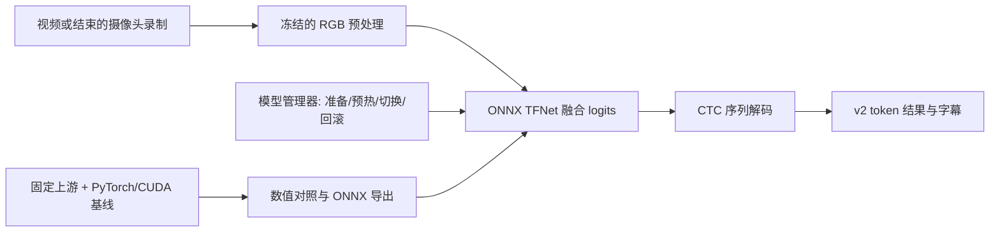

# CE-CSL TFNet 接入与验证

实施开始于2026-10-09，最终验证延续至2026-10-10（Asia/Shanghai）。文件名保留本次实施批次日期。

## 范围

本轮将完整中文手语视频识别接入共享运行时：RGB 全帧 → TFNet → CTC 中文词序列。既有 Libras 单动作分类保留在 v1。TFNet 为双向模型，摄像头需结束一段录制后识别；当前输出不是自然语言翻译，也没有逐词时间标注。



## 冻结身份

- 上游 `woshisad159/TFNet`：`ee7cb6a253a711e8f3699a1e8e0943179268060c`。
- 本地 checkpoint：`D:/Zenodo/CE-CSL/TFNet-CE-CSL-CSLDaily-32.46.pth`，SHA256 `160d35a42d9f8f52a090d0131586df1631d2fcf8c9f41ee94729cae1fb6b0386`。
- 词表：3515 个规范化词项 + blank=0；索引顺序不可改变。词表文件 SHA256 `218dd2f7890156fc20e3d73b97e34838adaa7d822442ac403d722b23d4f07a00`。
- 官方 train/dev/test：4973/515/500，签者 A–L 跨划分出现，不声明未知签者泛化。
- JPEG 质量95，256拉伸，224中心裁剪，RGB/float32，`pixels/127.5-1`；不采样、不截断；左补6帧，右补 `6+(-n)%4` 帧，输出 `ceil(n/4)` 步。
- FFT 保留源码的 512 特征通道轴与 forward 归一化。导出使用实数 cosine/sine MatMul；B1 下去除 pack 前后处理，必须通过数值与解码对照。

全部冻结证据在 `artifacts/cecsl-integration-20261009/frozen/`。视频全量冻结只检查存在和大小；实际评估的每段视频另计算 SHA256。原生加载固定源码文本、严格匹配所有状态张量，并使用限定 allowlist 的 `weights_only=True`，不运行训练入口或下载 ImageNet 权重。

## 环境

实际基线使用 Python3.12.7、PyTorch2.9.1+cu130、torchvision0.24.1+cu130、RTX5060Ti16GB。本次独立 venv 复用本机已有 PyTorch；项目部署依赖安装在 venv 内，完整版本与路径记录在证据中。

新机器建议创建独立环境，再从 [PyTorch 官方安装指令](https://pytorch.org/get-started/previous-versions/)安装匹配的 CUDA wheel；本项目固定 `torch==2.9.1 / torchvision==0.24.1`。部署只需 `api,rgb-sequence,onnx` 或 `api,rgb-sequence,onnx-gpu`，不需要 PyTorch 和上游源码。CPU/GPU 两种 ORT wheel 选择其一。

```powershell
python -m pip install -e '.[api,rgb-sequence,onnx-gpu]'
```

## 可复现命令

在项目根目录运行，以下 `python` 代表具备对应依赖的环境。

```powershell
python -m slbridge.cecsl_cli freeze --dataset-root D:/Zenodo/CE-CSL/CE-CSL --source-dir artifacts/cecsl-tfnet-audit-20261009/TFNet --output artifacts/cecsl-integration-20261009/frozen
python -m slbridge.cecsl_cli native --frozen-dir artifacts/cecsl-integration-20261009/frozen --checkpoint D:/Zenodo/CE-CSL/TFNet-CE-CSL-CSLDaily-32.46.pth --source-dir artifacts/cecsl-tfnet-audit-20261009/TFNet --device cuda:0 --split test --decoder prefix_beam --output artifacts/cecsl-integration-20261009/native-test500-beam.json
```

评估逐段写入 `.samples.jsonl` 与 `.progress.json`，完整报告不覆盖已有结果。中断后以相同参数加 `--resume`；会核验身份、已完成的官方样本前缀、视频哈希和指标。并发写同一输出会被锁拒绝。设备、显存上限等运行身份改变时应使用新输出，保留原失败证据。

```powershell
python -m slbridge.cecsl_cli export --frozen-dir artifacts/cecsl-integration-20261009/frozen --checkpoint D:/Zenodo/CE-CSL/TFNet-CE-CSL-CSLDaily-32.46.pth --source-dir artifacts/cecsl-tfnet-audit-20261009/TFNet --verification-video D:/Zenodo/CE-CSL/CE-CSL/video/test/A/test-00001.mp4 --device cuda:0 --output artifacts/cecsl-integration-20261009/export/model.onnx
python -m slbridge.cecsl_cli package --frozen-dir artifacts/cecsl-integration-20261009/frozen --onnx artifacts/cecsl-integration-20261009/export/model.onnx --output artifacts/models/cecsl-tfnet-onnx-20261009 --run-id cecsl-tfnet-onnx-20261009 --decoder prefix_beam
```

本次实际导出验证还包含32/33/34/35帧的派生前缀和247帧完整视频，覆盖 n mod4=0/1/2/3。单个验证视频导出命令仅证明该输入；想覆盖更多长度应重复 `--verification-video`。数值、长度或 greedy CTC 不一致时不发布 ONNX。模型包包含 graph、词表、输入规格、来源、数据索引、官方划分和各自哈希，部署文件不可单独改写。

本次图大小266,385,873字节，SHA256 `e52bf9ff768d7d9d4d4bb1c73ddae5f1693060cdd239d718d1fe65e36ba3f6c6`。首次导出在默认 cuDNN TF32 路径上未通过1e-4门槛；逐项对照确认关闭 TF32 后通过，保留原失败记录。导出工具在作用域内关闭 cuDNN/matmul TF32，结束或出错后恢复调用者标志；CTC ONNX CUDA 设置 `use_tf32=0`，RF 的 CUDA 配置不受此改动影响。

```powershell
python -m slbridge.cecsl_cli evaluate --frozen-dir artifacts/cecsl-integration-20261009/frozen --model artifacts/models/cecsl-tfnet-onnx-20261009 --device cuda --decoder prefix_beam --intra-op-threads 4 --gpu-mem-limit-mb 8192 --output artifacts/cecsl-integration-20261009/onnx-test500-beam-arena.json
```

## API 与显示

模型目录通过服务端 catalog 注册；`/v1/models`、切换与回滚复用现有生命周期。分类上传继续用 `/v1/recognitions`；连续词序列上传用 `/v2/recognitions`。两种请求在租约内核对任务，不允许热切换竞态造成结构错配。

v2 multipart 字段：`file` 必填；`request_id`、`representation_id=tfnet_rgb_v1`、`sign_language=csl` 可选声明，声明必须匹配已加载模型。支持 mp4/avi/mov/mkv；不接受关键点 npy/npz。

```json
{"schema_version":2,"request_id":"clip-1","model_generation":1,"result":{"task_type":"gloss_sequence","sign_language":"csl","prediction":{"decoder":"prefix_beam","tokens":[{"token_id":1601,"gloss":"我","score":null,"time_range":null}]}}}
```

以上是结构节选。实际响应还含 status、quality、整体 time_range、runtime 与 timing_ms。prefix beam 未估计逐词对齐，因此 score/time_range 为 null；greedy score 是对应连续 CTC 路径的平均词 posterior，未经校准。空序列显式拒绝，不复制其他样本的结果。统一错误 envelope 保持现有 schema_version1，并返回413/422/409/503等状态。

默认输入上限15秒/600帧/128MiB；不得超限截断。信任的离线评估可显式提高有界上限，运行时仍遵守包内规格。CUDA严格模式必须激活实际 CUDA provider，auto回退原因可见；算子级设备证明以 profile 为准。较复杂 RGB 模型应显式配置足够的 `--gpu-mem-limit-mb`，不能把默认2GiB当成通用显存需求。

该模型在默认 CUDA arena 策略下，8GiB于第257段、12GiB于第384段报显存分配错误，分别保留前256/383段与失败日志。两次此前都通过过337帧，失败样本为285/331帧，支持池增长或碎片化解释。提高显存上限没有解决变长重复推理的问题。

最终 CTC CUDA 路径使用 `arena_extend_strategy=kSameAsRequested`，每次预测及预热通过 `RunOptions` 配置 `memory.enable_memory_arena_shrinkage=gpu:<device_id>` 回收完全空闲的池区；CPU与RF调用策略保持原样。机制参见 [ORT CUDA配置](https://onnxruntime.ai/docs/execution-providers/CUDA-ExecutionProvider.html#arena_extend_strategy)及 [内存池回收说明](https://onnxruntime.ai/docs/get-started/with-c.html#features)，具体键核对 [v1.23.2头文件](https://github.com/microsoft/onnxruntime/blob/v1.23.2/include/onnxruntime/core/session/onnxruntime_run_options_config_keys.h)。

同一8GiB上限下，90/285/331/353帧各重复3次的生产适配器压力验证通过；旧策略全局显存驻留约9.1GiB，新策略每次请求后约2.0GiB，采样峰值5,281MiB。该数字是整卡采样，包含显示与其他进程，不是精确的ORT分配器峰值。仍不能保证任意设备或600帧输入都能运行；资源上限与模型能力须分别评估。模型包绑定输入规格，不能通过评估参数静默扩大包内上限。

```powershell
python -m slbridge.api_cli --catalog configs/cecsl_runtime_catalog.example.json --model csl-tfnet --device cuda --intra-op-threads 4 --gpu-mem-limit-mb 8192
curl.exe -X POST http://127.0.0.1:8765/v2/recognitions -F 'file=@D:/Zenodo/CE-CSL/CE-CSL/video/test/A/test-00010.mp4' -F 'representation_id=tfnet_rgb_v1' -F 'sign_language=csl'
python -m slbridge.desktop_cli --model artifacts/models/cecsl-tfnet-onnx-20261009 --device cpu
```

本机 ORT GPU 依赖位于 `D:/NVlDlA GPU ComputingToolkit/bin` 和 `D:/NVlDlA GPU ComputingToolkit/bin/12.9`。上述 GPU 命令在 DLL 不位于系统搜索路径时，需各追加一次 `--cuda-dll-dir`。新机器使用自己的 CUDA12/cuDNN9 路径；PyTorch cu130 的依赖目录不能直接充当 ORT CUDA12 安装。

桌面可载入该 v2 包，复用视频和结束录制输入，显示“中文手语词序列”；葡语显示“表达待审核”。具体共同语义审核见 [清单](CE-CSL_Libras共同语义审核清单_2026-10-09.md)，目前人工确认与动作对齐都是0项。

## 验证记录

所有证据路径相对于本地 `artifacts/cecsl-integration-20261009/`。未结束的阶段不标为通过。

| 检查 | 状态 | 证据 |
|---|---|---|
| 官方词表/划分/输入规格冻结 | passed | frozen/freeze_summary.json |
| 236帧 imageio/OpenCV 及 JPEG 像素对照 | passed，最大误差0 | frozen/decoder_cross_backend_parity.json |
| 313张量严格加载、真实中文 CUDA 推理 | passed | native-probe.json |
| 完整500段测试集 corrected prefix beam WER | passed，逐句32.4794%，语料32.8289% | native-test500-beam.json |
| 真实 TFNet ONNX CPU 数值/长度/解码 | passed；5个长度，最大绝对差1.86e-5 | export/model.onnx.metadata.json |
| ONNX CUDA 数值、双解码、实际算子 | passed；CPU/GPU最大绝对差3.05e-5；875 CUDA/110 CPU kernel事件 | onnx-gpu-acceptance.json |
| 最终显存策略的CPU/CUDA数值与双解码 | passed；5个长度，原1e-4门槛；实际provider/RunOptions读回 | onnx-gpu-final-policy-acceptance.json |
| 真实 TCP HTTP 视频上传及任务拒绝 | passed；v2返回词序列，错误v1任务/空白语种返回422 | http-api-acceptance.json |
| 变长生产适配器显存压力 | passed；8GiB上限，12次交替长度预测与原生词序列一致 | cuda-arena-production.json |
| 全500段 ONNX CUDA 执行 | passed；修复后8GiB完整运行；逐句WER32.4394%、语料32.7961% | onnx-test500-beam-arena.json |
| 与原生500段报告逐项对照 | 输入身份/长度500一致；词序列499一致，1项不同 | full-native-onnx-comparison.json |
| test-00445差异项精度对照 | passed；显式FP32原生/ONNX CPU/CUDA的greedy与beam一致，原1e-4门槛通过 | targeted-445-parity.json |
| Libras 迁移对照及独立复算 | passed；预训练72/72、随机17/72；限定12类子集 | transfer/result.json、transfer/verification.json |
| Qt离屏实际CPU模型、切换与回滚 | passed；28项；不含实体摄像头或像素验收 | qt-offscreen-acceptance.json |
| 最终完整CPU回归 | passed；416 passed / 10 skipped | core-final-arena-tests.xml、core-final-arena-tests.log |
| Torch导出/精度补测 | passed；25 passed，覆盖CPU环境缺少Torch的路径 | native-final-tests.xml、native-final-tests.log |

CUDA profile中的 Conv、LSTM、MatMul 已实际执行在 GPU；CPU事件主要为形状与索引处理，不声明所有算子都在GPU。修复显存策略前的独立5输入对照中，首次32帧推理约41.65秒，随后33/34/35帧约0.10秒，247帧约0.48秒；这包含冷启动和不同长度，不能作为稳态时延承诺。修复前真实HTTP首次175帧上传总耗时13.34秒（推理12.15秒），旧记录保留为 `http-api-acceptance-before-arena.json`；最终路径重复上传总耗时1.89秒（预处理1.12秒，推理/解码0.77秒）。两次缓存与并发条件不同，不作为受控速度增益。

最终数值验收从实际ORT会话读取 `get_provider_options()` 和 RunOptions，确认 CUDA `use_tf32=0`、8GiB上限、按需扩展和`gpu:0`回收均生效，见 `onnx-gpu-final-policy-acceptance.json`；先前12GiB的配置读回另保留为 `onnx-provider-options.json`。Qt离屏验收使用真实CE-CSL文件、真实Libras RF和主窗口异步控件，模型代际1→2→3，覆盖CTC→RF→CTC回滚、失败模型保持当前代、词表顺序、字幕和线程关闭。最终42.31秒验收绑定当前源码哈希，旧记录保留为 `qt-offscreen-acceptance-before-arena.json`。离屏验证不证明物理摄像头或显示像素质量；单个示例不作为准确率。

迁移实验仅训练新岭分类头、冻结MAM视觉表示，没有微调整个TFNet，也没有把其中文3516项CTC头用于Libras。360段原始视频在train/validation/test之间无相同SHA256；两臂选型均先于任一测试预测保存，720个表示缓存、训练头和72条测试预测独立复算一致。详见 [迁移报告](CE-CSL_Libras迁移验证_2026-10-09.md)。

原生500段报告生成时未记录TF32标志；之后诊断中复查新进程默认值为cuDNN TF32开启、matmul TF32关闭。该报告保持原样；导出数值对照另使用明确关闭TF32的原生参考。新原生运行记录实际精度标志，不能把两个配置下的耗时直接当成同条件基准。

最终ONNX报告SHA256 `444a88b680f4973cdc9595e4537a8c0398fbc02df2830ff0204b4cf2bb5f6d2b`，500条997次编辑/3040个参考词。原生报告为998次编辑。两者唯一词序列差异为 `test-00445`：原生“这里 / 经济 / 牌子 / 最 / 喜欢 / 。”，ONNX“这里 / 经济 / 最 / 喜欢 / 。”；严格的全量词序列完全相同检查为 failed，不能写成500/500一致。

单独254帧视频的对照重复了该差异：同一个严格加载的PyTorch模型保持权重不变，默认TF32重复两次均得到原生旧结果；仅关闭TF32，重复两次均得到ONNX结果。显式FP32原生→ONNX CPU最大绝对差6.20e-5，→CUDA最大1.57e-5，数值/长度/greedy/prefix beam均通过原1e-4门槛；默认→FP32最大差0.0643。独立ONNX进程不导入Torch，实际provider与回收策略均核对，作用域结束恢复TF32标志。证据为 `targeted-445-parity.json` 及绑定的四个分数/记录文件。该证据支持TF32解释，但没有重跑全500条FP32原生基线；原始两份全量报告与499/500比较保持不变。

最终ONNX逐段推理中位数0.395秒，预处理/解码在内的总耗时中位数1.328秒；这是本机离线500段记录，期间短暂并行API/Qt验收，不构成跨设备时延保证或同条件性能基准。实际视频时间还需先收集完整片段，TFNet双向结构不支持因果流式输出。

原始仓库 README 宣称 test WER32.46%；checkpoint33.188是历史最佳dev元数据。这里使用修正的有界prefix beam（beam10，token_top_k20），与源码ctcdecode及其额外去重不完全相同，因此独立报告本地逐句均值WER和语料WER，不称为验证了原始32.46%。Libras动作分类准确率与CE-CSL词序列WER不可直接比较。

上游没有明确 LICENSE；本仓库仅保存适配器与证据说明，不提交上游源码、checkpoint、数据或 ONNX 权重。
