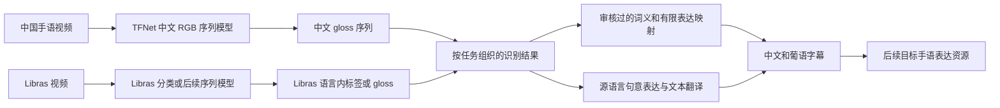

# CE-CSL / TFNet 与 Libras 的桥接评估及接入建议

日期：2026-10-09（Asia/Shanghai）。性质：本地数据、权重静态检查及上游源码审查；接入方案是建议，尚未实现 TFNet 推理、训练、ONNX 导出或跨手语翻译。

> 接入后增量：本页保留静态审计时点的结论。用户随后授权按冻结 → 原生基线 → 序列 API → 语义审核 → ONNX/迁移顺序执行，当前实现与实测见 [CE-CSL 接入与验证](CE-CSL_TFNet_ONNX接入与验证_2026-10-09.md)、[语义审核清单](CE-CSL_Libras共同语义审核清单_2026-10-09.md) 和 [迁移验证](CE-CSL_Libras迁移验证_2026-10-09.md)。

**CE-CSL 能补上本项目的中国手语连续识别数据来源；TFNet 权重具备作为中文识别基线的结构依据。推荐两种手语分别识别，在结果之后做语义与文本桥接。中文权重不能直接承担 Libras 识别，词义对应也不能作为动作、词序或训练标签等价的证据。**

## 1. 检查对象与证据边界

| 对象 | 本次检查范围 |
|---|---|
| 当前项目 | `3f9ce70040a9de0462082ec3319ac789393a8c0a`；核心契约、数据、推理、API、ONNX 分类后端、字幕及规划 |
| CE-CSL | `D:/Zenodo/CE-CSL/CE-CSL` 的全部 CSV 与视频文件清单；108 段抽样首帧、中帧解码 |
| 中文权重 | `D:/Zenodo/CE-CSL/TFNet-CE-CSL-CSLDaily-32.46.pth`，879,605,267 字节；ZIP 与 pickle 操作码静态检查，未执行反序列化或模型 |
| TFNet | [上游仓库固定版本](https://github.com/woshisad159/TFNet/tree/ee7cb6a253a711e8f3699a1e8e0943179268060c)，提交 `ee7cb6a253a711e8f3699a1e8e0943179268060c`，日期 2025-02-22；实际阅读数据、模型、训练及解码源码 |
| Libras | 项目 RGB 目录清单、既有数据审计、12 条目模型与字幕表；`D:/Zenodo/Libras-EQT-UECE` 的 README 与两个安全读取的 NPY 样本 |

原《开发指导》及 Review 是参考资料。本次以用户的“检查映射与项目贡献”请求为范围，不执行其中的采集、训练、下载或发布指令。

本地 CSV 与上游三个 CSV 的 SHA-256 **逐文件一致**；完整规范化词表及类别顺序也一致。权重 SHA-256：

```text
160d35a42d9f8f52a090d0131586df1631d2fcf8c9f41ee94729cae1fb6b0386
```

这证明本地标注与所查源码版本相符，不证明权重已能运行、原始视频发布版本经过校验、实际 WER 已复现或语义映射已通过语言学审核。没有全量解码、CE-CSL 视频内容去重或跨 split 视频哈希检查。

## 2. 两侧数据与模型的实际区别

| 维度 | CE-CSL / TFNet | 当前 Libras |
|---|---|---|
| 手语体系 | 中国手语；中文是标注文本语言 | 巴西手语 Libras；葡语是标注文本语言 |
| 本地规模 | 5,988 视频；train 4,973 / dev 515 / test 500 | RGB 5,347 视频、178 来源条目；当前模型为 12 条目、360 视频试点 |
| 监督信息 | `Number, Translator, Chinese Sentences, Gloss, Note`；中文句子与 `/` 分隔的手语 gloss 序列 | RGB 目录内的葡语单词或短语；已实现整段类别标签，尚未核验本地连续 gloss 序列标注 |
| 当前模型任务 | 完整视频 → 多个 gloss 的连续识别候选 | 完整片段 → 一个类别，RF / 验证导出的 ONNX RF |
| 数值输入 | RGB，`B,L,3,224,224`；变长、端点复制 padding | `mediapipe225_rgb_v1` 关键点、mask、固定目标时间采样 |
| 输出 | `T',B,3516` 融合 logits，经 CTC 得词序列 | `N,C` 类别概率，再选一个标签或拒识 |
| 自然句翻译 | 数据有中文参考句；已提供模型不直接生成自然中文句子或葡语 | 当前字幕是类别的双语释义；整段类别识别不等于开放句翻译 |
| 实时能力 | 整段上下文、双向 LSTM；未提供因果流式接口 | 摄像头预览与用户结束片段后的识别；不是连续流理解 |

CE-CSL 的 A–L 12 个签者 ID 同时出现在三个官方集合，**官方结果不是未见签者泛化结果**。本地未发现缺失标签视频配对、无标签视频、重复 Number 或空 Gloss。抽样 108 段的首帧和中帧全部解码成功；抽样时长 2.07–11.1 秒、中位数 6.27 秒，FPS 有 21、28、30，分辨率也不统一。这些是抽样观测范围，不是全量视频时长或可解码性结论。

原始 gloss 有 3,862 种 token；按 TFNet 规则规范化后为 **3,515 种，含标点**，再加 blank 得 3,516。训练集 3,512 个非标点类别中，1,688 个只出现一次、2,849 个至多五次，不能从词表规模推断每词识别可靠度。

论文介绍 CE-CSL 的复杂背景与连续标注，可作为模型环境鲁棒性评价资源；本项目仍需独立的摄像头和未见签者数据。[作者论文](https://arxiv.org/abs/2409.11960)

### Libras 的两个待确认资源

1. `D:/Zenodo/Libras-EQT-UECE-T.zip` 同时存在 `.aria2` 下载状态文件；当前未确认下载完成、完整校验或展开后的 `annotations/train.npy,dev.npy,test.npy`。官方 README 描述有该层资源，但不能把它计为已可用的本地连续标注。[作者发布页](https://zenodo.org/records/21398895)
2. 本地 Landmarks 实物为 NPY，和 README 的 CSV/JSON 描述不同。抽取同名 `100_Cair/INFORMANTE 1/IMG_4868.npy`：手部包 `(119,126)`，完整包 `(119,318)`，float32、有限值、z 非零、未带时间戳。318 维算术上对应 106 个 xyz 点，但本次未确认点序、语义拓扑或归一化。这些均不能直接当作项目的 225 维 NPZ 使用。

## 3. 当前 12 条目可以怎样对应

下表次数是 **CE-CSL 三个集合中规范化 gloss token 的出现总次数**，不是独立动作片段数、模型识别次数或准确率。映射为待审核候选；项目现有中文字幕同样全部是 `draft`。

| Libras 标签 | CE-CSL 中实际词条与次数 | 候选含义与处理 |
|---|---|---|
| `item:105` Árvore | 树 9；树木 1 | 树这一名词的候选对应较明确；保留两侧动作与标识 |
| `item:94` Serviço | 服务 17 | 服务概念候选；具体服务种类仍需上下文 |
| `item:93` Solicitar | 申请 7；请求 0 | 申请/请求候选；CE-CSL 语境为工作、入学等，不能直接验证电力服务申请 |
| `item:110` Menos | 少 41；减少 5 | 数量少、比较更少、减少要分别校对，不能全部合成一个意思 |
| `item:111` Mais | 多 163；更多 1 | 多/更多候选，量词和比较关系需保留 |
| `item:7` Quero | 想 207；要 256；想要 1 | 意愿候选；“想”“要”的具体义项要消歧，不能自动合并类别 |
| `item:2` Sim | 是 341；对 61；正确 2 | 确认回答候选；中文系词“是”与回答“是的”不能只凭标签文字视为等价 |
| `item:92` Energia | 电 9；能源/电力 0 | 可调查电力概念的局部对应；已有句子确涉水电费用、没电，但覆盖不完整 |
| `item:100` Cair | 倒 6；落 2；落下 2 | 高歧义：多数“倒”是倒汤、倒水、倒垃圾，不能直接当倒树/倒电线杆 |
| `item:106` Poste | 电线杆 0 | 没有直接词条证据，应补词义与中文手语样本 |
| `item:107` Raio | 闪电 0；雷 1 | “雷”的现有语境是雷阵雨；不能直接替代闪电 |
| `item:113` Religar | 重新 0；接 2；恢复 3 | 没有复电词义证据；“接”是接人/接捧花，“恢复”是精神或经济恢复 |

因此，适合首先审核 **树、服务、申请、数量多/少、意愿、确认** 这七个现有条目所涉及的概念。其余电力、倒落、电线杆、闪电和重新接通相关含义需要补齐或细化，不能把近义词替换当作已桥接成功。token 低频也不能代替有效的共同语义测试集。

### 全量 Libras 还有哪些扩展候选

本地 178 条目中还可选择下面的对齐方向；**它们大多尚不在当前 12 类模型中**：

| Libras 来源条目 | CE-CSL 现有证据 | 使用边界 |
|---|---|---|
| `103` Não sei | 不知道 30 | 否定知识状态候选；保留完整表达语义 |
| `97` Rua | 街道 6；路 11 | 街道/道路需区分具体含义 |
| `204` Data | 日期 5 | 日期概念可做桥接，另保留数字、单位和顺序 |
| `206` Dez / `208` Trinta | 十 4、10 5；三十 1、30 5 | 数值 10/30 候选；手语形式和文本数字编码分开 |
| `207` Quinze | 十五/15 均 0 | 没有本次词表匹配；不能把可组合数字当作已识别 15 |
| `12` Não, Obrigado | 不 231；谢谢 36 | 只有组件覆盖，不能据此认定完整拒绝短语对应成立 |
| `233` Está errado | 错 11；错误 13 | 错误判断候选，不能不经审核就直接作为成句文本 |
| `115` Luz | 灯 6；光 1 | “灯”可作电灯候选；唯一“光”来自“吃光”，不能作为光线词义的证据 |
| `153` PÁGINA / `98` Toda | 页 1；全部 29 | 有词条但可能低频，仍需独立验证 |

Pix、CPF、WhatsApp 及电力服务专业短语的业务含义不能靠普通词表拼接恢复。全量目录里有短语类别，也不表示已有该短语的连续词级识别能力。

## 4. 桥接应该位于哪一层

推荐保留独立语言模型与词表，在结构化识别结果之后建立两条用途不同的路径：有限词义用审核映射，开放句子用源语言理解及文本翻译。



具体约定：

- `sign_language` 是输入手语体系；`zh-CN` / `pt-BR` 是文本语言，不能替代手语体系字段。
- 保留 `dataset_id + native_sign_id/model_token_id + vocabulary_version`。例如 Libras 的 `item:105` 与 TFNet 的词表索引 `2061` 是两个不同标识；后者只有绑定完整词表后才表示“树”。不能全项目复用裸整数或裸中文词作为唯一 ID。
- `semantic_id` 是经过审核的概念引用，可为空、可多对多；记录义项、上下文、映射版本、`review_status` 和出处。不把本文候选写成已审核的训练标签。
- 保留原始 gloss 的数字变体、括号方向信息与 Note。现有 TFNet 规范化会合并 `树1/树2` 和一些指向注释，**模型输出无法恢复被合并的信息**；原始标注可以保留，但不能把推理中的变体补猜出来。
- 序列必须保留顺序、重复词、否定、疑问和数字。词级共享概念不够表达句子，不能把“我/不要/服务”逐词查表后宣称自然葡语翻译完成。
- CE-CSL 的 `Chinese Sentences` 可为后续 gloss→中文文本模块提供同视频参考监督；TFNet 本身只输出 gloss。中文→葡语、葡语→中文仍是另一项需要独立评价的能力。
- 目标手语视频检索或生成也独立建设。CE-CSL 没有词级时间戳，不能按 slash 个数均分句子视频，生成所谓真实词级动作资产。

目前没有 CE-CSL 与 Libras 的平行视频、共同完整句子标注或经审核的手语间动作对照，故**能够提出语义候选，尚不能训练或验证直接 CSL↔Libras 的端到端翻译**。

## 5. 对核心框架的具体贡献及改造位置

### 可以复用的已实现能力

模型目录与校验和、独立运行配置、模型预热、片段边界切换与回退、任务执行锁、上传和错误边界、request_id、model_generation、运行设备报告及耗时信息均能保留设计和大部分实现。视频文件与 CapturedClip 也可共用来源抽象。

**共用来源或管理流程，不等于共用 PreparedInput、预测方法或分类结果 schema。** 当前适配器仍有真实的分类假设，必须显式新增序列能力：

| 当前位置 | 已实现限制 | 建议扩展 |
|---|---|---|
| `slbridge/contracts.py` | SampleRecord 只持有单 label_id；InputSpec 支持三个关键点表示；Manifest 只允许 classification，RecognitionResult 仅有分类 prediction 结构 | 新增版本化序列目标、RGB InputSpec、gloss_sequence 结果；保留旧 v1 包读取 |
| `slbridge/data.py` | legacy/Libras 目录适配和分类拆分 | CE-CSL adapter 按 Number/Translator/官方 split 引用 RGB，另存原始 gloss、规范化 token、中文参考句与 Note |
| `slbridge/features.py` | MediaPipe 特征、固定目标帧数与关键点 PreparedInput | 增加完整 RGB 视频处理路径；按模型定义 resize/crop/normalize/pad/length，不转成225维，也不强制压成30帧 |
| `slbridge/backends.py` / `bundle.py` | RF 与 ONNX 分类 backend；分类产物、标签和处理状态校验 | 真实实现后注册 PyTorch CTC backend，再接 ONNX CTC backend；封装权重、词表、预处理、blank、解码器与任务能力 |
| `slbridge/inference.py` | `predict_proba` → 一个 class prediction | 按任务分派；序列模型返回有效长度与 gloss 序列，score_type 独立，不伪造单类别置信度 |
| `slbridge/onnx_backend.py` | NC / NTC 关键点输入，输出严格 `(1,C)` | 新增序列适配器支持 RGB 与 `T',B,V`，不把 CTC logits 接到现有概率校验器 |
| `slbridge/runtime.py` / `runtime_contracts.py` | 单个 active 模型；request 手语字段是相容性校验，尚非多语言路由 | 保留预热/租约/回退；增加手语体系、任务与模型别名路由，需要共存时各路持有模型实例 |
| `slbridge/api_schemas.py` / `api.py` | HTTP v1 明确只有分类预测 | 建议新增版本化多任务响应，例如 v2；按 task_type 区分类别与词序列，旧 v1 客户端行为保持兼容 |
| `slbridge/captions.py` / `session.py` / 桌面 presenter | 按单标签查字幕，现有模型控件为单模型切换 | 消费任务专属结果；分别展示原始识别内容和字幕释义；序列映射或翻译结果保留来源和不确定状态 |

上述是待开发建议，当前 API 中没有可调用的 TFNet/CTC 路由。建议先做完整视频的 `gloss_sequence + clip`，能力清单写 `stream=false`；经过流式算法与测试后才增加 stream。

### 两个模型同时工作时

未来中国侧与巴西侧同时交流，宜按 `(sign_language, task_type, model_alias)` 选择已驻留实例，再分别管理版本。**不要让两个人的每次请求轮流触发全局模型热切换**。可先分别部署中文和 Libras 的单模型服务；在确需同进程共存时再加路由和共享 GPU 调度。

模型任务内沿用当前管理器的切换与回退；跨模型限制总并发、输入帧数、GPU 占用和等待时间，并把每次请求绑定到其实际模型 generation。不同路的 generation 与回退不能互相覆盖。

序列模型耗时建议拆成：解码、图像处理、CPU→GPU、网络前向、CTC 解码、字幕/文本转换及总时间。当前 `preprocess_ms/inference_ms/total_ms` 可以保留总体口径，另增加明确版本的细分字段；CPU beam search 必须计入响应成本。

## 6. TFNet 接入前需要解决的实际源码问题

### 推理入口和产物

- `SLR.py` 默认调用训练。`Train.py` 的测试分支还会覆盖配置路径并遍历55个 epoch 文件，不适合作为项目单请求推理入口。
- 构造 `resnet34MAM` 会先下载 ImageNet 权重；已持有完整 TFNet 权重时应提供不下载的等结构推理构造路径。
- 使用 `moduleNet_state_dict`，严格核对全部键和 shape；不把 optimizer_state_dict 装入推理实例。当前静态检查发现313个张量键，五个 classifier 权重都为 `(1024,3516)`；NormLinear 的该维度含义是1024输入、3516输出。
- 必须同时 `model.eval()` 和 `forward(..., isTrain=False)`。`eval()` 不会改变 forward 默认实参，否则会使用分支输出，而非融合 `classifier55`。

以上依据 [训练源码](https://github.com/woshisad159/TFNet/blob/ee7cb6a253a711e8f3699a1e8e0943179268060c/Train.py)、[模型源码](https://github.com/woshisad159/TFNet/blob/ee7cb6a253a711e8f3699a1e8e0943179268060c/Net.py) 和 [模块源码](https://github.com/woshisad159/TFNet/blob/ee7cb6a253a711e8f3699a1e8e0943179268060c/Module.py)。

### 预处理和词表必须冻结

确定性评价路径：保留完整视频顺序 → RGB resize 256×256 → 中心裁剪224×224 → float32 `x/127.5-1`。不使用训练随机裁剪、随机镜像或 TemporalRescale。若原始 n 帧，单视频端点复制后 `L=4×ceil(n/4)+12`，模型有效输出 `T'=ceil(n/4)`。RGB 直接解码路径须与上游 JPEG 参考路径做数值/预测对照，JPEG 再压缩可能引起差异。

`PreWords` 去括号注释、去部分尾部变体数字、统一部分标点/数字格式，再按 Python 字典序建词表；blank=0，`。=77`、`，=3514`、`？=3515`。不能在加载前删标点、换排序、用界面翻译列表重新生成分类头顺序。[数据处理源码](https://github.com/woshisad159/TFNet/blob/ee7cb6a253a711e8f3699a1e8e0943179268060c/DataProcessMoudle.py)

上游用 train/dev/test 合建词表。本次确认规范化后三者词表的并集已全部被 train 覆盖；部署复现应冻结现有完整顺序。新训练实验仍应显式固定词表来源、分割及 OOV 策略，不能把测试样本拿来拟合特征或调参。

### 解码器不能原样复制到服务

原 wrapper 在 CTC 已解码后再次去连续重复词，会删除 blank 分开的合法同词重复；空结果会复制同批前一样本；第二返回只包含末样本。原评价 batch=1 隐藏部分批间问题，但不会消除重复词问题。部署应有独立 CTC 解码边界测试；复现原结果与修正解码器后的新结果分别报告。[解码源码](https://github.com/woshisad159/TFNet/blob/ee7cb6a253a711e8f3699a1e8e0943179268060c/decode.py)

原解码返回的序号不是词级时间戳；虽然 beam 解码产生 timesteps，wrapper 将其丢弃。新增时间信息要注明是解码对齐估计，映射时处理 stride、端点 padding 和实际视频时间，不冒充人工标注边界。未提供可靠对齐时允许时间字段为空。

### 准确率声明必须重新测量

README 声称最新下载权重 test WER 32.46%，旧表还保留 dev42.1/test41.9。当前文件名与静态维度检查不能复现这两个结果。[README](https://github.com/woshisad159/TFNet/blob/ee7cb6a253a711e8f3699a1e8e0943179268060c/README.md)

本地 checkpoint 保存 `bestWerScore=33.18813979979028`、`bestWerScoreEpoch=37`、`epoch=38`；按训练源码，这是历史最佳 **dev** 记录，不是本次 test 结果。源码按逐句 WER 平均；接入评价应同时保留复现口径，并报告语料级 `WER=(S+D+I)/参考词总数`、句子完全匹配率、标点处理与拒识覆盖。

**WER 32.46% 不能改写成67.54%识别准确率，也不能与12类分类 accuracy直接比较。** 尚未完成真实前向，本报告不给出中文识别率、FPS、ONNX成功率或GPU提速数字。

## 7. Backbone 与 GPU/ONNX 路线如何调整

建议形成两条相互支持的实验线：

| 实验线 | 近期工作 | 对另一侧的贡献 |
|---|---|---|
| 中文连续识别 | 固定 TFNet 原生模型与权重，先完成完整视频 CTC 识别和官方评价 | 验证核心支持 RGB、变长、词序列和不同评价方法；提供中文参考能力 |
| Libras 模型升级 | 保留 RF 参照；在同一协议上比较轻量 TCN/ST-GCN，或经许可采用 TFNet RGB 编码器初始化 | 检验时间建模/视觉表示增益；需独立 Libras 分类头或有真实序列标注的 CTC 头 |

TFNet 是 **RGB+CTC 中文参考模型/迁移候选**，不据此替换全部 Libras 路线。中国手语与 Libras 可共享模型代码、部分视觉初始化和部署工具，但分别保留词表、任务头和评价。

迁移建议至少比较：Libras 原基线、同结构普通视觉预训练初始化、CE-CSL 权重初始化。先冻结编码器训练 Libras 头，再依据 validation 决定解冻。当前 checkpoint 没有训练数据或预训练来源指纹；词表与头维度相符不证明全部训练来源。做新的中文未见签者评价时应检查权重已见签者范围，不能直接声称独立泛化。文件名含 CSLDaily 也不证明一个词表头能够同时识别 CSL-Daily 或 Libras。

### 部署顺序

1. **PyTorch CUDA 原生推理先作为数值参考**：使用独立环境，严格加载、冻结预处理及解码，先不转换图。实际设备兼容性与 CUDA 性能另测；不照搬 README 的旧 `1.11.0+cu113` 环境。
2. **ONNX 序列导出**：只暴露融合 logits 与有效长度；CTC 解码在图外。核对动态帧长、Conv3d、BiLSTM pack/unpack、FFT 和实虚数表示，按不同长度真实视频比对 scores、序列及 WER。
3. **CPU/CUDA 节点和端到端验收**：复用已有 provider 配置思想、session缓存、预热与错误策略；新增序列输入/输出适配，并采集节点 profiling。再测 decode→前向→CTC 的 P50/P95、峰值显存、两侧并发和冷启动。
4. **流式模型另立实验**：当前双向 LSTM与非因果时间卷积依赖后续帧；滑窗、分块或蒸馏都要重新测词序、重复输出、字幕修订和延迟，不能把离线吞吐称为实时逐词翻译。

**FFT 还有一个需要保留的源码事实**：当前张量由 `(B,512,L)` 转为 `(B,L,512)` 后做 `fft(dim=-1,norm='forward')`，实际在每帧512个特征通道上变换。改成时间轴 FFT 会改变现有权重对应的网络。先按代码复现，再把改轴视为需重新训练/评价的模型实验。[固定版 Net.py](https://github.com/woshisad159/TFNet/blob/ee7cb6a253a711e8f3699a1e8e0943179268060c/Net.py#L449)

ONNX 定义了 DFT，不能笼统说 ONNX 不支持 FFT；但本项目使用的 ORT **v1.23.2** 内核表将 DFT 列在 CPU/DirectML 段，CUDA 段未列。导出后的节点可能发生 CPU 执行与数据搬移，需要实际图和profiling核验。[ONNX DFT定义](https://onnx.ai/onnx/operators/onnx__DFT.html)、[ORT v1.23.2内核表](https://github.com/microsoft/onnxruntime/blob/v1.23.2/docs/OperatorKernels.md)

可以研究固定512维的等价实数 DFT/MatMul 包装，保留轴、全频谱、幅值与归一化，再做数值和速度对照。该方案尚未实现，不保证比原生 FFT 更快。CUDA provider 名称不能证明全部节点上GPU，训练 checkpoint 文件大小也不等于部署模型或峰值显存大小。

## 8. 推荐开发顺序与验收门槛

| 顺序 | 交付 | 进入下一步的条件 |
|---|---|---|
| C0 数据与权重登记 | CE-CSL 索引、官方split、原始/规范化标注、词表顺序与hash、完整checkpoint provenance | 配对和版本检查；明确官方split的签者重叠；不均分视频伪造词边界 |
| C1 原生中文基线 | 独立 TFNet clip 推理入口，严格加载，返回 gloss sequence | 代表性视频真实前向；重复词/全blank/批隔离验证；可复现评价配置与完整test日志 |
| C2 核心/API扩展 | RGB InputSpec、序列模型包、任务专属结果和版本化API，复用管理器 | 原 RF/ONNX分类回归通过；不适配请求明确失败；中文与Libras各自切换/回退正确 |
| C3 有限语义桥 | 审核七个优先概念，保留义项/语言内ID/出处；少量真实双侧表达测试 | 否定、疑问、数量不丢失；未审核/未知含义不会被强制归为已知概念 |
| C4 性能与迁移实验 | 原生CUDA对照、ONNX序列、Libras迁移或后续序列训练 | 图节点执行证据、真实视频P95/显存；两侧分别报告识别质量和迁移增益 |
| C5 开放交流与流式 | 源gloss→源文本、中文↔葡语、在线分段和状态协议，后续目标手语呈现 | 未分段长视频与真实交流评价；可追溯识别/翻译/表达各阶段错误 |

首先做 **C0+C1**，用现成中文权重建立可信连续识别参照；随后 C2 验证框架跨任务能力。不要先合并中巴训练标签，也不需要先大规模从零训练。C3 的人工审核可与 C1/C2 并行准备。

TFNet 仓库未见明确 LICENSE/COPYING，checkpoint与数据的再分发条件也未随本地文件提供。若后续提取代码、发布权重或分发示例视频，应补齐对应授权依据；本轮没有上传这些资产。Libras 的本地 README 使用 Free Use 字样，发布版实际条件要与完整 LICENSE 和本地版本对应，不能仅凭 README 判断。

## 9. 本地审查产物

本轮没有声称 TFNet 已接入或测试通过。数据与源码证据保存在 ignored 目录 `artifacts/cecsl-tfnet-audit-20261009/`：

- `local/README.md`、`label_video_summary.json`、`video_probes.json`：数据配对、官方分割、抽样解码及限制。
- `local/checkpoint_summary.json`、`checkpoint_tensor_metadata.json`：安全静态权重检查及哈希。
- `local/exact_gloss_term_counts.csv`、`gloss_variants.csv`、`gloss_term_contexts.json`：本文候选的逐split次数与实际中文语境。
- `upstream/source-audit.md`、`source_idx2word.json`、`source_vocab_summary.json`：固定源码、完整词表与预处理/模型/解码审查。
- `bridge/current_bridge_audit.md`、`libras_all178_language_index.csv`、`libras_pilot12_display_mapping.csv`：当前代码改造点、全量Libras条目和字幕审核状态。

相关项目文档：[核心框架](核心框架设计_2026-10-09.md)、[Backbone路线](Backbone模型选型与实验路线_2026-10-09.md)、[总体路线](中巴手语实时交流_总体架构与路线图_2026-10-09.md)、[API/ONNX使用说明](模型运行API与ONNX_使用说明_2026-10-09.md)。
