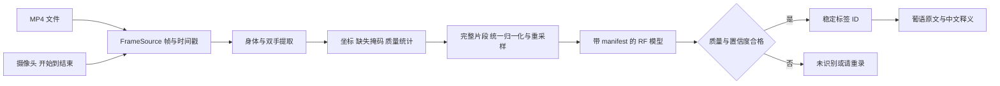

# Libras 识别 Demo：后续开发规划

日期：2026-10-09（Asia/Shanghai）。状态：规划稿，尚未实施功能改造。

> 最新优先级：先定不依赖场景的 [核心框架设计](核心框架设计_2026-10-09.md)，本文件作为数据来源与 RGB 输入闭环的验证材料。近期开发先贯通核心训练与独立推理，不先建设场景 UI。

> 范围更新：本文件保留为 Libras 早期工程验证子计划。长期目标现已明确为中巴用户双向实时交流，首个产品场景为双方各用设备的远程视频通话。总体依赖、客户端选择与模型扩展以 [中巴手语实时交流总体规划](中巴手语实时交流_总体架构与路线图_2026-10-09.md) 为准；本文件的 12 条目、RF 和 Tkinter 不构成长期架构限制。

此前确认的阶段目标：**视频／摄像头输入 Libras 动作，显示中文与葡语含义。** 该目标现纳入总体规划的 Libras 验证阶段。

> 实现更新：本文件是早期候选规划，64帧、raw75等方案不代表当前发布模型。实际特征契约以[巴西手语训练与验证](巴西手语训练与验证_2026-10-09.md)的30帧 `mediapipe225_rgb_v1` 为准；当前输入与字幕开发以[专项执行方案](视频摄像头输入与字幕_执行方案_2026-10-09.md)和[使用说明](视频摄像头与字幕_使用说明_2026-10-09.md)为准。

本文依据本地代码、两份 Markdown、RGB 数据实物及作者公开说明制定。两份原文档是参考材料；本轮只完成调查和规划，不把其中的命令或任务清单视为执行授权。

## 1. 产品范围与路线选择

推荐先做 **12 个经审核条目的完整动作识别 Demo**：导入 MP4 或点击开始／结束录制，识别整段动作，再查词典显示葡语和中文。先让离线文件和摄像头录制走同一流程，随后扩词、增加自动分段。

这里的 Libras 指巴西手语；葡萄牙语是文本标注／显示语言。显示中文含义并不表示系统已经识别中国手语，也不表示能够生成中国手语动作。

| 路线 | 优点 | 当前代价／局限 | 决策 |
|---|---|---|---|
| 小词表、完整片段、身体＋双手、RF | 能复用项目，容易查明数据与模型问题，能接摄像头 | 支持固定词表，需要动作边界 | 首版采用 |
| 将全部 178 个目录直接作为分类标签 | 表面上覆盖更多表达 | 单词与句子混合、重复视频标签冲突未处理、每条目仅约 30 条 | 暂不采用；审核后可另做有限句式分类 |
| 直接做连续手语到自由文本翻译 | 长期功能上限更高 | 需要明确序列标注、分段／对齐及额外评价，不是替换分类器即可完成 | 独立后续研究项目 |

首版交付定义：用户选 MP4 或录制一段完整动作，看到处理状态，得到已支持条目的 `pt-BR` 原文和经审核的中文释义；不确定时显示“未识别／请重试”。支持列表来自当前模型，不能把 README 中未实现的词汇当成能力。

## 2. 本轮核验到的数据事实

### 2.1 本地盘点

完整盘点和 SHA-256 见 [审计摘要](reports/libras-audit-2026-10-09/summary.json)、[条目清单](reports/libras-audit-2026-10-09/item_inventory.csv)、[视频哈希清单](reports/libras-audit-2026-10-09/video_hashes.csv)。

| 项目 | 本地实测 | 开发影响 |
|---|---:|---|
| RGB 视频 | 5,347 个 MP4，8,983,189,952 字节，约 8.98 GB | 首版引用原路径，不复制一份原视频 |
| 一级目录 | 334 个，其中 178 个有视频，156 个为空 | 空目录记录为审计结果，不进入词表 |
| 条目编号 | 178 个不同编号，范围 1–233，非连续 | 保留原编号，不能假定有 233 类 |
| 每条目视频数 | 171 个为 30；5 个为 29；2 个为 36 | 不用固定 30 的假设补造记录或删除“多余”文件 |
| 条目内分组 | 每条目均有 INFORMANTE 1–5；通常每组 6 条 | 分组身份须带条目命名空间 |
| 字节完全相同的视频 | 76 对，5,271 种不同 SHA-256 | 统计训练数量时区分文件数和独立内容数 |
| 跨条目的相同视频 | 72 对 | 标签冲突核验和切分隔离优先于训练 |
| 媒体元数据抽查 | 198 条：每条目排序首条＋5 个代表条目的各本地分组首条 | 是有确定规则的抽样，不是全部视频的媒体质量结论 |
| 抽查格式 | 198/198 为 H.264、1920×1080、平均帧率 30 fps | 先做等比例缩放性能试验，避免盲目压为 256×256 |
| 抽查时长 | 1.367–8.567 秒，中位数约 3.333 秒 | 不能只取开头 30 帧；必须覆盖完整动作 |
| 旧单手数据 | 80 个，均为 float64、(30,63)，A–D 各 20 个 | 独立 legacy schema |
| 旧身体／双手数据 | 80 个，均为 float64、(30,225)，含 8,379 个 -999 元素 | 缺失值须解释；继续保留旧播放器资产 |

160 个旧 NPY 均用 `allow_pickle=False` 读取，无 NaN/Inf；有限的 -999 仍是缺失值。没有读取旧模型 pickle，没有运行训练、GUI、摄像头或 MediaPipe。当前默认 Python 可用 NumPy/Pillow/scikit-learn，但找不到 cv2/mediapipe；这不证明其他环境也缺少它们。

抽取了 5 条视频各 3 个时刻进行视觉检查，见 [帧样本图](reports/libras-audit-2026-10-09/sample_contact_sheet.jpg)。样本包含身体相对位置、双手动作和面部变化，背景较受控。它支持优先保留身体＋双手信息的工程选择，但不能据此声称 12 类可被某组特征可靠区分，或真实摄像头泛化已经成立。

### 2.2 已确认的重复与标签风险

| 涉及条目 | 哈希检查结果 | 导入规则 |
|---|---|---|
| 198「Quero receber no meu e-mail」／199「Quero receber no meu Whatsapp」 | 30 对完全相同视频，覆盖两目录全部样本 | 两条目先隔离；核对原始标注和来源，不能猜测哪边正确 |
| 22／31「Desejo do mês de_」 | 30 对完全相同视频 | 保留两条来源记录；审核后映射同一标签或继续隔离，训练不能计作两份独立证据 |
| 151「ANTERIOR」／165「Página anterior」 | 12 对完全相同视频 | 核验标签粒度和别名关系；当前排除出试点 |
| 117、219、54、97 内部 | 各 1 对完全相同视频 | 保留来源关系，模型训练只选一个规范样本 |

其他需人工核验的同名条目：99／114「Oscilar」、18／81「Quero alterar a forma de pagamento_para Pix」。同名不自动合并，不同名也不保证视觉标签不同。

异常数量定位：25 的本地组 1 为 5 条；119、155、189、216 的本地组 5 为 5 条；152 的本地组 4 为 12 条；193 的本地组 2 为 12 条。哈希结果不能解释这些额外录制的全部来源，不应擅自裁减至每组 6 条。

路径中的下划线也有内容含义，例如 `22_Desejo do mês de_` 是有数据的目录。只解析开头的 `数字_`，原文完整保存；不能通过统一去尾下划线把目录合并。同名 MP4 文件也大量存在，basename 不能作全局主键。

### 2.3 作者说明与本地证据的边界

作者论文描述 178 个条目由 55 个孤立手势和 123 个连续表达组成，理论录制数为 5,340；本地实际为 5,347。作者还明确说明，7 位表演者在条目间轮换，`INFORMANTE 1–5` 只是条目内编号，不能当作全局人物 ID。论文发布的数值表示为 106 点／318 维，不能直接视为本项目 225 维格式。[作者论文，IV-A、IV-B、IV-C、IV-F](https://www.researchgate.net/publication/410629493_LIBRAS-EQT-UECE_A_Dataset_for_Isolated_and_Continuous_Brazilian_Sign_Language_Recognition_and_Translation)

本地没有逐条目孤立／连续类型表，不能用葡语单词数代替手语语言学标注。首版候选词需审看；完整 55／123 对照表需从作者标注补齐。

[官方 README](https://zenodo.org/records/21398895/files/README.md?download=1) 区分 RGB、T 包的标注／预处理帧，以及 Landmarks。当前项目只发现 RGB 包，不能把 T 包的 train/dev/test 当作已经在本地可用。[v4 发布页](https://zenodo.org/records/21398895) 和 [LICENSE.txt](https://zenodo.org/records/21398895/files/LICENSE.txt?download=1) 可用于登记来源和 CC BY-NC 4.0 条件；本地未核对原压缩包校验和，暂不将本地数据版本标成“已确认 v4”。首版按非商业 Demo 规划，若商业化，另核对授权。

## 3. 两份原文档如何转成开发决策

四份本地 Python 的 SHA-256 与 Review 报告一致，报告对这些源文件的分析仍适用。本地《开发指导.md》的文件哈希与报告记录不同，因此本文实际重新读取，而没有假定两个 Markdown 快照完全相同。

| 原建议／问题 | 本次决定 |
|---|---|
| 轻量 metadata、统一输入、RF 基线 | 保留；文件索引足够，不引入数据库平台 |
| 直接用 semantic_id 训练 | 改为审核后的语言内分类标签；语义映射和中葡释义分开管理 |
| 30×63 先接完 Libras，未来才升身体／双手 | 调整：63 维只维持旧 Demo；Libras 首轮特征就保留身体与双手 |
| 225 维作为未来升级 | 改为区分已存在的 legacy225 和新提取结果；维数相同不代表契约相同 |
| 先增强再拆分（R1） | 先冻结原视频／重复组／本地表演组，再仅增强训练集 |
| 任意宽度截前 63 维、两训练入口覆盖同一模型（R2） | 严格 schema 校验，模型按 run_id 独立保存 |
| 新词显示受 A–D 字典限制（R3） | 新词表与 manifest 驱动显示；缺中文不能把合法预测过滤掉 |
| 采集续录与编号覆盖（R4） | 再次使用旧采集器前修复；新摄像头流程使用不冲突的 sample_id |
| 输入时间、镜像、缺失和旧状态（R5/R6） | 统一特征服务＋片段状态机；处理节奏和预测节奏分离 |
| 通过 person_id 做跨人评估（R7/R9） | 区分 local_informant_id 与可空 global_signer_id；不声称全局跨签者 |
| “接一个真实来源”（R8） | 数据已在本地，先做专用 RGB adapter 与审计隔离，再补来源版本 |
| 模型／评价／README 闭环（R10/R11） | 纳入首版验收；实际入口为 desktop_app.py，不能继续指向不存在的 main.py |

不沿用旧 holdout 数值衡量新模型进步。Review 对默认五折未复现同源增强跨折的限定仍成立；真正需要修复的是显式的来源隔离机制，而不是将所有旧评价一概判为已证实泄漏。

## 4. 首版数据与标签设计

### 4.1 先冻结 12 条目试点

| 原编号 | 葡语标签 | 中文释义草案 |
|---|---|---|
| 2 | Sim | 是／同意 |
| 7 | Quero | 我想要 |
| 92 | Energia | 电力／能源 |
| 93 | Solicitar | 申请／请求 |
| 94 | Serviço | 服务 |
| 100 | Cair | 掉落／倒下 |
| 105 | Árvore | 树 |
| 106 | Poste | 电线杆 |
| 107 | Raio | 闪电 |
| 110 | Menos | 更少 |
| 111 | Mais | 更多 |
| 113 | Religar | 恢复接通／复电 |

这组候选有 **360 个视频、360 个不同 SHA-256**，每条目 5 个本地组、每组 6 条。本轮核实了数量与无字节重复；没有完成所有动作语义审核。中文是待审核显示草案，尤其服务语境下的多义词须确认。首轮只从每条目每个本地组取一条、共 60 条，验证提取质量与成本；数据选取规则应固定，不按测试识别效果挑样本。通过后扩到完整 360 条。

### 4.2 最小文件索引

维持 CSV／JSON，初期按职责使用以下文件，字段以 versioned schema 校验：

| 文件 | 主要字段／职责 |
|---|---|
| datasets.json | dataset_id、release_status、来源 URL、许可引用、root_alias、snapshot_hash |
| items.csv | dataset_id、source_item_id、raw_directory、native_label、item_type、审核状态、可空 canonical_label_id |
| samples.csv | sample_id、相对视频路径、内容 SHA-256、source_item_id、local_informant_id、可空 global_signer_id/session_id、duplicate_group_id、quality_status、exclusion_reason |
| features.csv | sample_id、cache_path、feature_schema_id、extractor_version、config_hash、源帧数／时间信息、输出帧数、缺失统计、提取状态 |
| label_catalog.json | canonical_label_id、sign_language=Libras、可空 sign_id/semantic_id、pt-BR、zh-CN、translation_status、映射版本 |
| splits/{protocol}/{fold}.csv | sample_id、train/validation/test、group_key、split_version；与来源官方 split 分列 |

样本主键由 `dataset_id + 原始相对路径` 生成稳定 UUID／摘要；视频内容 hash 是另一列。不同路径但同内容的两个来源记录仍可追溯，训练时通过 duplicate_group 选择规范样本。分类标签 ID 不由显示文字自动生成或随翻译修改而改变。

例如 `source_item_id=92`、`local_informant_id=2` 的分组键是 `libras_eqt_uece:item:92:informant:2`；`global_signer_id=null`。审核后才能设具体 sign_id；句子目录使用 utterance/item 标识，不把它伪装成一个词级 sign_id。

索引写入采用临时文件和原子替换；特征文件先完成再登记，失败留 error 状态，可重试恢复。重复运行不重复生成样本；标签／路径外键错误、越界路径、NaN、未知 schema 和重复标签冲突均返回具体错误。

## 5. 统一处理链与特征契约



### 5.1 输入接口

`FrameSource` 输出 frame、timestamp、frame_index、source_id、有效帧率信息及 EOF/error 状态。文件优先使用实际媒体时间，摄像头使用单调时钟；发生读帧失败时停止并释放设备，不能靠空循环继续跑。

图像预览可镜像，模型输入采用固定的未镜像方向；必须有显式 mirror_policy，左右手按表演者的解剖学左右固定槽位。旧单手镜像路径作为独立 legacy 配置保留。[MediaPipe Hands 的 handedness 说明](https://github.com/google-ai-edge/mediapipe/blob/v0.10.14/docs/solutions/hands.md)

离线和在线都逐时序运行同一提取器，明确每段开始时重置跟踪状态。可先比较等比例 960×540 与 1280×720 的手部有效率和耗时，再锁定配置；不使用横纵独立拉伸。优先对同一导入片段经两条调用路径得到相同结果做回归，再评估不同真实摄像头条件。

### 5.2 三类 schema 独立存在

| schema | 结构与用途 |
|---|---|
| hand63_v1 | 现有 (30,63) 单手模型；保持既有归一化，仅用于 A–D legacy |
| pose_hands225_legacy | 现有 (T,225)、-999 缺失编码；主要服务旧动画，不当作新提取结果 |
| holistic75_raw_v1（拟新增） | NPZ：points (T,75,3)、observed_mask (T,75)、pose_visibility (T,33)、timestamps (T,)；顺序为 pose33、left21、right21 |

新原始缓存保存图像归一化坐标、各分支原始 z 及坐标定义。新数据用显式 mask 表示无检测；无效位置数值置零但不能据零值推断缺失。pose visibility 阈值、手部整支是否检测到、低置信度处理均写进配置。原始观测 mask 不因后续插值变成“真实检测”。

RF 首轮候选预处理命名为 `body_hands_xy64_v1`：

1. 提取 75 点的 x/y，用图像宽高转为同一像素尺度，消除宽高比对距离的影响。
2. 以有效肩中点为平移参考，以片段有效肩宽的中位数为尺度；保留手腕相对躯干的位置、双手关系和运动轨迹。肩信息不足或尺度近零时返回质量错误。
3. 按完整片段的真实时间均匀重采样到 64 个时刻；插值限于短缺口，长缺口保留 mask。全程缺失、空片段和超出声明长度上限的输入不能静默通过。
4. 每时刻 150 个 x/y 数值＋75 个有效标志，展平为 14,400 维。它虽每时刻也有 225 个值，却与旧 xyz225 完全不同，必须以 schema ID 判兼容。
5. 原始 z 仍保存在缓存，第一版 RF 暂不使用；pose 和 hand 的 z 不能直接解释为同一个标定世界坐标。[MediaPipe Holistic 坐标说明](https://github.com/google-ai-edge/mediapipe/blob/v0.10.14/docs/solutions/holistic.md)

64 是初始工程配置，不是已验证最优长度。完成抽取后只在训练／验证数据上比较 32 与 64；如快动作损失明显再评估更高时间分辨率，并为每种输入配置生成独立 manifest。不能用测试结果决定长度。短缺口上限、有效率阈值等在首轮质量报告后冻结，记录校准依据，避免预先承诺任意准确率。

面部特征先保留扩展接口。若某些候选类依靠非手部表情区分，应缩减首版支持词表或新增带面部的 schema，再重训。作者 318 维 landmark 资源只有在点序、坐标、缺失定义与 RGB 对应关系核验后才能通过专用 adapter 使用。

批量提取按 `content_hash + extractor_version + config_hash` 命中缓存，按视频恢复，不为翻译文字改动重新提取视频；每条保存失败原因和耗时。先完成 60 条试点后据实估算扩到 360／5,347 条的时间，当前不提供未经测量的训练 ETA。

## 6. 训练与评估逻辑

### 6.1 分组先于增强和任何切窗

首个开发折采用各条目的本地组 1/2/3 为 train、4 为 validation、5 为 test。若试点 360 条全部通过质量检查，对应 216／72／72；这只是按文件分组算出的数量，不是已经完成的训练结果。剔除无效样本后必须重新报告每类支持数，不能为凑数量把验证数据移入训练。

五折验证在配置冻结后进行：依次轮换测试本地编号，验证编号取下一个，其余三组训练；每条原视频只出现在一个测试折。协议名称使用 `item_local_informant_5fold_v1`，表述为“已知条目的本地表演组留出”，不能写成“全局 signer-independent”。每折独立训练／调参，折间不能借用已看过的测试结果选择配置。

分组约束同时包括本地条目组、重复内容组、源视频及其派生关系。未来扩大词表时，先把这些关系连成不可拆分的样本组，再分配 split；如果约束冲突导致某类没有可用训练样本，要报告不可行，不要静默放宽。标签冲突先隔离，分组算法不能替代标签裁决。

来源官方 split 若以后取得，作为独立字段和独立协议保留。若官方 split 存在重复内容跨集合，记录审计结果，并另命名无泄漏协议；不能覆盖原始标注后声称复现了官方结果。分组原理参考 [scikit-learn 官方说明](https://scikit-learn.org/stable/modules/cross_validation.html#cross-validation-iterators-for-grouped-data)。

真正未见人的能力须另采集具有可靠全局签者 ID 的数据，再按人隔离。这不是把本地目录中的数字改个名称就能得到的结果。

### 6.2 RF 先建立可解释基线

第一轮固定 `seed=42`，沿用 RF 的 300 棵树、max_depth=20 作为起点，首先不增强；再在同一 split 上比较仅训练折的适度噪声／时间扰动。随机数生成器独立设种子；插值、尺度估计和统计量如需从数据学习，只使用训练数据。禁止给 mask 或缺失编码加噪声，也不默认左右镜像增强在语言学上保持标签不变。

最低报告包括 accuracy、macro-F1、每类 precision/recall/support、混淆矩阵、各本地测试组结果、拒识覆盖率，以及与多数类基线的比较。若要说明身体／双手特征优于单手，必须在相同 Libras 数据和切分上重训两套模型，不能比较旧 A–D 指标与新 Libras 指标。

拒识阈值用 validation 的已知动作、单独的空闲／无手片段和经审核的词表外动作校准；这些负例划分也按来源隔离。不能直接把所有其他目录都当“未知”，其中可能存在同义动作、相同视频或粒度不同的标签。冻结后在 test 上同时报告准确率、拒识率和误接收率，防止“全部拒识”得到看似良好的结果。

RF 不满意时先查：标签、双手检测、动作完整性、时间采样、背景／签者依赖和混淆类。只在这些证据明确后比较轻量时序模型（例如 TCN 或 GRU/LSTM），沿用同一数据和评估协议。Transformer 与连续文本生成暂不进入首版排期。

### 6.3 模型必须携带完整契约

产物为 `data/models/libras/{run_id}/` 下的 model、manifest、labels、metrics、confusion_matrix 和 split 清单。manifest 至少记录输入 schema、T、实际 n_features、提取器／预处理版本、配置 hash、数据清单 hash、标签版本、种子、依赖版本和评价协议。

应用先校验 manifest 和所选词表，再加载可信本地产物；schema 不匹配应明确提示更换模型。新训练失败不覆盖旧模型；发布新模型是切换活动版本指针，保留回退路径。只修中文释义可升级显示词典；若合并／拆分分类标签或更改预处理，必须生成新的模型契约并重训。

## 7. 桌面端的完整使用流程

保留 Tkinter 作为首版界面，复用已有窗口；不同时迁移到 Streamlit。

| 操作 | 产品行为 | 内部约束 |
|---|---|---|
| 启动 | 显示当前 Libras 模型、支持词汇与可用输入方式 | 从 manifest／词典加载，不硬编码 A–D |
| 选择视频 | 预览视频，点击识别，显示进度和最终结果 | 处理整段，取消／EOF／损坏均可结束 |
| 摄像头 | 打开预览，点击开始录制，完成动作后点击结束识别 | 从本次片段起点建立缓冲，保持真实时间戳 |
| 输入质量不足 | 显示“手部未完整入镜／请重新录制”等具体提示 | 不拿上一段结果当本次输出 |
| 预测合格 | 同时显示葡语原文、中文释义与支持范围 | 缺中文时显示原文及“中文释义待补充”，不吞掉预测 |
| 低置信度／词表外 | 显示“未识别／请重试” | 阈值与质量控制使用当前模型配置 |
| 停止、切源、取消 | 清空本次动作状态，释放文件／摄像头 | 清空 buffer/history/current_gesture，隔离旧请求结果 |

建议状态机：`IDLE → PREVIEW → RECORDING → PROCESSING → RESULT/REJECTED`。切换输入或重新录制时回到新片段；ERROR 允许重试。每次请求带递增 request_id，后台旧任务完成后不得覆盖较新的识别结果。特征处理放在工作线程，Tkinter 控件更新留在主线程，避免长视频卡住窗口。

第一版不要求自动理解整段日常对话。自动分段是之后的独立功能：在完整片段识别已经可靠的基础上，再添加动作开始／结束检测、无手超时、冷却和重复输出抑制。分类频率调整不能改变特征采样的时间跨度。

原骨架播放功能保留旧 A–D 资源；新 Libras 条目可在取得对应且审核过的资产后扩展。中文／葡语文字到动作必须经过目标手语体系与具体资产 ID，不能根据共用 semantic_id 自动借用其他手语动作。没有资源时提示暂无，首版识别闭环不以补齐所有动画为前提。

## 8. 依赖顺序与可交付任务

```text
M0 旧链路保护与可信训练前提
  → M1 RGB adapter、标签审核、词表与 split 冻结
  → M2 统一提取器和完整片段预处理，60 条试点
  → M3 360 条基线、模型契约、离线视频到双语显示
  → M4 摄像头录制到识别、拒识及状态恢复
  → M5 扩词与真实场景验证
  → M6 自动分段／有证据支持的时序模型
```

| 阶段 | 具体开发任务 | 阶段退出条件 |
|---|---|---|
| M0 | 固定源码／模型／旧数据清单；严格 63／225 loader；隔离两个训练输出；修先增强后切分；修采集 total_target/additional_count 与排他保存；整理实际入口 | 225 输入不被单手训练器吞下；旧文件不覆盖；失败不覆盖旧模型；旧采集补录测试通过 |
| M1 | 新增 Libras RGB adapter、轻量 schema/validator、冲突与重复状态、词典；审核试点 12 条目，固定 split 配置 | 5,347 条来源记录可追溯；156 空目录无训练标签；198/199 隔离；试点 360 条内容去重和本地组检查通过；重复导入幂等 |
| M2 | FrameSource、Holistic 提取、NPZ 缓存、质量统计、完整片段预处理；60 条试提取和缩放测试 | 离线／摄像头回放夹具走同一契约；双手槽位、缺失、短缺口、零尺度有明确结果；缓存可恢复；报告质量和实际耗时 |
| M3 | 12 类 360 条 RF、验证拒识、manifest、单视频推理入口、动态中葡词典接入桌面 | 冻结切分无源／哈希交叉；测试无增强；逐类报告完整；新标签在重启后可显示；不兼容模型被拒绝 |
| M4 | 摄像头开始／结束录制、后台处理、request_id 与重置机制、空闲／未知动作验证、README 与锁定环境 | 摄像头→录制→识别→双语显示可复现；停启／取消／设备断开无旧状态；处理时界面可响应；负例误接收与延迟有实测 |
| M5 | 每次增加一批审核过的条目；补新环境／新签者数据；按需求增加正确的 Libras 播放资产 | 每次扩词重新冻结标签与训练；新增词与原词回归均有报告；实景性能单列，不把受控背景分数当实景效果 |
| M6 | 自动分段、连续摄像头输出；根据错误分析比较小型时序模型 | 分段错误和分类错误分开计数；质量、误触发和延迟改善可复现，才替换已发布模型 |

首批建议落到这些模块。下面均为计划新增／修改项，不是当前已经存在的实现：

| 路径 | 职责 |
|---|---|
| app/data_contracts.py | schema、索引校验、标签与模型契约 |
| app/datasets/libras_eqt_rgb.py | 原目录解析、来源记录、局部组与重复关系 |
| app/video_source.py | 文件／摄像头帧、时间戳、错误与关闭 |
| app/landmarks.py | 身体／双手提取；不依赖 GUI |
| app/preprocessing.py | mask、归一化、完整片段重采样；训练推理共用 |
| app/inference.py | 模型兼容性、预测、质量／概率拒识 |
| app/train_model.py | 索引与 split 驱动训练，产出 run 目录 |
| app/train_hand_model.py | 明确 legacy 双手用途或提供带报错的迁移入口，禁止默认覆盖单手模型 |
| app/desktop_app.py | 界面与状态机；调用服务，不重复实现特征算法 |
| app/collect_data.py | 安全补录；后续复用输入／特征服务 |
| tools/audit_dataset.py、build_manifest.py、extract_features.py | 可重复审计、干跑索引、按视频恢复提取 |
| tests/ | 数据契约、切分隔离、特征一致性、状态重置与用户链路回归 |

现有 RGB、data/sequences、data/sequences_full 原位保留。新增 metadata、features、models 三类目录，各按版本分层；路径配置用 root_alias，避免把本机盘符写进可迁移的数据清单。

## 9. 必须覆盖的验收场景

1. **数据身份与标签：** 带重音／空格／内部下划线的目录正确解析；basename 重名不碰撞；空目录不生标签；同内容异标签被隔离；未知全局签者保持为空。
2. **切分与增强：** source_video_id、content_hash、group_key 不跨 train/val/test；衍生窗口继承分组；增强只发生在训练折；记录筛除后每类数量。
3. **特征兼容：** legacy63、legacy225、新 raw75、新模型输入互不混用；不同 schema 即使维数相同也拒绝；空／损坏／全缺失片段有错误结果。
4. **时间与几何：** 测试不同 fps、非连续时间戳、短长片段、肩尺度退化、左右手交叉、缺手和镜像；预览镜像不改变模型输入定义；同一片段两条调用路径输出一致。
5. **数据写入：** 已有 0/5/10/20 条、中间编号删除、标签带下划线、处理中断和重试；补足与额外新增语义明确；不覆盖原视频／旧特征。
6. **用户闭环：** 视频导入和摄像头录制都能完成识别；新标签无需改源码即可显示；中文缺失有回退；模型／词典重启后仍匹配；取消后旧结果不回填；关闭设备释放资源。
7. **实际效果：** 固定测试集逐类报告；录制新背景、光照、距离和新签者测试片段，报告误接收、拒识、端到端延迟 p50/p95。首轮测量后再冻结 Demo 的数值门槛，不能直接沿用“95%”等无依据目标。

## 10. 尚待实施时解决的证据缺口

| 缺口 | 可以继续的工作 | 如何解决 |
|---|---|---|
| 本地精确发布版本尚未核对 | 原文件只读审计、独立本地 snapshot 标识、adapter 开发 | 补来源记录或原压缩包 hash，与指定发布版本对应 |
| 55／123 的完整类型对照缺失 | 12 条目候选审看、保留 item_type=unverified | 获取作者标签表或完成明确的人工审核 |
| 全局签者身份映射缺失 | 条目内本地组评估与 Demo | 获取权威映射或另采具有可信 ID 的评估数据；不靠外貌猜人物身份 |
| 198／199 等内容与标签冲突 | 排除这些条目后开发试点 | 核对作者标注／源录制，再决定正确标签；不为扩词绕过 |
| 摄像头质量与 MediaPipe 吞吐未测 | 先做独立运行环境和 60 条试点 | 实测特征有效率、处理速度和丢帧；据此设缩放与质量阈值 |
| 词表翻译尚未审核 | 使用 pt-BR 原文和待审核中文草稿设计 UI | 确认语境释义；正式支持词表要求映射状态清楚 |

本轮交付是本规划及数据审计附件；没有修改四份业务 Python、原开发指导、原始 RGB 或旧模型。下一轮最小开发范围是 **M0＋M1**，随后以 60 条提取试点决定 M2 的最终特征配置。
