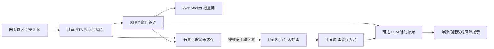

# 实时中国手语：增量词与句末中文

实时入口为 `http://127.0.0.1:8879/communicate/realtime.html`，原对话页顶部也有入口。选择视频、摄像头或共享画面，框选包含脸部、双手和上半身的手语者，再开始识别。页面分别显示动作中的词、句末中文和可核对的历史；“完成本句并暂停”交付尾句，“中止识别”或换源作废未完成的结果。历史中的人工修改保留识别原文。

停顿检测比较保守，保持一个手势不会单凭“画面不动”补译。需要主动分句并继续采集时点击“结束这句（继续）”。每句最多缓存8秒，超限提示分句，避免把截断的动作前半句当完整中文。视频自身的暂停与后台切换会取消采集；需要保留尾句时使用“完成本句并暂停”。

## 调度与接口

- 模型端 `GET /v3/realtime` 声明能力，`WS /v3/realtime` 使用独立 `csl-realtime-v1` 协议。产品端对应 `/v1/communication/realtime`。原v3上传接口仍处理完整片段；Uni-Sign本身仍是句段翻译，`native_streaming_translation=false`。
- SLRT负责动作过程中的词，Uni-Sign复用同一前端的原始133点补整句中文，两个输出可能不一致。分别按模型协议适配姿态，不把SLRT热图送给Uni-Sign。
- 单GPU采用词优先调度：先处理当前帧及积压，再执行已完成句子的翻译。最多2个句末任务按原句顺序等待，等待超过1.5秒明确拒答，保留实时词；不以无限排队或覆盖前一句掩盖负载。自然EOF排完已接收帧后处理有效句末任务，暂停/取消则丢弃未执行任务。
- 单个CSL实时会话持有模型租约，阻止竞争上传/切换。输入队列16帧，检测到积压会明确结束，既不偷偷删帧也不伪造连续索引。句段、消息、图像与历史均有上限。客户端自然文件EOF或“完成本句并暂停”会先等正在编码的帧发送完，再提交结束并等待尾句；“中止识别”立即丢弃未完成句。需要连续采集时可使用“结束这句（继续）”。
- 帧上限512×512，按选区比例留边；JPEG不超过180KiB，单消息不超过256KiB。源epoch、实际采样帧号、会话ID、句号与修订号一起拒绝迟到结果；浏览器后台/跳播/换源都会取消。
- 凭据保留在服务端，请求Origin须匹配页面；配置了 `SLBRIDGE_API_TOKEN` 时产品桥在服务端转发。会话最长30分钟。

## 启动配置

模型/API代码位于 `E:/githubproject/SignLanguage-Bridge`；当前产品页面与启动器位于 `C:/Users/ADMIN/.codex/worktrees/csl-animation-workspace/SignLanguage-Bridge`。这两个检出承担不同功能，不能把旧产品模型代码覆盖到模型检出。换机部署需同时准备模型API与对应产品资源。

1. 模型环境需要既有SLRT/Uni-Sign CUDA权重和RTMPose依赖，以及 `requirements-api.txt` 的WebSocket依赖。可选文字辅助另用 `requirements-realtime-llm.txt`。现有两个本机Python环境已安装新增WebSocket依赖。
2. 复制 [实时配置示例](../configs/realtime-csl.example.json) 与 [SLRT配置示例](../configs/slrt-realtime.example.json)，修改服务端本地资产路径。FP16仅适用于CUDA；默认SLRT配置依然保持原来的FP32和检测间隔1，实时选择是显式配置。
3. 在产品profile的 `recognition.realtime_config` 中填写实时JSON的绝对路径，并显式选择 `csl_model=unisign_pose_stage1`、独立 `libras_model=libras-rf` 和足够的预热等待。本机profile是 `E:/githubproject/SignLanguage-Bridge/artifacts/product-bridge-20261108/local-profile.json`。
4. 从产品检出执行其 `scripts/communication_product.ps1 -Profile <本地profile> -Action Start`。启动器核对完整进程参数、模型身份、实时能力及两层配置SHA；同一路径中的配置被改动也不能误认运行服务已更新。改配置后用同一启动器先 `-Action Stop` 再 `-Action Start`。若要更改profile内配置文件路径，先按旧profile停止，再改路径。

不配置 `realtime_config` 时不预热SLRT，原上传页继续可用。实时初始化失败会单独显示未就绪，不伪装成功。

## 可选文字辅助

示例配置默认 `llm.enabled=false`。服务端启用并有凭据时，页面才显示“辅助核对”复选框，默认不勾选；每次识别是否发送文字由本次勾选决定。LLM只收到实际识别词与已交付中文，不发送视频、姿态、练习目标句或评测参考。

后端使用本机OpenAI兼容端点 `http://127.0.0.1:8788/v1` 和显式模型 `deepseek-v4.1-flash`。凭据读取服务进程的 `WB_PROXY_API_KEY`，或服务端凭据文件 `refs.WB_PROXY_API_KEY`；密钥不写入网页、profile或实验产物。可通过 `llm.api_key_env/credentials_file/credentials_ref` 修改引用。

辅助独立排队：一个请求在运行、最多一个在等待，整个请求默认8秒截止，响应最多64KiB；超时/异常/繁忙不会阻塞词和原译文。原生会话结束后页面仍可按已绑定job ID查询辅助结果。换源会取消旧轮询，同一句旧修订失效，不丢掉前一句的结果。新内容及否定、人称、时间、数量变化有保守拦截，结果只作建议或风险提示，不自动覆盖事实或人工修改。该检查不能证明完整语义保持。

## 逐句核对

本机已启用“训练示范与问题回放”：选择示范、载入后可先观看，点击“识别此示范”从头走相同实时管线。示范标注只作对照，不送给识别模型。3条已成功训练短句与1条误追加案例分别标记；训练、问题、本地文件和摄像头来源随历史保留。可复现训练输入不等于跟练或现场质量通过，详见[示范与网页延迟复核](reports/realtime-demo-catalog-2026-11-11.md)。

部署可在profile的`product.demo_catalog`指定服务端固定目录清单，不配置则不显示示范入口。更改目录路径前先用旧profile执行StopProduct；按新配置Start会保留身份匹配的识别服务。启动器拒绝可选开关/路径/内容与运行实例不一致的复用，不能仅修改profile就当服务已更新。目录构建与官方train归属审计脚本位于`scripts/prepare_realtime_demos.py`和`scripts/audit_demo_training_sources.py`；媒体资源不随源码自动具备。

每条中文保留自己的实时词证据。只有一个词却生成较长中文时，会出现重点核对提示；这条提示不需要LLM，不更改或隐藏原文，其他未提示句子仍需核对。历史中的“确认”只记本人确认；“核对”可查看词证据、修改并保存确认。单词级结果可明确选择“使用实时词”填入编辑框，再决定是否保存，原译文和原提示仍能展开回读。

人工确认/编辑同时更新主显示与历史，后到机器修订不能覆盖；辅助建议仍标注其原始修订，原译文发生机器版本变化时旧建议失效。人工编辑后建议标为“原译文辅助核对”。当前记录存在会话内存中，刷新会清空；人工确认状态不是语义正确概率，也不混入模型评测结果。验证及已知限制见[本轮报告](reports/realtime-utterance-review-2026-11-11.md)。

## 验证边界

2026-11-12 数字人动作回认与迭代状态已归档到[当前缺陷及改进计划](superpowers/plans/2026-11-12-avatar-motion-quality.md)。产品数字人画面使用动作数据实时渲染；最近测试先录制画布，再按视频节奏送入本实时接口，未覆盖直接实时采集或物理摄像头。25 单词数字人句末匹配 8/25、30 完整句匹配 4/30，均为已见训练来源的有限诊断；最新姿态修正候选仍有语义回退，未替换产品动作。详细协议与未通过项见计划所列原报告。

暂停采集并确认一句后，可点击该句“加入对话并回复”，首次打开面对面表达页，后续复用同一窗口。实时页记录保留；对话页已有回复草稿不被覆盖，写好后仍须点击“转成手语”。机器原文、词证据与训练/问题来源随消息和TXT保留。若窗口响应超时，可回实时页重试，不必关闭原对话窗口；浏览器需允许本机弹窗。接线已有定向测试与HTTP核验，真实跨窗口体验待控制连接恢复后验收，见[接续报告](reports/realtime-conversation-2026-11-11.md)。

首词1–2秒是体验目标，须用实际交付计时验证；首个可见词、工程final词、句末中文、录制/回放EOF后的额外等待分别计量。数据集视频、重编码浏览器样例和物理摄像头是不同输入协议。

网页首词现在从点击开始计算，包含连接、工作线程预热和采集启动。展开“实时状态”可看连接/预热、帧往返、服务排队、本帧处理、图像编码和采样跳帧；ACK不会反复重建字幕历史。GET能力的performance.active/last保留有界数字诊断，过载/取消后也可读取，重新启动服务会清空。长时间运行后变慢时先保存该摘要与运行时长，再决定重建服务，不能仅依据ready判断吞吐正常。2026-11-11的去重、成对测试和持续回放见[延迟优化报告](reports/realtime-latency-optimization-2026-11-11.md)。

2026-11-11进一步省去Uni-Sign句末未使用的训练计算，保持原生成输出；独占模型均值325→300ms，8实际WS输入事件一致，首词P95并未改善。本轮新网页复验遇到浏览器控制超时和零采样帧，未认证通过，不能把旧记录当本次结果；具体状态及证据见[句末优化报告](reports/unisign-generation-optimization-2026-11-11.md)。

同日后续修复：新尝试/换源的主字幕不再回退到上一轮，历史确认与原文仍保留；零帧结束会提示检查预览并重试，采集交付2秒无进展会停止，编码挂起可中止。折叠状态显示采集/发送/处理计数。真实网页操作尚因控制连接超时未认证，不把43项Node或真实协议重放当网页通过；见[恢复报告](reports/realtime-capture-recovery-2026-11-11.md)。

工程记录和本次实测见 [实施报告](reports/realtime-csl-engineering-2026-11-10.md)。非空译文、合法JSON、BLEU、WER与人工确认的准确率分别报告。物理摄像头、新签者、用户原先“我想睡觉”录制和真人手语语义验收尚未完成。
