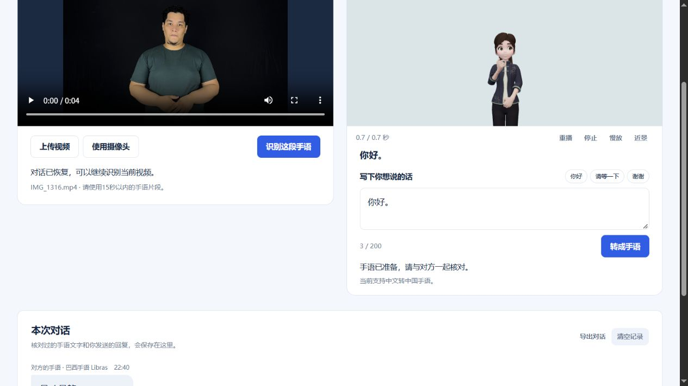

# 面对面沟通产品整合与上传视频验证

日期：2026-11-08，Asia/Taipei。按用户要求，将识别和text-to-gesture接成使用者可以完成对话的产品流程。原动画整合、词库扩容、v14A人物与接触修订继续保留；本轮没有重新训练模型，也没有远端合并或发布。

## 本轮结果

主入口为 <http://127.0.0.1:8879/communicate/>，根地址307跳转到该页面。主页面包含手语输入与核对、文字回复与人物、对话记录；模型和素材调试放入设置中的开发工具。1280×720桌面与390×844窄屏均实际检查，窄屏只显示当前任务面板，保留同一对话，无横向溢出。最终浏览器console error/warn为0。

实际完成“上传真实视频→识别→核对文字→加入对话→输入中文回复→数字人播放”，并验证取消、重播不重复记录、缺词/已知遗漏不播放、导出TXT、清空撤销。**这是工程链路验收，不是识别正确率、语言或动作质量验收。** 用户本轮明确选择只验证上传视频，没有访问物理摄像头或麦克风。

## 实际输入与观察

| 输入或操作 | 实际观察 | 验收边界 |
|---|---|---|
| `G:/Archive/Zenodo/CE-CSL/CE-CSL/video/test/A/test-00001.mp4` | 自动输出“平方 我 自己 。”，task为`gloss_sequence`；模型世代与预处理绑定一致 | 结果明显不完整，不能算句子自动翻译正确 |
| 上述视频的核对步骤 | 测试者按配对标注手动改成“40平米的房子比较适合一个人住。”，确认后入对话；保留原词序列 | 手动校正，不把标注作为模型输出；没有批准底层语义质量 |
| `E:/githubproject/SignLanguage-Bridge/Libras-EQT-UECE (RGB)/2_Sim/INFORMANTE 5/IMG_1316.mp4` | 真实RGB视频返回“是 / 是的”、葡语“Sim”，页面显示草案提示；确认后入对话 | 现有12词分类试点，非开放词汇或完整句子互译 |
| 中文回复“请等一下。”与“你好。” | 快速词组合实际播放至结束；显示字幕；历史回复再次展示没有多加一条记录 | 约0.5/0.7秒的显示轨仅为工程可播证据，动作是否充分、易懂和自然未验收 |
| “我想去成都。” | 显示缺完整手语动作的提示，播放禁用，可调整或显式尝试慢生成 | 没有部分播放，没有新增发送记录 |
| “明天早上我们一起去医院看朋友。” | 检出已知遗漏，提示调整或分句，播放禁用 | 仅有界遗漏保护，不代表所有语义错误均能被检出 |
| 上传识别后立即取消 | 页面保持“已取消本次识别”，结果区隐藏，迟到结果不入对话 | 同时有网关断开取消/临时文件清理和控制器世代保护测试 |
| 导出、清空与撤销 | 下载可读TXT，保留双方文字和手动修改前原文；清空后恢复原两条消息 | 会话内记录，刷新不持久保存；不把人工确认当模型已认证 |
| 数据集视频编码为WebM后上传 | 本地FFmpeg转换为无音轨MP4，HTTP200，媒体信息明确`transcoded=true`；返回“三 平方 我 自己 。” | 这是上传格式适配，**不是物理摄像头测试**；编码改变可能影响模型输出 |

WebM最终复查约8.15秒，仅记录该次HTTP用时，不是实时延迟或性能基准。没有重新进行冻结测试集评测，不新增模型准确率指标，也没有重测完整GPU慢生成。

## 实现与本机运行

源码工作树为`C:/Users/ADMIN/.codex/worktrees/csl-animation-workspace/SignLanguage-Bridge`，分支`codex/local-godette-v14a-demo-20261107`，基线HEAD `e8477dcd5c53495c0f555ae55fa8a1d97213f9a2`。本轮与此前动画工作均为本地未提交改动。E盘主检出保留识别分支，只补充本机跳转页和坑点记录，没有覆盖其既有识别代码。

| 部分 | 当前配置与职责 |
|---|---|
| 识别服务 | 127.0.0.1:8765；E盘`.venv-gpu`，CPU、4 intra-op线程；csl→`cecsl-tfnet-onnx-20261009`，libras→`libras-rf-pilot-20261009` |
| 产品与动作服务 | 127.0.0.1:8879；E盘`.venv-libras`运行C盘动画源码，识别通过服务器配置的loopback网关接入 |
| 人物 | v14A SHA256 `535fc9ab96ec3d837e2568817abc41d593fac1c4fcad8565b45b29c5f4472f5e` |
| 快速词库 | `csl-product-95379e49911c11908e420a94`，1,990词标签／14,317片段候选；没有新增词义或质量批准 |
| 原句语料 | 原有19,877完整动作／7,369不同文本继续保留为开发资源，不能计入任意新句覆盖率 |

网关不导入识别模型：逐次协商v3输入表示、预处理、task和模型世代，结果绑定不一致返回409；运行容量不足返回429。原视频body有128MiB上限，临时目录按请求清理，WebM转换有时长和进程超时限制，超长明确拒绝。断开时先取消并等待网关任务，再移除上传文件；原有v3推理的本地算子不保证可在运行中立即中断，前端仍隔离迟到结果。

前端复用已有MotionStage及快/慢控制器，只有显式核对的识别文字进入对话；回复就绪才加入发送记录。重播和历史展示不重复记录。设备获取迟到、录制停止迟到、换源、取消、清空、页面离开均有资源与任务所有权处理。摄像头生命周期仅单测，本轮未做设备实测。

本机运行`E:/githubproject/SignLanguage-Bridge/artifacts/product-bridge-20261108/start-product.ps1`，用同目录`stop-product.ps1`停止配置匹配的两端。通用启动脚本为`scripts/communication_product.ps1`；已实际验证产品独立重启、健康服务复用和错误配置拒绝控制，错误配置没有停止原监听进程。旧动画启动入口已转到新启动器；旧8874/8878仍未启动。外部模型、GLB、词库、视频、运行配置与产物不随Git分发。

## 验证记录

证据目录：`E:/githubproject/SignLanguage-Bridge/artifacts/product-bridge-20261108/`。

| 检查 | 结果 | 证据 |
|---|---|---|
| 定向Python：网关、绑定、容量、取消清理，场景/词库/组合/生成任务/API回归 | **206通过、27跳过、0失败** | `python-regression-final.log` |
| 产品网关最终定向 | **16通过**，属于上述集合，不重复相加 | `gateway-final.log` |
| Node前端全组与已配置的v14A/词接触资源回归 | **119通过、9跳过、0失败** | `node-regression-final.log` |
| 真实HTTP、身份、空输入和非视频输入拒绝、WebM适配 | **通过** | `http-audit-final.json`、`actual-csl-recognition.json`、`actual-libras-recognition.json` |
| 真实浏览器上传／核对／对话／回复、阻断、取消、导出、窄屏 | **通过**，console error/warn 0 | `browser-audit-final.json`、`product-final.jpg`、`product-mobile-upload.jpg`、`product-mobile-reply.jpg`、`exported-dialogue.txt` |
| 启动复用／独立重启／其他配置保护 | **通过** | `runtime-state.json`、`launcher-negative-control.json` |
| wheel构建与新页面、默认scene定义、网关资源入包 | **通过**，核对9个文件 | `wheel-build-final.log`、`wheel-content-audit.json` |
| `git diff --check` | **未全通过**：`pyproject.toml:67`和`rig.js:454`仍有EOF空行提示，未为此改写动画实现 | 该检查不作为通过项；不影响本次运行与测试结论 |

Python跳过23项Torch相关测试、1项lmdb、2项Windows符号链接，以及1项未配置冻结GLB路径的Python集成检查；Node已实际加载本次v14A，跳过旧v11/v12/v13及下颌GLB4项、未提供医院整段fixture的手形测试5项。不能把跳过项或历史通过项计入本轮已测。Node首次直接运行因浏览器绝对模块路径失败，新增显式测试loader映射到实际部署的Three后复测通过；无生产import路径替换。初次无隔离wheel构建因环境无setuptools失败，改用临时隔离构建后通过，未修改运行环境。

相关命令与选择的文件见本目录日志，产品新增Node用例为`tests/communication_product.test.mjs`，Python为`tests/test_communication.py`。源码与最终运行身份摘要见`verification.json`。构建仅核对资源入包，未在全新机器安装外部资产并重跑。

**仍未验收／未运行：** 物理摄像头及真实浏览器录制、真人手语语义理解、识别质量全面评测、手形／自然度／非手控语法、跨语言完整对话、Libras动作生成、完整慢模型GPU复测、全仓库与CI。既有“我想喝水。”组合句接触残余与新增避让跳动没有因产品化而解决，继续按[动画整合记录](animation-consolidated-status-2026-11-08.md)作为质量未通过项。历史ONNX/SciPy全仓库失败仍保留，不用本轮定向绿灯覆盖。
