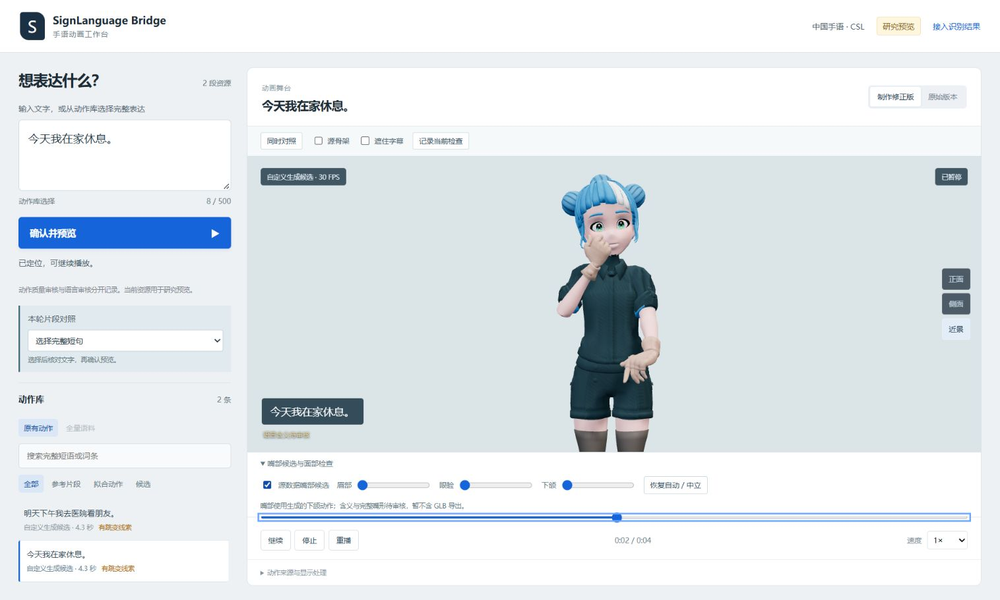

# 新中文句到三维动作：实际生成与同步说明（2026-11-07）

此前工作台只能匹配已有完整短句。本轮已用公开的 SignSparK 预训练权重，从两条库外中文输入实际生成身体、双手和面部参数，并在现有人物上播放。当前入口为 **CLI 生成候选 → 工作台预览**；浏览器尚未接入任意新句的在线生成任务，手语含义及自然度仍待独立审核。

## 本次可使用的改进

- SOKE 全库建立可续跑的 SQLite/NPZ 索引，19,877 段、2,359,884 帧完成转换与数值核验；775 段不完整、2 段缺失另列。支持分页检索与单条按需播放。2,000 个 Gloss 标签不能当作已切分、已审核的2,000条三维词条。
- 手势保留原始与修订轨道，提供短孤立跳变修订、有限平滑与腕部重定向；残余大变化仍提示复核，不将数值平滑当作语言正确性。
- 校准人物的下颌与下唇联动，支持源下颌候选、同帧关闭、手动覆盖和恢复自动。来源/人物摘要不符时不套用校准。SOKE表情10维与SignSparK表情50维保留；完整唇形及非手控语法尚未映射。
- SignSparK 使用独立运行环境、固定源码/分词器/权重身份、严格完整加载；参数meta构造保留真实CPU缓冲区，逐流使用GPU并记录内存阶段。没有新增训练。
- 新增仓库内小型认证清单，支持可替换的源码/文本资产路径；旧清单兼容，篡改仍拒绝。损坏参数帧会隔离到失败序列，极大分页offset返回参数错误。

## 实际生成证据

输入“明天下午我去医院看朋友。”与“今天我在家休息。”均不在当前全索引的精确/去标点文本中。每句显式128帧、30 FPS，50采样步、seed123，共256帧；长度是请求参数，不是已学会的时长预测。没有读取目标句动作或目标长度：`target_motion=null`、`observed_keyframes=0`。

| 项目 | 实测结果 |
|---|---|
| 三流权重 | 总16,742,608,923 B；各流文件大小与官方LFS SHA256一致 |
| 完整严格加载 | body / hand / face 各859张量，缺失/额外键均0 |
| 身体流遮罩负控 | 随机有限观察值被全False遮罩后，输出最大差异0 |
| 同seed、不同文字 | 身体原始输出最大差异约0.402296，且两句均非静态 |
| 初始化修订前后 | run01已完成的六条body/left/right与run02逐位相同；run01没有完成face，未作face比较 |
| 三流阶段耗时 | body55.094秒、hand37.532秒、face31.844秒，合计124.470秒 |
| 内存 | GPU分配峰5,795,846,656 B（约5.40 GiB）；进程工作集峰7,480,819,712 B（约6.97 GiB） |
| 转换及来源核验 | 8份原始流、两句55关节/表情50维、JSON/NPZ/归档/人物绑定一致，最终展示包审计PASS |
| 浏览器 | 两句实际人物播放、同一时刻原始/修订对照、生成下颌开关、review导出；控制台警告/错误0 |

耗时包括每流认证、加载、两句采样及一次身体负控，不含下载及进程早期导入；不是每句暖启动延迟或摄像头端到端延迟。系统提交额度在运行中变化，单次成功不能严格证明首轮OOM的唯一根因。

首轮run01在face搬运到GPU时OOM，保留failed状态及六份已完成原始流。run02采用参数meta/CPU缓冲区构造后完整完成。初次独立审计误把修订轨要求为float32；核对现有修订算法返回float64后修正审计器，原拒绝报告保留。其后发现两句分别有2/1个超过30°的关节变化而提示缺失；仅派生修正提示元数据，原运行与全部NPZ字节保留。

最终预览归档SHA256：`df2b2773d7f50dd811aead5295d67328c8e032d5e4fbce44f8d33d317eeacbff`。两句修订后最大变化分别37.5993°与40.9006°，均有“跳变线索”提示；超过60°事件均0。这些是运动诊断，不是手语误译率。

可随Git读取的关键数值、原始流摘要、来源身份与浏览器review见[证据汇总](evidence/2026-11-07-animation/custom-generation-summary.json)。完整运行日志、原始/失败报告、模型、数据、NPZ和GLB展示包属于本地运行产物，不随代码仓库分发。



人物为 Godette (Rigged)，zahlenmaler，CC BY 4.0；[原始人物来源](https://sketchfab.com/3d-models/godette-rigged-dd05b69799a2438e97c90d166f6e416a)。截图展示工程候选，不代表语言认证。

## 使用与验证

资产目录、固定来源、独立环境和启动命令见[工作台使用说明](../csl-animation-workspace.md)，主要依赖版本见[requirements-signspark.txt](../../requirements-signspark.txt)。[源码清单](../../configs/signspark/source-manifest.json)及[文本资产清单](../../configs/signspark/text-assets-manifest.json)不含权重或第三方源码正文。基包、模板及校准人物仍需另行准备并满足记录的身份。

生成后可对同帧数/seed的两句试点执行只读审计；输出文件应放在运行目录之外，且不能覆盖已有报告：

```powershell
python scripts/animation/audit_signspark_pilot.py --run-dir <生成输出目录> --output <新的审计JSON路径>
```

`--compare-run <首轮失败目录>`仅用于比较该次试点已完成的六份流，不会把失败运行升级为完成。审计不重跑GPU、不重新哈希大权重，也不认证语言含义。新元数据复用/重打包须明确记录来源，不算新推理。

代码回归、运行试点、浏览器和语言审核分别记录。当前生成仍有以下未完成范围：任意文本的浏览器生成任务、train-only检索锚点增强及严格OOV阻断、完整表情转移、包含新嘴部轨的GLB导出、词级独立制作与专家语言/自然度审核。持续改进目标保持进行中。

## 提交前回归

- Python全项目：`pytest -q`，**1291 passed / 38 skipped**，15条既有依赖弃用警告；skip保留为未运行的环境/外部模型用例。
- Node动画：全部`.test.mjs`，**38 passed / 0 skipped**，显式提供真实Three.js及校准GLB，包含实际下颌/下唇骨架测试。
- 独立生成运行环境：请求/strict/meta缓冲区/源遮罩/CLI/来源清单/人物专项，**66 passed / 0 skipped**；包含实际九个文本资产迁移、篡改拒绝与四十源码文件认证。此专项设置`CUDA_VISIBLE_DEVICES=-1`，不充当另一次真实GPU推理。
- 只读试点审计脚本对最终preview-v2返回PASS；首轮failed与缺跳变提示的旧run02保持拒绝记录。上述源码清单在Git索引中的实际字节再次核验SHA一致。

用户随后明确要求将当前改进同步到GitHub并说明。本次以增量功能分支和草稿PR提交代码、使用说明与小型关键证据；研究质量未审核的状态随提交保留。
