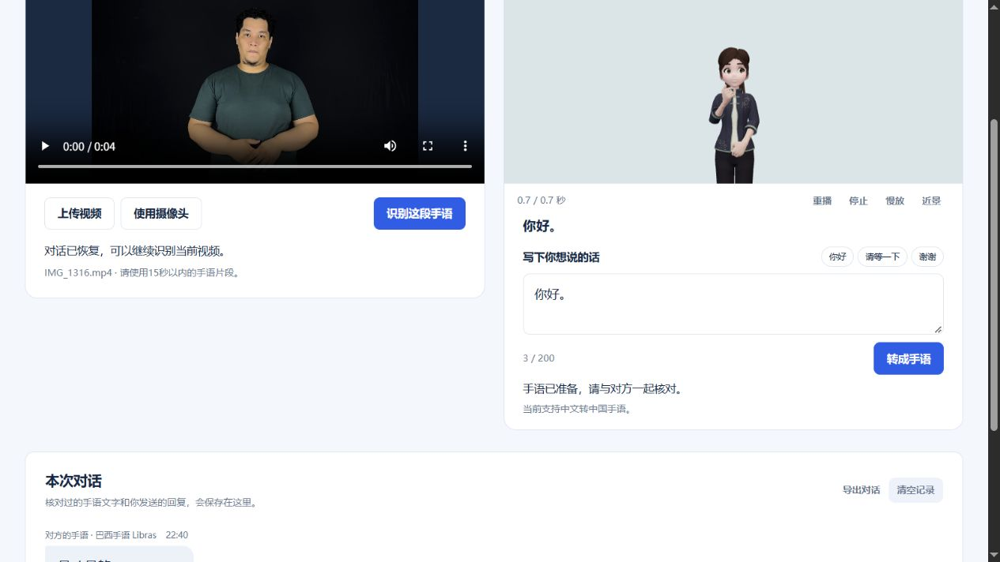

# 沟通产品与v14A后续改动同步说明

日期：2026-11-09，Asia/Taipei。用户已授权将最近改动同步到GitHub。本次增量以远端`codex/godette-v14-reference-20261107`的`e8477dcd5c53495c0f555ae55fa8a1d97213f9a2`为基线，推送目标为`codex/local-godette-v14a-demo-20261107`，用于草稿PR审查，不自动合入主分支。已有PR #1和历史分支保留。

## 本次包含

- 同页沟通产品：上传视频识别、手语种选择、原文保留与人工核对、对话记录、文字回复与人物播放；取消、重播、导出、清空撤销和窄屏任务切换。
- 本机独立识别与动作服务启动器、v3模型契约绑定、受限视频上传、WebM转换、任务取消和临时文件清理；新增可迁移配置示例。
- 自由文字快/慢模式、文字规划器、有界词片段构建/扩容/组合、缺词与已知遗漏阻断、模型只读映射和CPU文本缓存/逐层offload。
- v14A身份接入、保留源指骨的显示策略、有限头部/躯干避让，以及用户指定S000931整段接触轨；不将该轨推广到其他同名句。
- 对应源码、测试、设计/实施记录、使用说明及本页链接的小型证据。v14A原人物与可编辑Blender备份已在基线远端保存，归因见[资产说明](../../assets/godette-v14-preview/ATTRIBUTION.md)。

没有把外部模型权重、完整数据集/词库、原视频、完整本机artifacts、或E盘主检出中的其他调研草稿/测试工具包一起加入。主检出及活动动画工作区继续保留。

## 本轮新跑的检查

| 检查 | 结果 | 范围 |
|---|---|---|
| 预览环境Python | **387通过、37跳过、0失败** | animation、word、text、SignSparK/CLI、communication及v14A定向模块，不是全仓库 |
| 独立生成环境Python | **133通过、0跳过、0失败** | 只读映射、CPU offload、生成契约、词库构建/扩容/组合与文字规划；小型真实fixture，不是完整GPU动作生成 |
| Node前端 | **119通过、9跳过、0失败** | 控制器、已配置的真实v14A GLB和词接触资源；旧版本GLB与未提供的整段医院手形fixture未运行 |
| PowerShell语法、JSON示例、源码与增量检查 | 通过 | 启动器可解析，配置结构一致，清理EOF空行；`git diff --check`复查 |

两套Python有用例重叠，计数不能直接相加。预览环境跳过项及原因完整保存在日志；生成环境补测不等于消除另一环境的跳过。完整神经模型GPU、全仓库和远端CI未在这次同步中重跑。

验证摘要与可复查日志见[证据索引](evidence/communication-product-2026-11-09/README.md)。提交后以远端分支SHA和PR读回确认同步，不能只凭本地commit宣称已上传。

## 真实产品验证与质量边界

真实上传、核对、回复、导出和窄屏来自2026-11-08实测，**本轮同步没有重新采集视频或访问摄像头**。中文例子仅输出“平方 我 自己 。”，完整房子句由测试者人工修正；Libras Sim为12词分类及中葡草案。产品页输出目前仍限中国手语，完整中葡句子互译及Libras动作生成未接入。

快组合缺“成都”或检出漏“医院”时阻断播放，但该保护不是完整语义认证。“我想喝水。”组合动作的接触残余与新增避让跳动仍是质量未通过项。104段原动作的核心检查和源指骨键保持，不代表所有新组合、网格碰撞、手形含义或自然度通过。详细边界见[产品实测](communication-product-2026-11-08.md)和[动画整合](animation-consolidated-status-2026-11-08.md)。

