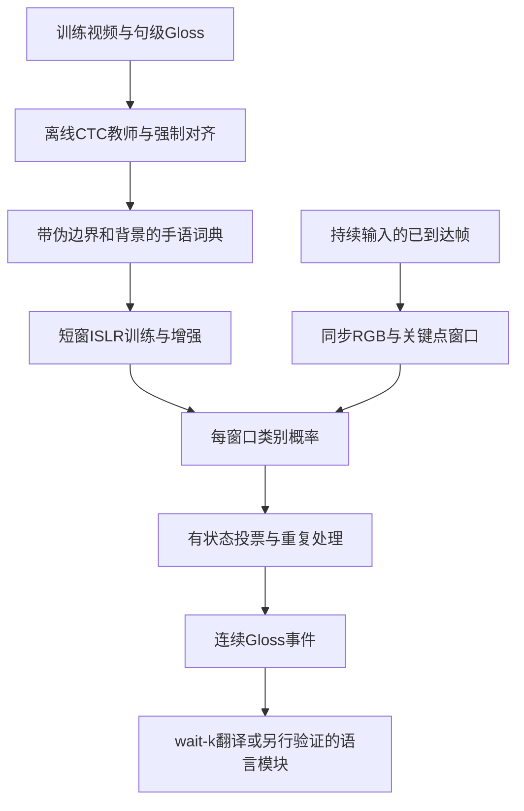

# 在线 CSLR：两篇论文解读、项目接入与复现清单

核对日期：2026-10-23（Asia/Taipei）。本轮按用户选择完成论文深读和清单，不实施产品改动，不执行论文训练或模型评测。

结论：**以 Zuo 2024 作为在线识别的主要复现对象，以 Camgoz 2020 理解联合识别与翻译，是成立的研究路线；尚不能据此认定本项目已经实现连续 Gloss 与增量句子翻译。** 最值得学习的是监督构造、短窗训练、输出提交和翻译读取策略的完整链条。

## 交付与证据范围

| 交付 | 用途 |
|---|---|
| [Zuo 2024 深读卡](E:/githubproject/SignLanguage-Bridge/docs/reports/online-cslr-study-2026-10-23/zuo-2024/paper-card.md) | 16节方法、公式、全部图表清单、主要实验、局限与可检验方向 |
| [Camgoz 2020 深读卡](E:/githubproject/SignLanguage-Bridge/docs/reports/online-cslr-study-2026-10-23/camgoz-2020/paper-card.md) | 联合训练图、任务差异、实验、官方代码复现差异 |
| [两篇参考文献](E:/githubproject/SignLanguage-Bridge/docs/reports/online-cslr-study-2026-10-23/references.bib) | 2条BibTeX；来自Zotero书目核对并整理，不写回Zotero |
| 两个子目录的 `source_bundle.json` | 从Zotero本地PDF抽取的页码、图表、公式、源文件SHA256 |
| 两个子目录的 `audit-report.json` | 结构及来源指针审计；不代表论文实验复现通过 |
| [本轮关键源码hash](E:/githubproject/SignLanguage-Bridge/docs/reports/online-cslr-study-2026-10-23/source-hashes.json) | 标记未跟踪论文代码及当前工作区实现的实际读取版本 |

Zotero API、connector均读回成功。使用两篇收藏的完整PDF，Zuo为18页；书目并与 [ACL正式记录](https://aclanthology.org/2024.emnlp-main.619/) 和 [CVPR正式记录](https://openaccess.thecvf.com/content_CVPR_2020/html/Camgoz_Sign_Language_Transformers_Joint_End-to-End_Sign_Language_Recognition_and_Translation_CVPR_2020_paper.html)核对。item key分别为 `DIW4847I`、`HBF727KE`，BibTeX key为 `zuo_towards_2024`、`camgoz_sign_2020`。Zotero搜索摘要将编者也合并进creators，正式BibTeX正确区分作者与编者。

本项目基线分支 `codex/model-contract-auto-captions`，HEAD `cf291c2a81558faf6de0dc5a7243e730531e4367`。工作区已有未提交产品改动；本报告核对的是当前磁盘源码，包括这些改动。`Paper-algorithm/`也是未跟踪目录，未取得对应上游提交SHA，不能把主仓HEAD当成上游论文代码版本。

## 先校正三个容易影响技术判断的表述

1. **Zuo 2024也有中文实验。** 数据为Phoenix-2014、Phoenix-2014T、CSL-Daily。其表中的`CSL`指CSL-Daily，不能等同于本项目CE-CSL；没有Libras结果。来源：Zuo PDF p.6 §4.1、p.7表1–2，[本地Online README](E:/githubproject/SignLanguage-Bridge/Paper-algorithm/SLRT-main/Online/README.md:23)。
2. **`SLRT-main`不是Camgoz 2020的原始工程。** 目录总览列出Zuo 2024、TwoStream 2022等工作；Camgoz官方实现是 [neccam/slt](https://github.com/neccam/slt)。本地`Online/SLT`是Zuo扩展使用的wait-k网络，不能因名字SLT相近而混同。[本地总览](E:/githubproject/SignLanguage-Bridge/Paper-algorithm/SLRT-main/README.md:3)
3. **现项目的LLM尚未接入。** 存在设计草案与候选导出能力，但没有运行中的`LLMProvider`或`semantic_assistance`实现；UI直接说明尚未接入。[桌面源码](E:/githubproject/SignLanguage-Bridge/slbridge/desktop.py:703)、[设计草案](E:/githubproject/SignLanguage-Bridge/docs/LLM中葡表达辅助智能体_设计草案_2026-10-11.md:3)

## 两篇论文分别解决什么

| 比较项 | Zuo等，EMNLP 2024 | Camgoz等，CVPR 2020 |
|---|---|---|
| 核心问题 | 如何在未结束的连续视频上持续输出Gloss | 如何让识别监督帮助视觉到自然语言翻译 |
| 训练核心 | 离线CTC强制对齐构词典；训练短窗ISLR，加入背景、增强、Gloss级与saliency损失 | 同一连续视觉编码表示同时受CTC识别损失和自回归翻译损失监督 |
| 推理主链 | RGB＋关键点短窗→词类别→投票/去重→Gloss | 连续视觉表示→识别头、翻译decoder；联合分支不必先把硬Gloss喂给翻译器 |
| 增量翻译 | 追加受监督的wait-k mBART gloss-to-text，k=2 | 原论文主要是完整视频的联合认译，不能直接当在线因果架构 |
| 对独立模型训练的意义 | 可独立训练识别器和翻译器，冻结各自输入输出契约 | 提供联合多任务训练对照，需要视频/Gloss/自然语言的配对监督 |
| 与通用LLM关系 | 非通用LLM调用；LLM接入应另列实验 | 非“识别后调用LLM”；原方法有可微共享表示及联合优化 |
| 最适合项目的角色 | 近期在线识别复现主线 | 联合训练的理论与离线工程参照 |

依据：Zuo PDF pp.4–6方法、pp.13–15附录；Camgoz原文§3及Figure 1，细节见两张深读卡。这里的组合是项目设计推论，论文没有共同验证本项目端到端路线。

Zuo的关键机制可以用下面的训练/推理分离来理解：



### 怎样读论文分数

| 数值 | 原文条件与意义 | 不能据此声称 |
|---|---|---|
| Zuo在线测试WER：22.1% / 22.1% / 29.3% | P-2014 / P-2014T / CSL-Daily，16帧；PDF p.7表1 | 本项目CE-CSL或Libras相同准确率 |
| Zuo在线翻译BLEU-4：23.69 / 20.63 | P-2014T / CSL-Daily；同一wait-k网络；p.7表2 | 通用LLM翻译已验收，或BLEU是识别准确率 |
| Zuo离线融合测试WER：18.0% / 18.6% / 24.4% | 另加离线模型和adapter；p.7表3 | 纯在线模型有18.6% WER |
| Zuo AL 320ms、WPL 29ms、显存5.1GB | 单张V100，P-2014T dev；p.8表4 | 摄像头到字幕P95为349ms、包含全部关键点和翻译成本 |
| Camgoz联合识别与翻译结果 | 在PHOENIX14T下比较不同任务、权重和解码参数 | 不同论文版本、BLEU实现或输入特征的分数可直接横比 |

WER、孤立分类准确率、BLEU属于不同任务指标。论文结果、源码机制、本机运行和真人产品验收也属于不同证据层级。

## 与当前项目的逐环节对应

| 环节 | 当前磁盘源码事实 | 接入论文方法仍需完成 |
|---|---|---|
| 采集/缓存 | 有界连续窗口；默认1.2–2.4秒，目标0.5秒更新，最多180帧/96MiB | 论文窗口是16帧，需按目标采样帧率校准，不可只替换秒数 |
| 调度 | 单推理任务，忙时不堆队列，空闲取最新完整窗口，调用`infer_clip` | 高频S=1逐窗推理可能与“取最新”策略冲突，须明确是否丢窗、投票如何处理缺口 |
| CSL识别 | TFNet ONNX CTC输出`gloss_sequence`，manifest只有`clip` | 新建短窗ISLR模型与manifest，或明确另做TFNet切词教师实验 |
| Libras识别 | RF是12类`classification`，30帧MediaPipe225，manifest只有`clip` | 目标不是简单把分类标签串起来；需连续监督、过渡/背景、词表和在线评价 |
| 候选证据 | 记录原始预测、时间、模型版本与`overlaps_candidate_id` | 重叠标记不是跨窗token对齐、投票或稳定前缀提交 |
| 正式字幕 | `CaptionLedger`有按动作ID的幂等提交；连续窗口当前只进候选 | 保留候选和正式记录边界；系统提交不代表人工核验词义 |
| 翻译 | 词典释义/原Gloss展示；LLM仍为设计 | 先定义句界、修订/撤回范围、语言方向与质量评价，再实现语言模块 |

证据：[continuous.py](E:/githubproject/SignLanguage-Bridge/slbridge/continuous.py:10)、[session调度](E:/githubproject/SignLanguage-Bridge/slbridge/session.py:212)、[候选结构](E:/githubproject/SignLanguage-Bridge/slbridge/candidate_context.py:46)、[候选提交](E:/githubproject/SignLanguage-Bridge/slbridge/session.py:747)、[字幕幂等](E:/githubproject/SignLanguage-Bridge/slbridge/caption_events.py:48)、[当前字幕生成](E:/githubproject/SignLanguage-Bridge/slbridge/captions.py:96)。两个模型分别见[CSL manifest](E:/githubproject/SignLanguage-Bridge/artifacts/models/cecsl-tfnet-onnx-20261009/manifest.json:88)与[Libras manifest](E:/githubproject/SignLanguage-Bridge/artifacts/experiments/libras-rf-pilot-20261009/models/libras-rf-pilot-20261009/manifest.json:84)。

`ModelCapabilities`能声明`stream`，但`ModelAdapter`当前只有一次性`infer`；没有每会话的open/push/reset/flush/close生命周期。不能只将manifest改为`stream`就认定支持原生流。[适配器契约](E:/githubproject/SignLanguage-Bridge/slbridge/model_adapters.py:70)、[运行请求](E:/githubproject/SignLanguage-Bridge/slbridge/runtime_contracts.py:43)

较新的相机恢复记录说明采集预览后来恢复；10月23日报告记录211帧真实观察，但没有合格动作候选/词义结果。因此应写“采集曾验证；本次未复测，识别正确率、动作到输出时延及P95未证实”。不能沿用早先一次相机失败推断硬件现在仍不可用，也不能把恢复预览当成识别成功。[最新报告](E:/githubproject/SignLanguage-Bridge/docs/reports/datasets-models-accuracy-latency-2026-10-23.md:47)

## 官方源码值得复用的部分与需要先校正的部分

| 文件/位置 | 读到的行为 | 复现或接入动作 |
|---|---|---|
| [gen_segment.py:34](E:/githubproject/SignLanguage-Bridge/Paper-algorithm/SLRT-main/Online/CSLR/gen_segment.py:34) | 给定GT，动态规划/回溯切词；时序分辨率映射回原帧 | 固定logit长度、blank ID、Gloss顺序与帧映射；这不是自由预测 |
| [gen_segment.py:7](E:/githubproject/SignLanguage-Bridge/Paper-algorithm/SLRT-main/Online/CSLR/gen_segment.py:7) | 指向`../CTC_based`，当前实际目录叫`CTC_fusion` | 复现分支中校正并记录差异 |
| [gen_segment.py:144](E:/githubproject/SignLanguage-Bridge/Paper-algorithm/SLRT-main/Online/CSLR/gen_segment.py:144) | 默认phoenix、`only_blank=True`、仅dev/test | 明确train的前景/背景生成，不照抄默认就认为词典已完整；隔离测试监督 |
| [sign_augment.py:16](E:/githubproject/SignLanguage-Bridge/Paper-algorithm/SLRT-main/Online/CSLR/sign_augment.py:16) | 输入命名有`phoenix.train`，其他配置用`phoenix14t.train` | 对照实际元数据名；固定同一视频片段不跨集合 |
| [prediction_slide.py:96](E:/githubproject/SignLanguage-Bridge/Paper-algorithm/SLRT-main/Online/CSLR/prediction_slide.py:96) | 输入完整T并预分配全部窗口，边缘复制 | 先用原入口做基准；摄像头另做有界buffer，不混写复现和工程改写 |
| [prediction_slide.py:338](E:/githubproject/SignLanguage-Bridge/Paper-algorithm/SLRT-main/Online/CSLR/prediction_slide.py:338) | 多种居中投票窗口、折叠相邻重复后删除blank | 复现登记B=7且开发集选参；生产只用已到达输入并保留时间戳 |
| [prediction_slide.py:620](E:/githubproject/SignLanguage-Bridge/Paper-algorithm/SLRT-main/Online/CSLR/prediction_slide.py:620) | 权重缺失时可只记录日志继续 | 运行前必须硬性校验实际checkpoint及加载键；脚本退出0不是权重正确证据 |
| [Dataset.py:9](E:/githubproject/SignLanguage-Bridge/Paper-algorithm/SLRT-main/Online/CSLR/dataset/Dataset.py:9) | 默认HRNet WholeBody选点，按排序后的组名拼接；hand42+mouth10+pose11 | MediaPipe不能只对齐点数或padding/truncate后冒充同一representation |
| [VideoLoader.py:369](E:/githubproject/SignLanguage-Bridge/Paper-algorithm/SLRT-main/Online/CSLR/dataset/VideoLoader.py:369) | 同步视频float[0,1]与关键点 | 冻结裁剪、RGB/BGR、坐标、置信度、缺点和采样顺序 |
| [CTC_fusion识别](E:/githubproject/SignLanguage-Bridge/Paper-algorithm/SLRT-main/Online/CTC_fusion/modelling/recognition.py:334) | 在线特征经adapter后与离线特征融合 | 单列离线扩展；不放进“低延迟翻译模块” |
| [wait-k配置](E:/githubproject/SignLanguage-Bridge/Paper-algorithm/SLRT-main/Online/SLT/configs/g2t_wait2.yaml:58) | 预训练mBART、Gloss/文本、wait_k=2 | 正确区分GT-G2T、预测Gloss-G2T、通用LLM三个实验 |

以中心帧标时的W=16窗口覆盖`i−7…i+8`，居中B=7投票另看3个位置；这是源码推导的可用时间约束。可以用窗口尾部作为在线输出时刻，但不得把这些等待从端到端时延中删除。论文算法2是队列式描述，官方评测入口则预先装入完整视频；二者须通过逐帧回放的一致性检查衔接。

## 本机运行条件与资产门槛

以下为本轮轻量版本/包信息/定点路径查询，未启动Docker、未运行GPU张量或论文模型。

| 项目 | 核对结果 | 含义 |
|---|---|---|
| GPU | RTX 5060 Ti，16,311 MiB；驱动616.92 | 不等于论文V100环境；旧CUDA配方在现硬件可用性未验证 |
| CUDA工具 | nvcc12.9，驱动UMD显示13.4 | 两者不是已安装Torch的CUDA版本 |
| `.venv-gpu` | Python3.12.7；没有torch/torchvision/transformers/timm/ctcdecode | 当前桌面ONNX环境不能直接运行论文PyTorch入口 |
| 当前主要包 | NumPy1.26.3、Pillow12.3.0、opencv-contrib4.10.0.84、onnxruntime-gpu1.23.2 | 与论文固定旧依赖不同 |
| Docker/WSL | Docker CLI29.7.2；WSL3.0.1.0；仅列出停止的docker-desktop | CLI存在不等于daemon、GPU透传或Linux训练环境就绪 |
| 官方依赖 | torch1.9.0+cu102、torchvision0.10.0、numpy1.21.6、transformers4.11.3、Lintel、ctcdecode等 | 放到独立复现环境；不要覆盖当前桌面环境 |
| 默认数据与权重 | `SLRT-main/data`、`pretrained_models`、`Online/CSLR/results`、`CTC_fusion/results`缺失 | 默认入口的实际资产未就绪；本轮没有全面搜索其他盘的所有权重 |

参考：[requirements](E:/githubproject/SignLanguage-Bridge/Paper-algorithm/SLRT-main/Online/requirements.txt:1)、[P-2014T配置](E:/githubproject/SignLanguage-Bridge/Paper-algorithm/SLRT-main/Online/CSLR/configs/slide_phoenix-2014t.yaml:7)、[CSL-Daily配置](E:/githubproject/SignLanguage-Bridge/Paper-algorithm/SLRT-main/Online/CSLR/configs/slide_csl-daily.yaml:7)。官方推荐镜像`rzuo/pose:sing_ISLR`未拉取/运行，其当前可用性和GPU兼容性也未验证。

PDF阅读工具另安装于临时目录`C:/Users/ADMIN/AppData/Local/Temp/slbridge-paper-reading-20261023-libs`，仅供报告抽取；没有将论文依赖装入项目环境。

## 按阶段执行的复现清单

这些是**待执行任务**。复现成功必须有实际输入、实际加载权重、完整输出与指标文件，不能以清单或源码阅读代替。

| 顺序 | 工作与必要输入 | 交付/核验条件 | 当前状态 |
|---|---|---|---|
| 0 | 固定正式论文版本、上游commit/本地文件hash、数据版本、词表/blank ID、划分 | provenance记录及修改差异；不混用未跟踪目录和主项目HEAD | 论文/关键文件已核对；上游commit待补 |
| 1 | 建独立Linux/容器环境；选择与GPU匹配的Torch，核对旧依赖 | 记录环境锁、设备、一次实际CUDA计算、依赖导入；若需移植，标记为port而非原环境复刻 | 未执行；BLOCKED_BY_ENVIRONMENT |
| 2 | 准备原始PHOENIX14T或CSL-Daily、HRNet点、元数据、词表、K400/ISLR权重 | 逐项存在性/hash/shape/帧数与RGB-keypoint同步检查；实际checkpoint加载证据 | 未执行；BLOCKED_BY_ASSETS |
| 3 | 先跑发布checkpoint的完整dev/test推理 | 保存逐样本预测、S/D/I和全语料WER；记录W/S/B、blank、清洗规则；与表1匹配条件后比较 | NOT_RUN |
| 4 | 再复现切词、增强与ISLR训练 | 仅训练数据进入训练词典；保留原视频ID/边界/教师版本；背景、增强、Gloss级、saliency消融 | NOT_RUN |
| 5 | 独立复现wait-2 G2T | 区分GT Gloss与预测Gloss；同一SacreBLEU版本和分词；记录输入可见前缀/输出可用时刻 | NOT_RUN |
| 6 | 单列可选离线fusion | 冻结两识别器，adapter/头训练；与在线结果分表 | NOT_RUN，非近期摄像头必需项 |
| 7 | 相同视频按原帧率逐帧回放 | 只读已到达帧、RGB-keypoint同步、有界buffer；与批式参考结果比较，记录因果/边缘处理差异 | NOT_RUN |
| 8 | 接桌面adapter与真实摄像头 | 来源切换/reset/EOS、预热、背压、丢帧、长时内存、质量与P50/P95一起验收 | NOT_RUN |

原配方的P-2014T推理命令应在完成0–2后、独立环境中执行；本轮未执行：

```bash
cd Paper-algorithm/SLRT-main/Online/CSLR
python -m torch.distributed.launch --nproc_per_node 1 --master_port 29999 --use_env prediction_slide.py --config=configs/slide_phoenix-2014t.yaml
```

README的`--save_fea 1`仅在需要离线fusion特征时使用。当前缺少checkpoint时可能继续执行的分支应先在隔离复现副本中修正为失败退出。不要把该命令直接视为现Windows/Python3.12环境的可用命令。

### CE-CSL迁移清单

- [x] 本轮读回本地`train.csv`，确有`Chinese Sentences`及`Gloss`字段；项目解析器保留二者，任务为连续Gloss CTC。[解析器](E:/githubproject/SignLanguage-Bridge/slbridge/cecsl.py:126)
- [ ] 冻结CE-CSL官方划分及标注规范，不把CSL-Daily标签与CE-CSL词表混用。
- [ ] 首先决定“原TwoStream教师在CE-CSL训练”还是“当前TFNet作为替代教师”；后一条属于方法迁移，不能标原配方复现。
- [ ] 核对TFNet logit时间轴、blank及预处理；在训练集内切词、构建前景/背景，再人工抽核类别与边界。
- [ ] 训练专用短窗识别器，对比“TFNet直接滑窗”和“迁移短窗模型”；同时报整集WER、短词/重复词、插入/分钟和延迟。
- [ ] 在相机域、新背景与可用的说话者分组上重新评价；原划分结果不能自动当成新说话者泛化。
- [ ] 若做中文翻译，保持Gloss、中文句子各自字段，分别评价GT-G2T和预测Gloss-G2T，再考虑中文到葡语的额外语言转换。

### Libras迁移清单

- [x] 当前生产模型为12类片段分类器，本轮核对manifest；不能因其他孤立分类实验较好就推出连续句子识别能力。
- [ ] 先重审数据监督：现项目历史审计记录5,335条`original_info.label_gloss=[]`；本轮未重新全量反序列化。`label_char`中的葡语自然文本不能直接改名当Gloss。数据中有孤立项及句式，不能说全部语料只有孤立词。[数据策略记录](E:/githubproject/SignLanguage-Bridge/docs/Libras新增特征数据_算法策略与执行路线_2026-10-10.md:22)
- [ ] 若复现在线CSLR，先取得/标注连续Libras视频、句级Gloss与目标词表；若另训G2T，再补充Gloss—葡语句子配对。经人工验证的目标词典可支持短窗分类训练，但孤立录制样本不能替代连续过渡训练与连续测试。
- [ ] 如暂时只有葡语句式标签，可另做固定句式分类或gloss-free文本生成研究，单列任务与指标，不能标记为Online Gloss复现。
- [ ] 冻结每个模型的点位、顺序、坐标、缺点与归一化协议；当前MediaPipe225、其他321维实验、论文HRNet63点三者都不能互相padding/truncate后当同一输入。
- [ ] 与CSL分别训练、登记、评价。葡语输出文本不等于视觉模型已理解另一种手语。

## 推荐的产品接入边界

这是基于源码和论文的设计建议，本轮未实现。

| 对象 | 建议保存的证据与状态 | 规则 |
|---|---|---|
| 原始窗口候选 | 窗口起止/可用时间、模型/预处理/解码版本、词概率、原始Gloss、来源epoch | 保留当前`unconfirmed`与原始预测；重叠关系不自动变成语义关系 |
| 在线Gloss事件 | 对齐后的token、暂定/稳定状态、修订号、覆盖输入时间范围、blank/重复处理依据 | 稳定前缀和可撤回尾部规则要明确；`A blank A`不可被全局去重吞掉 |
| 表达草案 | 依赖的Gloss事件版本、目标语言、输入范围、译文、澄清项、生成版本 | 可失败回退；不覆写原Gloss，不自动确认词义，不自动成为训练标签 |
| 用户确认内容 | 被确认的具体来源版本与表达 | 若来源修订，旧确认不可无条件沿用 |

保留现有的来源epoch、模型generation、窗口revision、取消及结果年龄检查。[有效性检查](E:/githubproject/SignLanguage-Bridge/slbridge/session.py:741)

若首版只用当前完整窗口推理，继续诚实声明`clip`，把跨窗聚合另做实验模块。若后续引入模型缓存或在线解码状态，应增加每会话显式流生命周期：新建、喂帧、reset、flush/EOS、关闭；源切换、丢帧或模型更换不能沿用旧状态。

翻译路线应分开比较：①论文wait-k受监督基线；②本项目可修订语言表达草案；③有配对监督后的Camgoz式联合训练对照。直接给通用LLM一个Gloss列表，与①或③均不是相同算法。wait-k也不提供自动句界、对话轮次与人工确认机制。

## 验收与对照实验

| 层面 | 正向证据 | 负向/边界对照 |
|---|---|---|
| 资产加载 | 权重hash、实际路径、加载键和输出词表 | 删除/错置权重必须失败；词表错配必须拒绝 |
| 在线约束 | 每个输出对应已到达帧，记录可用时间 | 给未来帧设置哨兵，当前输出不应访问；EOS与边缘padding分别标记 |
| Gloss序列 | 全语料WER、S/D/I，重复词和短词分层 | 空闲/非手语/快速过渡、A-A与A-blank-A、语言/模型切换 |
| 系统行为 | 有界缓存、丢帧数、队列年龄、长时内存 | 持续输入快于处理时不会累积旧窗口；过期结果不能入当前会话 |
| 翻译 | GT-G2T与预测Gloss-G2T；BLEU/人工语义、修订次数 | 错Gloss/缺词/矛盾输入应可澄清；语言模型不能掩盖原识别误差 |
| 时延 | 采集、关键点、等待、模型、投票稳定、翻译、UI分别计时；足量样本P50/P95 | 冷启动/预热分开，不能用单样本或模型forward替代端到端 |

目前最合理的推进顺序是：**补齐并复现官方发布权重 → 按时间回放证明在线约束 → CE-CSL迁移短窗训练 → 桌面接入 → 真人长流 → 语言表达模块**。Libras先补监督审计和连续标注路线。Camgoz联合训练作为对照分支，避免与首个在线基线同时改动过多条件。

## 本轮状态

| 项目 | 状态 |
|---|---|
| Zotero条目、正式书目、全文获取 | 已核对 |
| 两篇全文方法、实验、局限和本地主要源码映射 | 已完成阅读与整理，见配套卡片 |
| 论文卡结构/来源指针审计 | 两卡各14项通过、0警告、0错误；只验证文档结构和追溯 |
| 本地引用/BibTeX检查 | 37个文件及行号引用通过，BibTeX共2条；见`document-link-check.json` |
| 独立源码/数字复审 | 2处Important表述已修正并读回关闭：fusion方向、CSLR/G2T监督要求；无Critical遗留 |
| 本机包/GPU与默认资产门槛 | 已定点核对 |
| 论文权重推理、训练、指标复现 | NOT_RUN；默认环境和资产尚未就绪 |
| 本轮相机/真人/端到端P95 | NOT_RUN |
| LLM接入与增量翻译 | 未实现、NOT_RUN |
| 产品代码、现有模型和Zotero文库 | 本轮未修改 |
