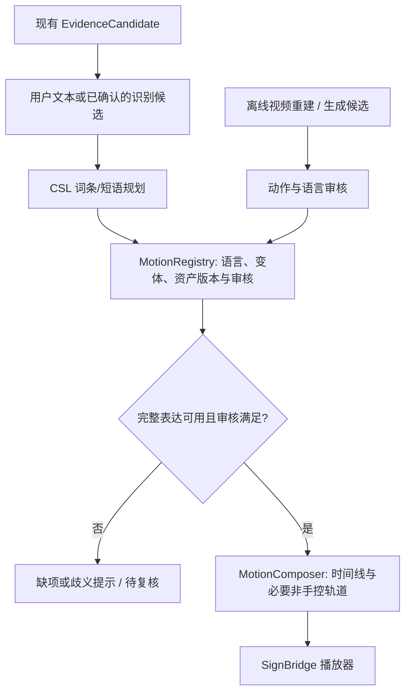

# 中国手语三维动画路线评审与调研

日期：2026-10-28（Asia/Taipei）。范围：当前 SignLanguage-Bridge 与公开上游的源码、论文、数据说明和许可标识核验。**本次是路线评审与资料调研，未运行三维播放器、重建、生成模型或真人语言验收；所有本机效果、速度、显存与可理解性均为 NOT_RUN。**

本地基线：`782dee3f128f727373dcdd3e4c2590d7bdc987da`，分支 `codex/model-contract-auto-captions`；开始时 `git status --porcelain=v1` 为空。上游 SignBridge 和本仓库 SignLanguage-Bridge 是两个仓库，不能把前者的功能写成本项目已有功能。

用户补充迁移路径后，已做[本地已有成果与 G 盘复用核验](csl-animation-existing-assets-reuse-2026-10-28.md)：本机实际保留了完整 100 段动作演示归档，可以优先验证播放，无需为首轮演示从零重建或重训；新清单与本报告的路线调研分开保存。

## 1. 评审结论

**支持“词典/短语资产驱动为工程主线、视频重建为资产制作手段、生成模型为研究扩展”的顺序。需要修改首阶段目标与现有能力判断。**

首阶段建议定义为：**已审核的 CSL 词条和完整短语 → 明确版本的动作资产 → SignBridge 播放；确认后的识别结果作为一种输入。** 自由中文、葡语、未经确认的 SLRT Gloss 暂时不能直接承诺转换为语义正确的连续 CSL。

关键调整：

1. 上游有资源校验与动作质量审批，但没有据此认证标准 CSL 语言语义。审核机制存在、动作流畅、语言正确是不同结论。
2. 把“完整短语资产”放到首阶段，与孤立词词典并列。逐词动作全部正确，也不能推出拼接句子正确。
3. SMPL-X 是参数化人体表示；OSX、WiLoR、拟合优化等才构成视频重建算法。原方案应明确具体生产流程。
4. SignBridge 已有 SMPL-X 重定向原型；主要缺口包括表情、口型、空间指代与语言审核，而不只是增加一个文件转换器。
5. SOKE 已有 CSL-Daily 三维姿态资源入口，应先核验可用数据与预训练资产，再决定是否训练；没有理由把全量训练设为首阶段前置条件。
6. CSL 与 Libras 保持独立语法、变体和资产审核。可共享经过确认的语义概念，但中文/葡语别名相同不构成动作等价证据。

## 2. 对原方案逐项核验

| 原方案判断 | 评审结果 | 修订建议与证据 |
|---|---|---|
| Uni-Sign、SLRT 不能反向运行生成动画 | 成立 | 本地 `slbridge/contracts.py` 分别定义 `TextPrediction`、`GlossSequencePrediction`；新增生成协议，保持原始输出。 |
| VLibras 可作为分层架构参考 | 成立，需限定 | 借鉴文本处理、手语资源与播放器分层；不能移植 Libras 词序/动作充当 CSL。其当前文本核心还包含深度学习翻译/修订选项，不能概括为完全纯规则系统。[独立源码审计](csl-animation-source-audit-2026-10-28.md)。 |
| SignBridge 已有可继承的词典、校验与播放器 | 部分成立 | 实际代码位于上游 `signbridge/src/...`。已有原型和质量控制，但不代表本项目已接入，也不代表词条全部经过 CSL 专家审核。[独立源码审计](csl-animation-source-audit-2026-10-28.md)。 |
| 首阶段播放“已审核标准中国手语动作” | 是建设目标，不能写成既有事实 | 上游当前固定快照有 100 段资产；83 段拟合审批的范围是 `motion_quality_only`，manifest 明示 `semantic_accuracy_certified=false`。100 段不是 100 个标准词条。 |
| SMPL-X → Humanoid → Three.js | 技术可行，存在信息损失 | 上游已有上肢/头颈/双手重定向；面部系数未转接、jaw/eyes 静止等边界使其不能直接覆盖完整非手控表达。 |
| 四元数插值/CrossFade 能作为连续编排基础 | 成立 | Three.js 提供动画权重淡入淡出；语言层必须指定允许的过渡区间、手形和接触约束。通用混合不认证语义。[Three.js 官方 API](https://threejs.org/docs/pages/AnimationAction.html)。 |
| SignAvatars 可扩大 CSL 资源库 | 只能作为方法与跨语言资源参考 | 官方列出 ASL、GSL、HamNoSys、Word 等子集来源，没有将其认证为标准 CSL 词库；不能把外国手语动作换一个中文别名后导入。[官方 README](https://github.com/ZhengdiYu/SignAvatars)。 |
| SOKE 只留作未来研究 | 基本支持，但数据可提前使用 | 它提供 CSL-Daily 姿态入口；先做数据/格式/许可核验及少量播放，生成能力仍走独立研究门。[项目主页](https://2000zrl.github.io/soke/)。 |

上述上游数量与功能边界绑定 SignBridge SHA `3503ff7802bc991ccf5e0753c2fe41b79689b860`，详见独立审计中的固定链接；没有逐段观看动作，也没有复核上游宣称的测试通过状态。

## 3. 调研后的候选资源与定位

| 资源 | 实际任务及语言范围 | 适合本项目的用途 | 可用性边界 |
|---|---|---|---|
| VLibras | 葡语内容到 Libras 的分层系统与社区资源机制 | 参考服务边界、词典运维和播放器接口 | 不能作为 CSL 规划器或 CSL 动作来源；当前源码与许可见独立审计。 |
| SignBridge | 词典/片段播放、动作资源验证、SMPL-X 重定向原型 | 作为独立播放器候选，通过接口接入 | 代码能力与语言认证分开；不是 SignLanguage-Bridge 的现成依赖。 |
| [SignAvatars，ECCV 2024](https://github.com/ZhengdiYu/SignAvatars) | 多来源手语三维动作标注、研究基准和可视化 | 研究动作表示、平滑与重建质量 | 标注需申请，官方说明限非商业研究，原 RGB 不随标注再分发；没有据此获得 CSL 词典。 |
| [SGNify，CVPR 2023](https://sgnify.is.tue.mpg.de/) | 用手语语言学先验改善单目视频重建 | 孤立词资产制作的对照方案，尤其手形/双手关系 | 可借鉴约束，不能直接当作已经通过 CSL 验收的批量转换器。 |
| [SOKE，ICCV 2025](https://2000zrl.github.io/soke/) | 文本条件、检索增强的三维连续手语生成；ASL/CSL/DGS | CSL-Daily 姿态资源和后续生成研究基线 | 未宣称支持 Libras；本地模型加载、资产完整性和运行成本均未验证。 |
| [PHOSA/MVSign，ECCV 2026](https://naaapi.github.io/PHOSA/) | 原生 CSL 多视角采集、拟合与照片级虚拟人建模 | 补充身体/手/脸重建评测与制作流程参考 | 项目页仍标 Code coming soon；数据有受限访问，且不是现成文本到 CSL 翻译器。 |

### 3.1 SOKE：优先取资源与做小样本验证

权威入口是作者项目页链接的 [`2000ZRL/SOKE`](https://github.com/2000ZRL/SOKE)，本次核验 main SHA `5cbc55d84b5a7cbf05a9cf020c468052e8d94d00`（2026-02-21，修复批生成）；原搜索也会出现其他 fork，应避免混用。

其生成条件不是简单的 Gloss 查表：检索到的动作 token 是语言模型条件，输出仍由模型生成；因此不能保证逐点保留已审核手形。论文中三语种训练使用 6 张 RTX 3090；CSL 用户研究仅 4 名专业签者、15 个样例，不能据此认证任意中文输入。论文的 133 维动作表示也不同于本项目的 RTMPose 133 点。[论文正文与附录](https://arxiv.org/html/2411.17799v2)。

源码核验：

- [`configs/soke.yaml`](https://github.com/2000ZRL/SOKE/blob/5cbc55d84b5a7cbf05a9cf020c468052e8d94d00/configs/soke.yaml) 默认设备为 6 卡，生成训练 150 epoch，`TEST.CHECKPOINTS: null`；这只是上游配置，不是本机显存或时间估算。
- [`test.py`](https://github.com/2000ZRL/SOKE/blob/5cbc55d84b5a7cbf05a9cf020c468052e8d94d00/test.py) 在没有显式测试 checkpoint 时寻找实验目录的 `last.ckpt`。README 虽提供 tokenizer 与 mBART 资源链接，不能仅下载通用 mBART 就宣称生成模型已齐备；完整任务 checkpoint 需下载清单和实际加载核验。GitHub releases 集合本次为空，但外链可能另有发布，不能反推“没有权重”。
- [`configs/lm/mbart_h2s_csl_phoenix.yaml`](https://github.com/2000ZRL/SOKE/blob/5cbc55d84b5a7cbf05a9cf020c468052e8d94d00/configs/lm/mbart_h2s_csl_phoenix.yaml) 与 [`mgpt_mbart.py`](https://github.com/2000ZRL/SOKE/blob/5cbc55d84b5a7cbf05a9cf020c468052e8d94d00/mGPT/archs/mgpt_mbart.py) 依赖专用目录、tokenizer 和 `map_ids.pkl`；不是把 Uni-Sign 的 mT5 权重反向调用。
- [`H2S.py`](https://github.com/2000ZRL/SOKE/blob/5cbc55d84b5a7cbf05a9cf020c468052e8d94d00/mGPT/data/H2S.py) 与 [`vis_mesh.py`](https://github.com/2000ZRL/SOKE/blob/5cbc55d84b5a7cbf05a9cf020c468052e8d94d00/vis_mesh.py) 含动作维度选择、mean/std 和重建逻辑；须保留完整 feature schema，不能按总维度强行 reshape。可视化脚本中还存在本地路径与 CUDA 假设。

研究评测可记录 DTW-JPE、手部误差与回译分数，但必须加目标用户理解任务。作者在[官方 Issue 回复](https://github.com/2000ZRL/SOKE/issues/1#issuecomment-3565341839)也指出回译会受翻译误差影响；这支持把回译当辅助指标。作者推荐的几何指标同样不能替代本项目的语言可理解性验收。

### 3.2 重建路线：明确“表示—估计器—优化—审核”

[SMPL-X 官方说明](https://smpl-x.is.tue.mpg.de/)区分人体模型和拟合方法 SMPLify-X。工程上应写成：

`授权视频 → 身体/手/脸估计 → SMPL-X 参数拟合与时序约束 → 原模型预览 → 目标角色重定向 → 双侧对照审核 → 版本化资产`

建议先对同一批授权片段比较 SGNify 与 SOKE 的重建方法思路，后者使用 OSX、WiLoR 和投影/时序优化。已发布姿态可以作为候选输入，但属于拟合标签，不是 mocap 真值。词级片段的取得还需人工边界或可靠对齐；句级标注不会自动变成孤立词动作。

2026 年新增资源值得纳入：[MVSign 官方数据卡](https://huggingface.co/datasets/naaaaapi/MVSign)记载 5 名原生 CSL 签者、16 相机、约 115K 时间帧，提供 `smplx_params.npz` 与三维点等，并含基本手形和日常句子。它更适合本路线中的手脸重建、驱动保真评测；下载需先取得访问，完整数据标示约 1.83 TB，应先评估可选片段和标注，不安排无差别全量下载。本次未申请、未下载。

### 3.3 许可必须按组件记录

这是选型事实核验，不把不同材料的授权合并为一句“开源可用”：

- SOKE 源码 [`license.txt`](https://github.com/2000ZRL/SOKE/blob/5cbc55d84b5a7cbf05a9cf020c468052e8d94d00/license.txt) 标为 **CC BY-NC-ND 4.0**。修改、分发或产品使用前需要核清对应授权；不能因为 GitHub 公开就视为宽松许可证。
- [SMPL-X 模型许可](https://smpl-x.is.tue.mpg.de/modellicense.html)是非商业科研等用途许可，并另设商业授权入口；代码、人体模型、导出资产须分别核对。
- SignAvatars 数据说明为非商业研究申请；MVSign 数据卡标 **CC BY-NC 4.0**，另有访问条件。
- SignBridge 的代码、Godette 角色、拟合来源视频和 token/动作数据分别建来源台账，不能用仓库代码许可证覆盖所有资产。VLibras 的各组件许可也分别核验，见独立审计。

## 4. 与本仓库对接：复用已有证据层

本地事实以当前源码为准：

- `slbridge/contracts.py`：`GlossToken` 有 token ID、Gloss、可空分数/时间范围；`TextPrediction` 是独立自然语言输出。
- `slbridge/evidence.py`：已有 `EvidenceCandidate`，保留 `sign_system`、`model_revision`、`preprocess_version`、窗口与原输出。`calibrated_reliability` 在当前 P0-A 中为空。生成侧应引用该证据，不能把未校准分数自动变成播放批准。
- `slbridge/captions.py`、`caption_events.py`、`candidate_context.py` 是可检查的字幕/候选上下文入口；没有发现已集成的 Three.js/SMPL-X 动作生成模块。此结论限本次检查的受跟踪应用代码、配置和文档，不声明所有外部目录都不存在相关实验。
- `docs/experiments/P-1/G2_DECISION_MEMO.md` / ADR-P1-010 已决定融合不进主链路。这是识别结果改写实验的结论，不证明 LLM 永远不能做 CSL 规划；但新增规划器必须有自己的证据与验收，不能默认依赖“LLM 能修好识别”。
- `docs/CE-CSL_Libras共同语义审核清单_2026-10-09.md` 和 `configs/libras_caption_catalog.json` 中的跨语言/字幕草稿不能直接升级为已确认动画语义映射。

建议的接口边界：

`CSLPlanner`、`MotionRegistry`、`MotionComposer` 的职责划分合理，但第一版可以是小型确定性模块，甚至静态清单和前端播放适配器；没有必要为查词和播放额外依赖 GPU 后端。后端适用于共享检索、版本运维、规划服务和后续模型推理。

## 5. 必须补足的数据契约

建议拆开以下身份，避免一个 `gloss` 同时承担语言、词义和资源定位：

| 对象 | 身份与边界 |
|---|---|
| `concept_id` / `sense_id` | 语义概念/具体义项，可供 CSL 与 Libras 显式确认后的语义关联。 |
| `gloss` + `gloss_namespace` | 某数据集/标注版本中的语言学标签；CE-CSL 和 CSL-Daily 的数字 token ID 不能直接互换。 |
| `sign_id` + `sign_system` + `variant` | 目标手语及变体中的词条/表达；同一概念可以有多个表达。 |
| `motion_asset_id` + version + hash | 某段具体动作资源；一个词条可以有多个演员、语境和速度版本。 |
| `phrase_id` / template version | 完整短语或已审核模板；保留否定、问句和空间参数的适用条件。 |

不要把 `Humanoid / SMPL-X / glTF` 放在一个互斥枚举里：前两者涉及骨架或参数表示，glTF 是资产容器。至少分别记录 `motion_representation`、`skeleton_profile`、`container_format`、`coordinate_system`、`units`、`fps/timebase`、`rest_pose`、`rotation_convention` 和 `retarget_profile_version`。人体参数、角色身形与面部 blendshape 之间需要显式映射。

审核建议拆为 `language_review`、`motion_review`、`rights_review`，每次记录对象哈希、适用范围、审核人角色、日期、证据引用。离线生成的片段先作为候选，审核绑定其具体内容；原片段通过不能自动批准所有新的拼接句子或重定向版本。

动作规划应另外保存 `origin_evidence_id`、`input_kind`、输入原文/原 Gloss、目标变体、规划版本、歧义和未匹配列表。状态可为 `needs_review`、`blocked`、`playable`；`playable` 的条件必须能解释。用户示例中的 `csl_thanks`/`csl_thanks_v1` 只能是示意标识，本次没有确认其存在或获批。

**特别危险的协议撞名：** 本仓库 RTMPose 133 是 133 个二维点及其置信度，通常为 `T×133×3`；SOKE 133 是人体动作参数特征向量。数值相同没有格式兼容性，不能把 confidence 当深度或人体旋转参数。

## 6. 连续编排与语言正确性的边界

`MotionComposer` 应控制准备、主动作、保持、收回等阶段，过渡只发生在允许区间，保留动作辨识信息；不应对所有轨道统一任意 CrossFade。手脸接触、双手相对位置与符号化空间指代必须保持在目标角色上。

身体、左右手、脸/头/视线可以分别存轨道，但语义约束和作用域必须共享同一时间线。问句表情可能覆盖一个短语，否定范围也不一定等于单个词时长。完全独立优化各轨道会破坏这些关系。

优先使用完整短语解决首阶段表达。逐词播放可以是教学演示，但应明确该模式，不直接标成连续自然 CSL 翻译。无法覆盖否定、数量或指代时不能静默删去词项后播成另一个肯定句；应提示缺项并要求复核。左右手变换也不能仅按画面镜像处理，须有符合目标手语变体的规则与审核。

“国家通用手语”需绑定语言来源和版本。[教育部关于《国家通用手语常用词表》的说明](https://qspfw.moe.gov.cn/html/hotnews/20180523/12925.html)可作为规范来源入口；它的存在不等于项目已获得可分发 3D 动作文件，也不证明某个 CSL-Daily/CE-CSL 视频就是该规范表达。

## 7. 推荐阶段与退出条件

以下规模是建议试点规模，不是已经具备的资源量，也不是工期承诺。

| 阶段 | 具体工作 | 进入下一阶段的依据 |
|---|---|---|
| P0：资源与技术底座核验 | 固定 SignBridge SHA，盘点片段/独立词条/完整短语/来源/审核；选 5–10 段候选做格式和重定向对照 | 找到可用且来源明确的候选；播放器加载、暂停、调速、视角、同步、缺失资产及取消行为有实测记录。技术通过仍不等于语言通过。 |
| P1：审核词条与短语闭环 | 以 20–50 个常用完整表达及其必要词条为候选，人工制作/纠正优先；中文输入与人工选词优先 | 目标 CSL 使用者完成独立理解测试；表情/否定/数字/对象不因动画改变；范围和失败案例明确后再接确认后的识别结果。 |
| P2：半自动资产生产 | 选择有遮挡、双手接触、脸部接触和口型的片段，比较重建/人工修正的成本与保真；形成可追溯流水线 | 证明比纯人工制作有效，同时语言审核通过；不能只以重投影误差或骨架平滑验收。 |
| P3：生成研究 | 先核验 SOKE 数据和完整权重，隔离环境做少量文本到动作与重定向；缺词和域外输入单独测试 | 相对“审核短语/词典 + 确定性编排”基线，证明语义收益、资源成本和许可适配；再决定微调/全训。 |

先分开测试两个输入问题：①人工确认的文本/Gloss → 动画，测生成侧；②视频 → 识别 → 确认 → 动画，测全链路。否则识别错误与动画错误混在一起，无法决定改哪个模块。

### 验收设计

1. **工程指标**：资源校验/哈希、骨架与手指映射、时间与字幕同步、冷/热加载、帧率、播放/暂停/调速/取消、失败计数；性能写明设备与计时边界。
2. **动作指标**：手形和手腕方向、双手关系、接触点、穿模、速度与加速度；源视频/原 SMPL-X/目标角色三者对照，定位重建或重定向损失。
3. **语言指标**：目标 CSL 熟练使用者独立审查，覆盖时间、数字、否定、问句、人称/空间指代与非手控特征。审核者身份与是否参与制作要记录，AI 审核另列。
4. **理解任务**：先不给字幕，让使用者复述含义或完成任务；与原真人视频和完整短语基线比较。流畅评分、强制选择题和回译分数只能补充。
5. **协议纪律**：先在开发素材确定阈值，冻结后测试新表达/新组合；按句子与签者报告样本量和不确定性。不把当前已反复检查的 P-1 样本改称新盲测，也不覆盖历史实验结果。

## 8. 本次交付与未验证事项

完成：当前源码边界核验、上游固定版本核验、原方案纠正、可用研究资源补充、接口与阶段建议。另附 [SignBridge/VLibras 源码审计](csl-animation-source-audit-2026-10-28.md)。

**未执行（NOT_RUN）**：模型/受限数据下载与授权流程、依赖安装、SOKE 训练或推理、SMPL-X 拟合、Three.js 现场播放、字幕同步实测、跨仓库集成、目标用户语言审核、端到端时延/显存和 CSL↔Libras 翻译验收。

当前判断可以支持选型与准备 P0 试点；不能据此宣布三维生成已接入或产品验收通过。
