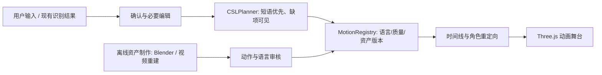

# 手语动画集成与画面/动作升级：方案草案

后续状态：用户确认后已完成第一期工程实施，见[实施与验收报告](../reports/csl-animation-workspace-acceptance-2026-10-28.md)与[启动说明](../csl-animation-workspace.md)。下文保留方案写作时的核验状态；不代表最新运行结果。

日期：2026-10-28（Asia/Taipei）。状态：**供范围评审的设计草案，尚未实施**。用户已明确同时改善“动作与人物画面”。本轮检查了现有工程入口、GLB/蒙皮、完整动作包，并在浏览器实际打开旧演示、选择并播放参考/拟合片段、暂停拟合片段；未修改产品运行时代码或制作新角色。

关联：[原路线评审](csl-3d-animation-route-review-2026-10-28.md)、[现有资产复用](csl-animation-existing-assets-reuse-2026-10-28.md)、[本轮集成代码审计](csl-animation-integration-code-audit-2026-10-28.md)。

## 1. 建议决策

首期建设 **SignLanguage-Bridge 自己的浏览器动画工作台 + 现有 FastAPI**，复用 SignBridge 的动作读取、骨架映射和播放基础，重做面向本项目的展示与交互。原 Qt 桌面提供工作台入口；桌面内嵌放到后续。既有识别默认模型及 P-1 证据不改。

Blender **不是接通现有动画的前置依赖，也不是在线播放/推理的运行时依赖**。在本轮用户希望同时升级动作和人物画面的目标下，推荐把 Blender 作为第二步的离线资产工具：修改/替换角色、修蒙皮、建立表情、校正关键动作，再导出 GLB 与动作资源。首期先用现有角色建立对照和完成播放器/重定向修复，不立即从零雕刻整个人物。

## 2. 对现有演示的实际判断

### 本轮看到和核验了什么

使用本地已校验发布包，解包到独立的 gitignored `artifacts/animation-baseline-20261028/released-demo/`，通过仅绑定 `127.0.0.1` 的临时 HTTP 服务打开。没有覆盖另一个仓库的源码或 dist。

- 页面实际显示 Godette 角色及参考/拟合/词库条目，表明完整归档资源可被当前浏览器加载。
- 选择“工作忙吗？”并触发参考动作播放，页面进入播放状态，观察到角色手臂/手部姿态。
- 选择“认识你很高兴”并触发 SMPL-X 拟合片段，页面进入播放状态；暂停后显示“已暂停，可继续或停止”，画面时间为约 `2.7 / 8.0s`。
- 初始 1265×713 视窗中，标题与输入区占据较多空间，角色的完整手语空间需要滚动才能看到。滚动后能够看到双手及腰部。
- 角色为明显卡通化造型，服装、领结与肩带细节较多；白色手套与浅色裤子/背景之间的轮廓区分有限。将这些改成更安静的服装与更清楚的手部对比，是设计建议，不是语言错误判断。
- 只抽看两个片段和截图，**没有逐段观看 100 段，也没有认证动作含义、全程自然度或运行帧率**。
- 浏览器日志捕获到一次未带来源 URL 的 `MutationObserver.observe` TypeError；没有足够堆栈判断来自页面还是注入脚本。页面仍能显示角色与播放状态，本轮未修复/归因该错误，不能称基线无控制台错误。

基线截图（旧演示，非改版效果图）：

### 为什么换一个好看的模型还不够

源码事实：

1. 手写词库中，一些词条只有 1–2 个姿态目标。例如 `csl_hello` 两个目标、`csl_thanks` 一个目标；这类表示本身缺少细致轨迹。播放器的静态分支以不超过 150 ms 的插值到达目标后保持，无法恢复未制作的动作细节。见另一仓库 `signbridge/src/avatar/sign-language-data.js:119–137`、`motion-player.js:130–145`。
2. 真实拟合和 T08 动作走四元数轨道；这与静态词库是不同质量来源，应分别评估，不能用其中一个演示替代另一个。
3. SMPL-X 重定向只驱动约 40 个头颈/肩臂/双手骨骼，源码明确将脸部保留静止。源资源的表情系数也没有进入当前角色驱动；面部表现不足不能全归因于建模。
4. 已有显示平滑模块包含不同窗口/尖峰处理方式；继续加重滤波可能抹掉真实手形变化或动作反转。需要对源姿态、重定向和修正后的结果做对照，而非一律“平滑越强越好”。

因此，画质、动作轨迹、角色驱动和语言规划分别有独立工作；Blender 只能承担其中的离线制作部分。

## 3. GLB 实查：有条件先修驱动

对发布包 `avatar/model.glb` 做二进制 JSON/顶点权重读取，没有运行 Blender：

| 项目 | 实查结果 | 对开发的意义 |
|---|---|---|
| 大小 | 1,659,576 字节 | 体积不是本次发现的主要问题。 |
| 网格/顶点 | 1 个 mesh，15,638 个顶点 | 不应仅为提高画面就盲目增加面数。 |
| 材质 | 1 个，含基础色纹理；metallic=0、roughness≈0.603 | 表面风格与颜色不只是灯光问题；改变单独服装/手套可能涉及纹理或材质区域处理。 |
| 骨架 | 227 个 skin joints，其中 142 个在顶点上具有非零权重 | GLB 并非只有当前映射的 40 根骨骼。 |
| 面部变形骨骼 | 按 jaw/lip/eye/brow 等名称筛选，69 个具有非零顶点权重 | 嘴、眉、眼睑存在可测试的骨骼路径；这是静态权重证据，不是完整表情控制器验收。 |
| Morph targets / BlendShape | 0 | 不能直接假定有 ARKit 等 BlendShape 可用。 |
| 内置动画 | 0 | 当前动作来自外部资源，改角色和改动作可分开管理。 |
| 模型来源信息 | GLB extras 标注 Godette (Rigged)，作者 zahlenmaler，CC-BY-4.0 | 保存模型归属与版本，不能以项目代码许可覆盖角色资产。 |

原始核验摘要：`artifacts/animation-baseline-20261028/asset-inspection.json`、`deformation-inspection.json`。这两个文件是本地诊断产物，没有宣称外部来源许可已完整法律审查。

**推荐先验证现有骨骼的 neutral、jaw、眉、眼睑驱动及其坐标映射。** 若局部变形不合格，再用 Blender 修权重/拓扑或换角色。即便现有骨骼能眨眼，也没有自动解决问句、否定、口型的语言标注；自然待机与语言性的非手控轨应分开。

## 4. 三条方案比较

| 方案 | 复用程度 | 画面/动作改善 | 选择 |
|---|---|---|---|
| A：浏览器工作台 + 渐进角色升级 | 复用 Three.js、GLB、已导出动作；新增项目接口与 UI | 能独立优化舞台、驱动、动作；后续可更换角色 | **首期推荐** |
| B：立即做 QtWebEngine 内嵌 | 在 A 之上增加 WebEngine 依赖、宿主消息、打包与生命周期 | 和 A 使用相同渲染，内嵌本身不会改善手形/画质 | A 稳定后采用 |
| C：原生 Qt/OpenGL 或更换整套引擎 | 现有 JS 播放器需重写/改造 | 上限取决于资产和驱动，换引擎不自动修复动作语义 | 首期成本过高 |

环境探测确认：`.conda-env` 缺 API 依赖、两个现有环境都缺 QtWebEngineWidgets。首期应在已验证的目标模型环境中增补项目锁定的 API extra，并做环境回归；不升级或混入旧 SMPLer-X CUDA 栈。详见[代码审计](csl-animation-integration-code-audit-2026-10-28.md)。

## 5. 产品流程与模块

首期交互：

1. 独立输入文字或选择已有动作，立即得到匹配/缺项结果；现有研究片段允许明确选择后预览，并显示其语言未认证状态。
2. 从识别结果进入时保留原文本/Gloss、模型和来源，用户“确认并播放”；编辑内容另存，不覆盖识别证据。
3. 全句资产命中优先；词条组合是独立教学/实验模式，不包装为自然 CSL 句法。必要否定、数字、指代无法表达时阻止完整译文播放，提示缺口。
4. 支持暂停、继续、停止、重播、0.5×/0.75×/1×、时间轴定位和正面/侧面观察；视角切换不改变源动作。
5. 左侧紧凑输入/来源，主区优先展示完整手语空间，底部放同步字幕和时间轴；动作清单与研究元数据放抽屉，避免挤占舞台。

建议新增模块，名字为设计建议而非已存在 API：

- `animation` 后端子包：资源注册、输入规划、计划版本、审核门、资产读取。
- 独立 Web 前端：舞台、播放器、输入确认、短语检索、逐帧对照与质量标记。
- `RigProfile`：命名映射、rest pose、左右手/轴、角色比例、脸部通道；不在业务代码散布 Godette 骨骼名。
- `MotionComposer`：已确定动作的阶段/节奏和允许过渡；首期保留可靠停顿，复杂接触 IK/自然协同发音后续单独验收。
- 离线导入工具：从原发布包只读导入，验证清单/哈希，把动作缓存放 gitignored 目录，不把模型/大视频装入 Python 源码包。

可设计 `GET /v1/animation/assets`、`POST /v1/animation/plans` 和按逻辑 ID 取资产的接口；确切路径在实现计划前冻结。它们与已有 `/v1/videos/infer`、jobs、`/v3/recognitions` 协作，不修改已有冻结证据 schema。静态页面与 API 同源，默认只监听回环地址；不开放整个 G 盘，也不让客户端提交任意文件路径。

## 6. 计划身份与生命周期

动画计划独立保存 `plan_id`、输入修订号、`playback_generation`、目标手语/变体、原始证据引用、`session_id/segment_id/source_epoch/model_generation`、动作哈希、角色/重定向版本和审核范围。

现有 `EvidenceCandidate` 本身没有 session/epoch 字段，需通过封装关联 `InferenceResponse`；不要为动画改写冻结合同。`CaptionLedger.committed` 和 job 的 `subtitle.final` 是程序状态，不是用户确认。

用户修改文本、换视频、切模型或停止后，旧规划与旧资源加载不得重新开始播放。暂停仅暂停当前播放；停止取消当前播放代次；取消识别与停止动画各有明确操作及联动策略。两者都不应悄悄删除已保存的字幕/来源。

## 7. 画面与动作的升级顺序

### 第一层：用代码和现有资产改善

- 舞台优先保证手部空间完整可见，提供手部近景；相机按允许动作范围校准，避免手出画或镜头随帧抖动。
- 调整背景、主辅光、色彩映射和接触阴影，让皮肤/手指轮廓可辨；反射、Bloom 和高饱和装饰不是优先项。
- 将原动作、显示修正、目标角色驱动分开保留；用 wrist/palm/finger rest calibration 检查朝向和手臂比例，先定位误差再修。
- 不再把少数静态手势帧当成高质量动态词条；优先使用真实完整片段，逐项替换有质量问题的手写动作。
- 先验证现有脸部骨骼可控程度；没有语言依据时保持中性脸，不用一律微笑替代问句/否定。

这一层不需要先安装 Blender，但需要浏览器对照和源动作/角色姿态测试。

### 第二层：离线角色制作与动作修正

推荐角色方向是中性、略写实的成人上半身：朴素深色服装、清楚的手指和手腕、无遮挡的眉眼与嘴部。这个方向便于手语阅读，仍需后续与用户确认具体美术风格和角色资源。

Blender 工作主要是：

1. 导入已有或授权角色，检查 rest pose、比例、手指关节与肩腕蒙皮；能修则修，不自动从零建模。
2. 需要换造型时处理服装、头发、材质/纹理；为脸部添加可控骨骼或 Shape Keys，定义命名通道。
3. 针对精选片段修正手形、手腕、接触点和轨迹，保存独立修正版；禁止覆盖原始拟合动作。
4. 将编辑器内 IK、约束或驱动器的结果烘焙成实际骨骼/形态动画，导出 GLB 后在 Three.js 再验证；`.blend` 中正常不等于导出正确。
5. 在角色更换后重新生成对应 `RigProfile` 和目标动作缓存，重新检查所有获准片段。原始姿态继续复用，但重定向结果的旧批准不自动跨角色继承。

[Blender 官方 glTF 文档](https://docs.blender.org/manual/en/latest/addons/scene_gltf2.html)说明可导出网格、材质、蒙皮、骨骼及 Shape Key 动画；支持范围不等于任意编辑器节点/约束都能原样进入运行时。[Three.js 官方角色示例](https://github.com/mrdoob/three.js/blob/dev/examples/webgl_animation_skinning_morph.html)展示 GLTFLoader、骨架与 morph 动画的运行方式。以上通过 Context7 核对官方文档/源码，本轮没有运行 Blender 导出。

### 第三层：补足真正的连续表达

经过审核的非手控轨、空间指代、接触保持和阶段过渡逐步加入。缺少这种标注时，角色质量再好也不能承诺自然 CSL。SOKE 等生成模型只在对照基线建立后研究，不是解决当前画面的第一步。

## 8. 建议第一期开发范围

以“一条人工输入/确认后的文本 → 精确资产计划 → 改版舞台播放”作为首个可验收切片：

1. 验证并导入已有 100 段动作，保持原始资源、出处与质量状态；默认推荐列表仅选少量清楚的短语。
2. 建立明确的静态资产/计划接口，支持未匹配与研究预览状态，完成独立工作台和播放控制。
3. 对同一批动作做旧版/新版对照，改善舞台、相机和手部可见度；完成第一版重定向校准。
4. 加一个既有识别结果的“确认并播放”入口，验证原始证据保护和迟到/停止行为。
5. 用 3–5 个候选角色/修正片段进行美术与动作比较后，再确定 Blender 角色改造范围。候选数量是建议，不是现有资源承诺。

该一期包含真实集成和可见质量改进，但不包含自由文本连续 CSL 语法、CSL↔Libras 全链路、SOKE 全训、完整角色从零雕刻或原生 Qt 引擎重写。

## 9. 验收与当前边界

拟定的实现验收应覆盖：

- 计划/资产身份与资源校验、精确匹配及未知项处理。
- 播放/暂停/停止/重播/调速/拖动后的时间一致性，旧响应不能重启播放。
- 输入修订、视频/模型切换、重复文本与显式历史回放。
- 固定视角下源姿态/旧版/新版的关键帧与完整片段对照；检查手部遮挡、掌向、接触和脸部范围。
- 目标 CSL 使用者理解任务；把画面偏好、动作自然度和表达正确性分别记录，不让开发者/AI 的截图评分替代语言验收。
- 选定环境中的依赖检查、现有识别回归与本机加载性能；30/60 FPS、显存和 P95 在实测前不承诺。

本轮完成：当前 GLB 与权重结构审计、上游原演示的少量真实浏览器交互与截图、集成源码和环境模块核验、开发方案草案。**没有完成新界面、角色修复、面部驱动、动作修正、模型接线或语言验收。**

浏览器基线运行不能外推到所有 100 段、本机部署全链路、QtWebEngine 或新版本质量。正式实施应在范围确认后冻结设计与实现计划；本草案不宣称已获产品验收。
