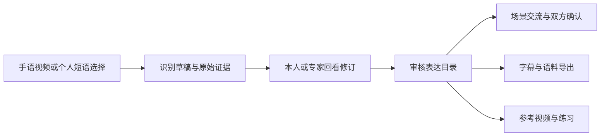

# SignLanguage-Bridge：从识别演示到实用交流工具

> 2026-10-11｜专题决策报告｜目标：兼顾真实使用与中巴竞赛｜证据：原始用户研究、官方产品/部署材料、本地代码与审计。优先级是研究判断，未完成真实用户验收。

## 1. 建议选择什么

建议围绕**“用户可以确认、纠正的手语交流”**发展，用一个审校与语义目录核心支撑两条路线：

- **产品入口：手语视频字幕与语料审校工作台。** 让创作者、教师或研究人员回看视频、修改识别草稿、审核完整表达、导出成果。
- **竞赛主线：限定场景的中巴交流助手。** 从校园/活动接待中选择双方参与者实际需要的任务，以手语识别、图片、短语选择、数字输入和审核回复视频共同完成交流。

若能获得巴西电力服务伙伴，限定客服任务是现有 Libras 数据适配更强的试点候选；若已有中巴校园伙伴，则校园路线优先，但须补采巴西侧表达。**伙伴能否参与真实任务，以及审核资产能否取得，应先于模型名称决定方向。** 这是结合需求、数据和验证成本的判断，不是已证实的市场结论。[1][2][L1][L2]

关键变化是把“模型识别出一个标签”推进到“另一方正确理解并完成一件事”。模型仍重要；确认、否定、数量、回退和用户修改决定结果能否被使用。当前产品假设需要通过后述对照试验检验。

## 2. 哪些新证据改变了方向判断

**中国内容创作者值得成为首批研究对象。** CHI 2026 研究访谈 13 位中国聋人视频创作者，观察到他们结合手语、字幕和图像处理表达与受众理解。作者提出多候选译法与协作修订。这直接启发内容工作台，但不是工具效果证明：访谈实际发生在 2022–2023 年，样本偏向发达地区、较高教育程度，未调查观众接收效果。[1]

**已有部署体现了具体任务。** SWR 2025 年客户报告确认 One Scan 接入 AI 生成 BSL，服务车次、扰动等信息。SignStudio 官方提供后期内容制作及质量检查/人工翻译选项；SignStream 则明确即时输出没有人工语法审核。这些材料支持借鉴受约束信息与审校流程，未证明任意摄像头输入的自由双向会话。[4][5][6]

**本项目的主要缺口已经转到可用闭环。** 当前 12 项中文字幕目录全部为 `draft`，共同语义生产映射为 0；字幕事件具备来源、片段时间、读回和撤销，但还没有完整编辑与持久工程。[L2][L3] GPU 已把同一 8.2 秒完整样例的模型前向缩短到 0.541–0.559 秒、HTTP 上传到 2.069–2.250 秒；这没有验证真实摄像头长流或动作结束到字幕显示的 P95。[L4]

## 3. 六个方向的实际任务与取舍

以下优先级为条件性排序；“入口”表示先验证价值，不表示已经实现。

| 方向 | 谁用、完成什么 | 首版范围 | 最大缺口 | 建议 |
|---|---|---|---|---|
| 字幕/语料审校工作台 | 聋人创作者、教师、语料人员处理自己的视频 | 原视频定位回看、识别草稿、人工修订、审核版本、字幕/清单导出 | 编辑器、持久项目、自然语言审校；实际省时效果 | 产品入口优先 |
| 有限场景交流助手 | 聋人使用者与接待人员完成一个明确服务任务 | 少量完整意图、候选确认、图片与数字输入、回复选择 | 两侧表达审核、未知动作、留出签者验证 | 竞赛主线；有伙伴再试点 |
| 个人短语板与双向参考视频 | 用户表达自己的常用请求，对方给出可理解回复 | 自选短语、完整真人视频、文字/图片、常用表达收藏 | 授权资产与适合本人语言/变体的内容 | 作为交流助手共享组件 |
| 手语练习与教师反馈 | 学习者练习、教师复看作业 | 慢放、录制、并排比较、教师标注反馈 | 错误标注、变体、学习效果；现模型不评教学质量 | 内容与回看先做，自动评分后置 |
| 语料标注/评测工具 | 手语专家与研究团队筛查样本、审核语义 | 草稿分段、重复/缺失提示、边界修订、评测清单 | 专家界面、标准交换、审核工时证据 | 审校台自然扩展 |
| 结构化信息与人工翻译辅助 | 机构发布固定指引，译员/字幕员准备素材 | 审核通知、术语检索、离线草稿和最终人工审定 | 场景内容、目标语言审核、长片处理 | 后续扩展，不先做自由会议通译 |

### A. 审校工作台：更贴近近期可交付价值

建议先选**手语视频→自然文字草稿→本人/专家审校**这一明确任务。逐段显示原视频、原始模型输出与人工修订，允许重复播放和边界调整；保存来源、版本和审核人，输出可继续编辑的字幕或语料清单。与普通字幕工具的差异，应验证是否来自手语片段检索、模型候选、变体与双语审核，而非仅多一个播放器。[1][L3]

**先做内容适配检查：**现有电力词表与 CE-CSL 模型没有创作者自由内容的覆盖验证，不能假定会产生有用草稿。[L1][L4][L5] 试点保留关闭模型、手动编辑/导入字幕的路径，并测量模型到底减少还是增加修改工作。若大量草稿需重写，优先转为贴近现有数据的语料审核工具，或补齐所选主题后再验证创作者辅助；纯手工工具也必须与已有编辑器比较，不能仅因可用就认定有产品优势。

现有 `CaptionLedger` 是实时会话内存记录，默认只保留最近 200 条；长视频需要独立持久项目。当前 CTC manifest 的整片上限为 15 秒/600 帧，长素材须先人工分成协议允许的短片并保留全局时间，再验证草稿流程；不能依赖尚未验收的自动端点。[L3][L5] CTC gloss 还要经过自然语言审校，不能直接作为发布字幕。若创作者实际要处理的是口语视频，应导入外部字幕或另设 ASR 来源，当前 CSL 识别不能承担语音转录。[L5]

ELAN 已支持分层、时间对齐的 gloss/翻译/注释及 EAF 文件。建议做模型辅助的审核层与交换能力，避免把通用标注编辑器全部重建。是否节省时间，要与人工编辑和现有工具比较。[9]

### B. 场景助手：兼顾竞赛与日常使用

首个演示可选“活动接待/校园问路与约见”，例如确认目的地、时间或请求重做。具体表达由双方手语伙伴决定，以下流程只是设计建议，不宣称当前模型已覆盖这些句子：

1. 用户手语输入，或点击本人熟悉的短语/图片。
2. 系统呈现候选完整意图；含否定、时间、地点时分别核对。
3. 本人确认后，对方看到中葡文字或审核过的完整手语参考视频。
4. 对方选择回复/补充信息；另一方核对收到的意图。
5. 不明、未知或误识别时，允许重做、改选、回看和转人工沟通。

首版可用手动结束一个动作或一句，降低端点不可靠对演示的影响；应明确这仍是完整片段识别。现场识别、点击短语与预录回复各自标明来源。演示除成功流程外，还应包含一次未知输入或误识别的修复。[L5]

数据选择要诚实：Libras 候选中，故障 42 条目/1,259 个视频，缴费 23/690，日期 25/749；它们是按源文字分组的待审候选、包含重复，且当前 12 类模型没有缴费/日期类。CE-CSL 校园候选为 50 条记录、49 句，多数具体句仅一次录制；Libras 对应校园表达仍需补采。两边“有某概念”不等于完整句已经配对。[L1]

电力试点可以先研究“请求报修→补充地址/联系方式→工作人员核对草稿”。日期、账户和金额可由触屏/文字输入承担；识别建议不直接执行支付或改变账期。若用户需要书面语言支持，应提供审核视频/图片确认入口，不能默认每个人都能靠中葡文字纠错。

### C. 学习与个性化：有用，但换一套验收目标

Hand Talk 官方提供主题词典、调速、离线访问和学习模块，说明参考与练习产品形态存在；其公开页的方向为葡语→Libras、英语→ASL，不能当作本项目摄像头识别或 CSL 支持证据。[7]

关键点相似度可以提示“这次手腕轨迹与参考不同”，但不能仅凭距离给出“标准手语 95 分”。学习者的错误动作仍可能被分类为正确标签。2024 年 DSGS 研究让 GPT-4 把已有专家错误标注解释成文字，使用 100 个句子与 5 名学习者评价，仍发现漏误说明和虚构参考；它没有验证直接从摄像头发现错误或长期学习收益。[8]

个人常用表达值得保留，可建立本人确认的模板与习惯，但“对这个人适应得好”和“新签者无需设置即可用”必须分别测量。参考视频也应保留自然变体，不能把与单一示范不相似自动认作错误。

## 4. 共用哪些能力，怎样投入才不会重复建设

建议共享四项资产：**授权源视频与人工时间段、版本化审核表达目录、原预测与人工修订记录、任务评测集**。表达目录记录语言、完整意图、适用场景/变体及审核证据；共同 ID 只在两侧专家确认对应关系后启用。[L2]

识别端继续研究“逐帧只提取一次→缓存轨迹→限定动作分类→可靠提交”。225 与 321 维保持独立契约；Libras 的自然葡语文本不能冒充 gloss。原生在线识别要单独训练/验证，EMNLP 2024 方法也包含词典构建与专门模型训练，并非简单截短旧 CTC 输入。[11][L6]

LLM 则放在审核义项之后，承担表达草稿、澄清或解释专家反馈。原始预测保留；不能通过流畅改写补齐缺失动作或自动提高审核状态。目前 `LLMProvider/semantic_assistance` 仍是设计草案。[L7]

## 5. 用什么证据决定是否继续开发

建议按阶段门槛推进，时间取决于伙伴、素材与审核资源，不在此承诺工期。

| 阶段 | 要产出什么 | 继续条件 |
|---|---|---|
| 找到任务 | 两侧真实使用者、完整交流样例、现有替代方法、选定场景；审校台另抽查真实内容覆盖 | 任务确实反复发生，有参与者愿意持续验证；模型草稿适配可用，或手工路径有可测优势 |
| 审核内容 | 少量完整表达、变体、回复、许可与双侧语义审核 | 人工点击/播放路径能让另一方理解，并可修复误解 |
| 加入识别 | 冻结输入协议、独立测试签者、未知/背景样例 | 相比手动路径带来净收益；重要误义、确认负担和拒识率可接受 |
| 产品与竞赛闭环 | 工程保存/读回、真实现场或待处理素材、纠错与导出 | 任务完成证据可复查，现场演示与日常模式使用同一流程 |

**对照试验建议：**交流比较图片/短语板、文字等现有方法与“识别＋确认”；审校比较从空白人工制作与模型草稿辅助，任务顺序交错安排以降低熟悉效应。用未参与训练/调参的签者与素材做最后评估。FluentSigners-50 的独立签者和未见句划分支持这种评测思路，但其 KRSL 成绩不能外推本项目。[10]

记录：另一方实际理解的任务成功率、未被双方发现的重要误义、修复轮数/耗时、总编辑时间、审校后错误、拒识覆盖、各签者差异、动作结束至稳定显示的时延分布。分开报告首用与个性化后结果；主动放弃、回退或转人工也计入总样本。不能把“确认过”本身当作语义正确真值。阈值需由试点伙伴预先约定。[3]

## 6. 哪些条件可能改变建议

- 若已获得长期校园伙伴和双侧补采资源，交流助手可以先于审校台；若只能取得待处理视频，先验证内容工具；若只有算法数据没有真实伙伴，交付语料审核/评测成果更诚实。
- 中巴跨境交流的频次、付费意愿、采购主体、预算尚未证实；美国 32 人调查的商户/自助场景偏好只提供选题线索。[2]
- 巴西医疗研究记录 Libras 使用者沟通困难，但没有评估自动翻译效果。需求严重不能自动推出自由医疗通译适合首发；此类任务应独立研究专业流程。[12]
- 授权需落实到素材与使用方式。VLibras 2026-08-27 条款限制官方工具/头像/输出用途，其中品牌、头像或服务用于商业/广告等场景须事先授权；某文本组件另有 LGPLv3。开源代码、托管服务、头像与源视频不是一项统一授权。本报告未作完整法律审查或完成接入。[13][14]
- 企业材料证明公开功能说明，SWR 报告证明部署存在，都不构成独立准确率或本地产品效果。SignStudio 同页对 AI ASL 当前可用性有冲突，未据此推荐具体套餐。SignAll 当前资料访问不足，未作为推荐依据。
- 本轮没有用户访谈、竞品实测、模型训练、摄像头任务验收或支付意愿调查；原始候选视频未逐条重新判读。WFD 强调社区参与、数据所有权、透明度与实际表现，试点应让使用者参与任务选择和表达审核。[3]

**方向判断：近期同时建设可用的审校与表达目录核心，竞赛只选一个完整交流任务展示。** 如果识别无法比手动短语/图片路径减少负担，就调整识别入口；如果审核后的表达仍不能让另一方正确理解，就先改内容与交互。用这些结果决定扩大场景与词表，而不是用模型速度或标签数量代替实用性。

## 参考文献

[1] Tang & Piper. CHI 2026. [Chinese Deaf Online Content Creators](https://arxiv.org/html/2602.10235v1). 方法/设计/局限；作者稿。
[2] Tran, Ladner & Bragg. ASSETS 2023. [U.S. Deaf Community Perspectives on Automatic Sign Language Translation](https://danibragg.com/papers/Automatic_Sign_Language_Translation_Perspectives.pdf). 美国观点调查。
[3] WFD. 2025-08-12. [Artificial Intelligence and Sign Languages](https://wfdeaf.org/artificial-intelligence-and-sign-languages/). 会议报告。
[4] South Western Railway. [Customer Report, March 2025](https://www.southwesternrailway.com/-/media/files/other/about-us/customer-report/customer-report-march-2025.pdf). 部署方报告。
[5] Signapse. [SignStudio](https://www.signapse.ai/signstudio-platform). 当前官方产品页；语言套餐说明存在冲突。
[6] Signapse. [SignStream API](https://www.signapse.ai/signstream-api). 当前官方产品页/FAQ。
[7] Hand Talk. [App](https://www.handtalk.me/en/app/). 当前官方功能说明。
[8] Battisti & Ebling. LAW 2024. [Annotation Elaboration as Feedback](https://aclanthology.org/2024.law-1.5.pdf). 原始小规模实验。
[9] The Language Archive / MPI. [ELAN](https://archive.mpi.nl/tla/elan). 官方工具描述。
[10] Mukushev et al. PLOS ONE, 2022. [FluentSigners-50](https://journals.plos.org/plosone/article?id=10.1371/journal.pone.0273649). 原始数据集研究。
[11] Zuo, Wei & Mak. EMNLP 2024. [Towards Online CSLR and Translation](https://aclanthology.org/2024.emnlp-main.619/). 原始模型研究。
[12] Moraes et al. Cadernos de Saúde Pública, 2025. [Access to healthcare services](https://scielo.br/j/csp/a/f7xLDvF3cHXKJhzJBLTndLh/abstract/?ilang=en&lang=en). 巴西横断调查；本轮依据摘要/表1。
[13] VLibras. [Terms of Use and Privacy](https://www.vlibras.gov.br/privacy.html). 更新2026-08-27。
[14] VLibras. [translator-text-core LICENSE](https://github.com/spbgovbr-vlibras/vlibras-translator-text-core/blob/dev/LICENSE). 该组件许可，不延伸其他资产。

## 本地证据

本轮读代码/JSON与既有审计；数据计数未等同重新观看验证。工作基线：`de316f5`。保留已有未提交材料。

- [L1] [场景候选审查](/E:/githubproject/SignLanguage-Bridge/docs/中巴手语竞赛_场景语义覆盖审查_2026-10-09.md)及候选CSV；本轮重算分组。
- [L2] [共同语义JSON](/E:/githubproject/SignLanguage-Bridge/docs/reports/cecsl-libras-semantic-review-2026-10-09.json)与[字幕目录](/E:/githubproject/SignLanguage-Bridge/slbridge/resources/libras_caption_catalog.json)；本轮核对审核状态。
- [L3] [CaptionLedger](/E:/githubproject/SignLanguage-Bridge/slbridge/caption_events.py:15)、[API](/E:/githubproject/SignLanguage-Bridge/slbridge/api.py:605)、[桌面显示](/E:/githubproject/SignLanguage-Bridge/slbridge/desktop.py:171)。
- [L4] [GPU验证](/E:/githubproject/SignLanguage-Bridge/docs/reports/ctc-gpu-inference-2026-10-11.md:3)及[自动字幕证据](/E:/githubproject/SignLanguage-Bridge/docs/reports/auto-captions-2026-10-11.md)。
- [L5] [分段到整片推理](/E:/githubproject/SignLanguage-Bridge/slbridge/session.py:327)、[CTC接口与验证](/E:/githubproject/SignLanguage-Bridge/docs/CE-CSL_TFNet_ONNX接入与验证_2026-10-09.md)及[当前模型manifest](/E:/githubproject/SignLanguage-Bridge/artifacts/models/cecsl-tfnet-onnx-20261009/manifest.json:30)。
- [L6] [特征与标签审计](/E:/githubproject/SignLanguage-Bridge/docs/Libras新增特征数据_算法策略与执行路线_2026-10-10.md)、[模型契约](/E:/githubproject/SignLanguage-Bridge/slbridge/contracts.py:341)；另一训练工作树仅为独立研究实现。
- [L7] [中葡表达辅助设计](/E:/githubproject/SignLanguage-Bridge/docs/LLM中葡表达辅助智能体_设计草案_2026-10-11.md:3)。

逐线程来源、支持摘述与未决项见本目录 `research-notes/task-a.md` 至 `task-d.md`；本报告的方向优先级为负责人综合判断。
