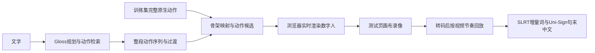

# 数字人手语：当前缺陷、证据与改进计划

归档日期：2026-11-12（Asia/Taipei）。用途：后续开发、实验复现与验收交接。本文是截至该日的状态快照和计划；历史成绩保留在原报告中，新实验另建目录和报告，不覆盖本基线。

**当前结论：数字人可以由动作数据驱动并在浏览器实时渲染，但动作语义、稳定回认和直接实时采集链路尚未通过验收。** 已尝试的放大画面、慢放、放宽避碰及手腕位置校准均没有形成可默认接入的完整改进。识别失败是问题证据，不能单独证明数字人动作不规范，也不能单独证明识别模型不适应数字人。

## 1. 实际架构与测试口径

当前快速表达路径为：文字规划为 Gloss → 检索已有词动作或完整原句动作 → 组合并生成过渡 → 骨架重定向 → 浏览器 `MotionStage` 根据播放时钟插值并实时渲染。可选完整动作生成路径先完成整段生成任务，再加载播放；当前不具备边输入文字、边连续生成动作帧的验收结果。

图中“画布录像 → 按节奏回放”是最近几轮的测试方法。产品数字人并非播放该录像；测试也不等于数字人画面直接送入识别器的实时监控。录像、转码、回放与真实摄像头的采集延迟、丢帧和端到端体验必须另测。

统一报告规则：

- 词序列完全匹配、词级 WER、句末文本完整匹配、非空率、请求完成率分别统计，不能合成一个“准确率”。WER 越低越好；句末结果是含活动/词证据门控的整条实时链路成绩，不能当独立 Uni-Sign 准确率。
- 文本主口径使用项目 P1 的 NFKC 与去空白，不做同义改写；其他标点或语义口径只能另列。空输出计入预定样本分母；请求失败和缺失素材单列，不能当作模型空输出或静默删样。
- 动作准备与渲染可以使用源词元数据；识别请求只包含画面和协议字段，不传目标文字、标注或参考答案。LLM 在本批主实验中关闭；辅助建议、人工编辑和确认均不得混入模型成绩。
- 词和句分数不是经校准的正确概率。模型能识别回来、动作能播放、关键点存在、几何误差下降及有限碰撞采样通过，都不能替代手语人员对手形、掌向、接触位置和表达含义的审核。

## 2. 冻结结果与证据索引

### 2.1 主回放结果

| 输入批次 | 数据范围 | 最终词完整匹配 | 词 WER | 句末文本完整匹配 | 无词/句输出 |
| --- | --- | ---: | ---: | ---: | ---: |
| 真人训练视频复核 | 30 条、8 位签者，已见短训练视频 | 11/30 | 18.90% | 29/30 | 0/30 |
| 数字人完整单词动作 | 25 条、8 个词、3 位源签者 | 6/25 | 76% | 8/25 | 14/25 |
| 数字人完整多词动作 | 30 条、8 位源签者，与真人批按 ID 对应 | 0/30 | 90.16% | 4/30 | 7/30 |

25 条单词与 30 条多词动作没有源样本 ID 重叠，合计 55 个已见训练来源样本；协议、词数和签者分布不同，不合并成一个总体识别率。真人批与多词数字人批虽然同源，画面、动作重定向、裁剪和时序仍不同，不能仅凭差值认定单一原因。单词源清单预定 26 条，其中 `S000444_P0000_T00` 本地 native LMDB 缺失，实际完成 25 条；不是 26 条全部跑过。

本次文档归档读取既有机器汇总，保存了[关键指标及源文件 SHA 快照](../../reports/evidence/avatar-motion-quality-2026-11-12/summary.json)。该快照是已有实验结果的导入摘要，不是新一轮推理或完整原始媒体包。

### 2.2 已尝试的改进

| 试验 | 实际观察 | 截至归档日的决定 |
| --- | --- | --- |
| 固定放大数字人画面 | 25 单词词 WER 76%→80%，句匹配 8→9；另一批 30 多词 WER 90.16%→83.46%，句匹配 4→3 | 有取舍，未接入默认配置 |
| 对实时空输出补跑完整视频 | 事后选 14 条空输出，整段翻译匹配 5 条；静止数字人被误译“腰酸背痛。” | 不能直接取消门控或自动采纳非空译文 |
| 0.5 倍慢放 | “谢谢”“我想睡觉”两例均无有效词/句 | 单例未见改善，不推广到其他速度或词 |
| “我想睡觉”避碰精修 | 305 个插值时刻核心点命中 61→0，相邻修正跳变约 0.0583→0.0140；最大偏移约 0.0795，超过原 0.06 限制；识别仍无输出 | 研究候选，未接入；不是全网格无碰撞或语义通过 |
| 训练姿态驱动的手腕校准 | 30 条按签者分 17 拟合/13 保留；8 条真实重渲染候选中 6 条受限修正、2 条回退；保留签者 4 条手腕偏差 0.462→0.437 肩宽，WER 81.58%不变；拟合签者句匹配 1/4→0/4 | 候选验收未通过，未替换产品动作 |

上表的肩宽单位、角色世界单位及真实人体厘米不可混用。“0.461→0.303 肩宽”的理想二维坐标拟合成绩不是实际渲染改进；实际八段对照以[姿态迭代报告](../../reports/avatar-retarget-iteration-2026-11-12.md)为准。

| 证据 | 报告 | 原始产物目录（模型主检出的 `artifacts/` 下） |
| --- | --- | --- |
| E01 真人训练视频复核 | [30 条复核](../../reports/train-realtime-recheck-2026-11-12.md) | `train-realtime-recheck-20261112/` |
| E02 同源“谢谢”与组合动作 | [单例对照](../../reports/avatar-human-recognition-comparison-2026-11-12.md) | `avatar-human-compare-20261112/`、`avatar-sleep-compare-20261112/` |
| E03 单词数字人批量回认 | [25 条结果](../../reports/avatar-train-recognition-2026-11-12.md) | `avatar-train-eval-20261112/`，含 `repeat/` |
| E04 完整句、构图与无动作对照 | [扩展试验](../../reports/avatar-train-sentence-expansion-2026-11-12.md) | `avatar-train-sentences-20261112/`、`avatar-train-crop-probe-20261112/`、`avatar-train-sentences-crop-20261112/`、`avatar-empty-gate-probe-20261112/` |
| E05 几何避碰候选 | [交叉核对](../../reports/avatar-crosscheck-optimization-2026-11-12.md) | `avatar-sleep-clearance-candidate-20261112/`、`avatar-sleep-refined-20261112/` |
| E06 基于姿态的动作迭代 | [八段候选与评估工具](../../reports/avatar-retarget-iteration-2026-11-12.md) | `avatar-retarget-iteration-20261112/`、`avatar-retarget-candidate-20261112/` |

原始目录内应保留冻结清单、输入和源文件摘要、视频、原始词/句事件、逐条表及汇总；目录存在不等于所有验收范围通过。外部模型、数据与大视频并非随文档自动具备，换机复现须验证本机资产。

## 3. 当前缺陷与能力缺口

优先级 P0 表示后续优化结论的前置可信条件，P1 表示直接影响动作或识别验收，P2 表示后续覆盖和运行维护。优先级不是已经定位了原因。以下均不得写作“已修复”。

| ID | 优先级 | 缺陷/缺口及状态 | 已有证据与影响 | 后续任务 |
| --- | --- | --- | --- | --- |
| AV-01 | P0 | 真人视频与 native 动作未严格时序对齐；待验证 | 帧数不同，当前仅起终点线性暂配准、每段取 9 个点；可能把时间偏差算成位置偏差 | M1 |
| AV-02 | P0 | 重录画面存在变体；可重复性不足以支持动作单因果归因 | 同一“谢谢”两份相近录制各重复识别 3 次，分别稳定误识别与稳定无输出；回退原动作的重录也可能换词 | M2 |
| AV-03 | P1 | 数字人回认质量低；验收未通过 | E03/E04 的大量空输出和漏词；多词批 254 个参考词漏 199 个 | M3、M4 |
| AV-04 | P1 | 手形、掌向、身体相对位置和整句含义缺少手语人员审核；未验收 | 2D 估计、源动作拟合和模型回认都不构成独立语言真值 | M1、M3、M6 |
| AV-05 | P1 | 动作修正与接触/可达性冲突；候选未通过 | 全幅手腕修正 6/8 段增加核心命中或产生 IK 夹限；减幅后仍有 2 段回退 | M3 |
| AV-06 | P1 | 几何改善未转化为稳定词/句改善，且有语义回退 | “今天发钱……”被改成“今天放假……”；保留签者词 WER 不变 | M3、M4 |
| AV-07 | P1 | 输入尺度/构图调整存在指标取舍；原因待定位 | 放大减少部分漏词，却增加部分替换/多词或使正确句变错 | M2、M4 |
| AV-08 | P1 | 自动句界和无效动作拒答仍有失败 | 真人小猫句后误追加；完整片段路径对静止人物和静止数字人生成无依据文本 | M4 |
| AV-09 | P1 | 表情、口部及空间变化等通道未完整映射；影响未量化 | 动作接口将相关通道列为未映射/未审核，尚未单独消融 | M3 |
| AV-10 | P2 | 产品动作库包含不同 split、素材缺失和组合上下文风险；覆盖待审核 | “我想睡觉”由多个源词组成且含 dev 素材，标记为 product-demo；本轮 1 个单词源缺失 | M0、M6 |
| AV-11 | P1 | 数字人直接实时采集及真实摄像头端到端尚未验收 | 本批使用画布录像后按节奏回放；服务输入零丢帧不能证明浏览器/摄像头零丢帧 | M6 |
| AV-12 | P2 | 用户原始“我想睡觉→绿色”录制未复现 | 历史路由和现用路由不同，未取得该次实际输入；不能归因用户动作或本批数字人现象 | M6 |
| AV-13 | P2 | 长时吞吐退化根因仍未定位 | 曾在约 22.8 小时旧服务上普遍过载，同代码/权重重建可恢复；ready 不等于吞吐稳定 | M6；见[训练应用现场](../../reports/training-application-validation.md) |

已知工程机制与缺陷要分开：来源/帧索引校验工具和模型调用链已经有实现，不代表表中动作质量或真实场景验收完成。

## 4. 计划改进与交付物

以下为计划，尚未执行的条目不记为 PASS。后续开发以依赖顺序推进，不因某一个分数上涨跳过负控或语言审核。

### M0：冻结证据与评估入口（部分完成）

- 已有：30 条同源数据身份、17/13 签者隔离、低置信点过滤、时序反转对照、缓存/源文件/帧索引绑定及命令行评估工具；本轮工具定向测试和既有导出测试共 8 passed，只验证机制。
- 待交付：统一的批次清单，显式记录源 split、样本/签者/源句 ID、动作参数、人物/代码/模型/配置摘要、渲染和编码参数、人工审核状态；列出缺失与失败项。
- 验收条件：来源或缓存被替换、训练/保留签者或源句重叠、帧索引错配、保留组无有效点时拒绝出具完整结果；原始失败记录与历史结果保留。当前 55 个源样本均为已见诊断数据，不能再称未见验收集。

### M1：核实时间与空间对齐（下一优先任务）

- 在固定的 8 个不同签者代表样本上标出动作开始、主要动作/接触、结束等可见时间锚点，保存标注者、原视频时间戳、native 索引、依据与不确定性。时间标注与手语语义审核分别记录。
- 结合全段运动轨迹估计映射，输出每段的覆盖、残差、有效点数、被排除点数与低可信原因；线性映射、受限动态对齐及人工锚点分别比较。不得用任意拉伸获得更小误差后反称原动作正确。
- 拟定首轮目标：经人工核对的锚点至少 95% 落在 ±2 个源视频帧内；这是计划目标，尚未实测。未达标的映射标为不可靠，不进入自动动作拟合。时间反转、错源匹配应独立留作负向对照。
- 交付：`time-alignment.json`、标注依据、逐段诊断和固定保留样本清单；之后再重新计算手腕/手形/掌向指标。

### M2：建立可重复的渲染与 A/A 对照（待实施）

- 固定角色、相机、视角、DPR、画布尺寸、源动作时钟、插值、帧序号、编码与预留/尾部时间；记录每个识别帧对应的源动作时间，而非仅记录录像总 FPS。
- 同一视频文件至少重复识别 3 次，比较原始词/句语义事件；另对相同动作重渲染至少 3 次，度量画面差异、点轨迹差异和输出变动。两种对照不可互相替代。
- 固定时钟渲染用于控制变量，正常播放/直接实时采集用于体验验收。先冻结 A/A 波动范围，再做 A/B；差异没有超过该范围或存在输入漂移时，只报告相关现象，不归因某一动作参数。
- 交付：带帧时间绑定的采集器、A/A 基线、已知正确和已知失败回放包。

### M3：在约束下优化动作映射（依赖 M1、M2）

- 优先校准肩肘腕、手形、掌心方向及手与身体的相对位置，保留手指局部旋转、接触关系、关节可达性和原始动作。单纯统一平移手腕不再作为已证实的通用修复。
- 将身体避让、手间/指间接触、服饰遮挡和插值时刻一起检查；核心椭球采样与全网格检查分别报告。不得把“命中数不增”写成“无穿模”，也不得为了消除碰撞静默扩大偏移限制。
- 原产品约 0.06 的避让预算与上一轮候选相对原动作额外 0.03 的研究上限是不同约束；未来候选须同时披露总偏移、额外偏移、相邻变化和回退段，不继承语言批准。
- 验收条件：在新的冻结保留样本上，预先指定的姿态指标改善、几何约束不回退、被影响表达通过手语审核；未知语义保持为未审核。原先正确表达变错即为回退，不能用平均分抵消后直接接入。
- 交付：独立候选参数/轨迹、完整来源、逐段 A/B、回退理由、审核记录；通过前使用隔离入口。

### M4：改进识别前端、窗口和拒答（依赖 M2，可与 M3 分开研究）

- 分别检查数字人渲染出的真实关节、图像估计的身体/双手关键点及识别前处理，定位遮挡、尺度、方向、估计器替换或分段造成的漏词；存在率不能代替关键点精度。
- 每轮只调整一个受控因素：画面框选/留边、时间窗口/投票、句界或受限的二次识别。冻结主指标与拒绝条件后再看保留集，不按目标文字挑输出，不将 LLM 当正确性裁判。
- 负控必须含黑帧、静止真人、静止数字人及非手语动作，分别统计误输出；“小猫在桌子下面”句后误追加作为固定回归样本。不能以取消门控或接受全部非空文本换取覆盖率。
- 验收条件：固定协议下报告 Gloss WER、词/句完整匹配、空输出、错误追加及误接受；保留集词指标改善且句末和负控不回退。真人旧批的 29/30 句匹配和 18.90% WER 是回归参照，只有输入协议一致时才能比较。

### M5：必要时做数字人域适配（待前述定位后决定）

- 若对齐可靠、动作经审核后仍存在显著域差异，再尝试数字人/真人混合训练、轻量适配或蒸馏。用训练 split 生成训练数据，按源句和签者隔离；重新渲染的同源变体不得跨训练与验收集合。
- 首轮新增不少于 30 个与当前 55 个源样本及源句 ID 不重叠的冻结样本作为下一轮样本目标；其中保留批在参数固定前不参与选择。来自历史已测语料时标明已见，不称新盲测。官方 dev/test 不得混入训练选材。
- 验收条件：与冻结基线成对比较，数字人主指标有改善、真人识别和负控不退化、资源与实时延迟合格；不能仅凭训练集拟合分数替换模型。

### M6：直接实时链路与产品验收（候选通过后）

- 将数字人画面直接按采集时钟送入识别链路，与录像回放成对比较；再做实际浏览器、摄像头与用户跟练。分别记录开始到首词、采集起点到首词、停顿到句末、队列、编码和采样跳帧。
- 用户体验目标仍为动作过程中约 1–2 秒出现词、停顿后补句；该目标不是本批录像回放已经通过的承诺。空输出和超时同时报告，不能只对有结果的样本计时。
- 持续运行前后保留进程身份、配置和性能摘要，复查既有长时退化；重启恢复不算根因修复。对用户原“我想睡觉→绿色”需以实际输入和模型路由独立复现，不用新模拟替代。
- 交付：人工手语审核、真实端到端验收、候选与基线版本/配置摘要、回退方式和未通过项；未通过的候选保持隔离，不把本地测试写成发布、合并或远端 CI 通过。

## 5. 代码、资产与接续入口

| 内容 | 本机位置及状态 |
| --- | --- |
| 模型/API 主检出 | `E:/githubproject/SignLanguage-Bridge`；分支 `codex/model-contract-auto-captions`，本次归档时 HEAD `782dee3f128f727373dcdd3e4c2590d7bdc987da` |
| 数字人/产品检出 | `C:/Users/ADMIN/.codex/worktrees/csl-animation-workspace/SignLanguage-Bridge`；分支 `codex/local-godette-v14a-demo-20261107`，本次归档时 HEAD `ca20cbb94acf6cc26c02e07db78ced165d41393c` |
| 动作评估模块 | [retarget_pose_evaluation.py](https://github.com/betterway614/SignLanguage-Bridge/blob/codex/realtime-product-20261112/slbridge/animation/retarget_pose_evaluation.py) |
| 命令行入口与测试 | [evaluate_retarget_pose.py](https://github.com/betterway614/SignLanguage-Bridge/blob/codex/realtime-product-20261112/scripts/animation/evaluate_retarget_pose.py)、[test_retarget_pose_evaluation.py](https://github.com/betterway614/SignLanguage-Bridge/blob/codex/realtime-product-20261112/tests/test_retarget_pose_evaluation.py) |
| 渲染/动作映射 | [stage.js](https://github.com/betterway614/SignLanguage-Bridge/blob/codex/realtime-product-20261112/slbridge/animation/web/stage.js)、[retarget.js](https://github.com/betterway614/SignLanguage-Bridge/blob/codex/realtime-product-20261112/slbridge/animation/web/retarget.js) |
| 使用说明 | [当前入口](../../animation-current-status.md)、[实时识别](../../realtime-csl.md) |

两份检出均有既有未提交改动；HEAD 不是完整实验源码快照，复现仍须以各运行清单中的代码/资产摘要为准。评估工具是本地新增代码，不代表已推送或部署到其他环境。服务能力可用与本计划验收是不同状态，本次文档归档不新增运行、模型或摄像头验收结论。

归档时的实验身份：数字人 Godette v14A SHA-256 `535fc9ab96ec3d837e2568817abc41d593fac1c4fcad8565b45b29c5f4472f5e`；SLRT checkpoint `e9fdd3a66d9667e7685c2b1437c67b8cbc9e45d2562730f04c0226717b7cbd4d`；Uni-Sign 句末模型 ID `uni-sign-csl-daily-pose-only-182913ca`。这些身份来自已完成实验记录，下一轮开始前须重新核验。
