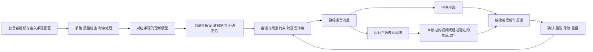
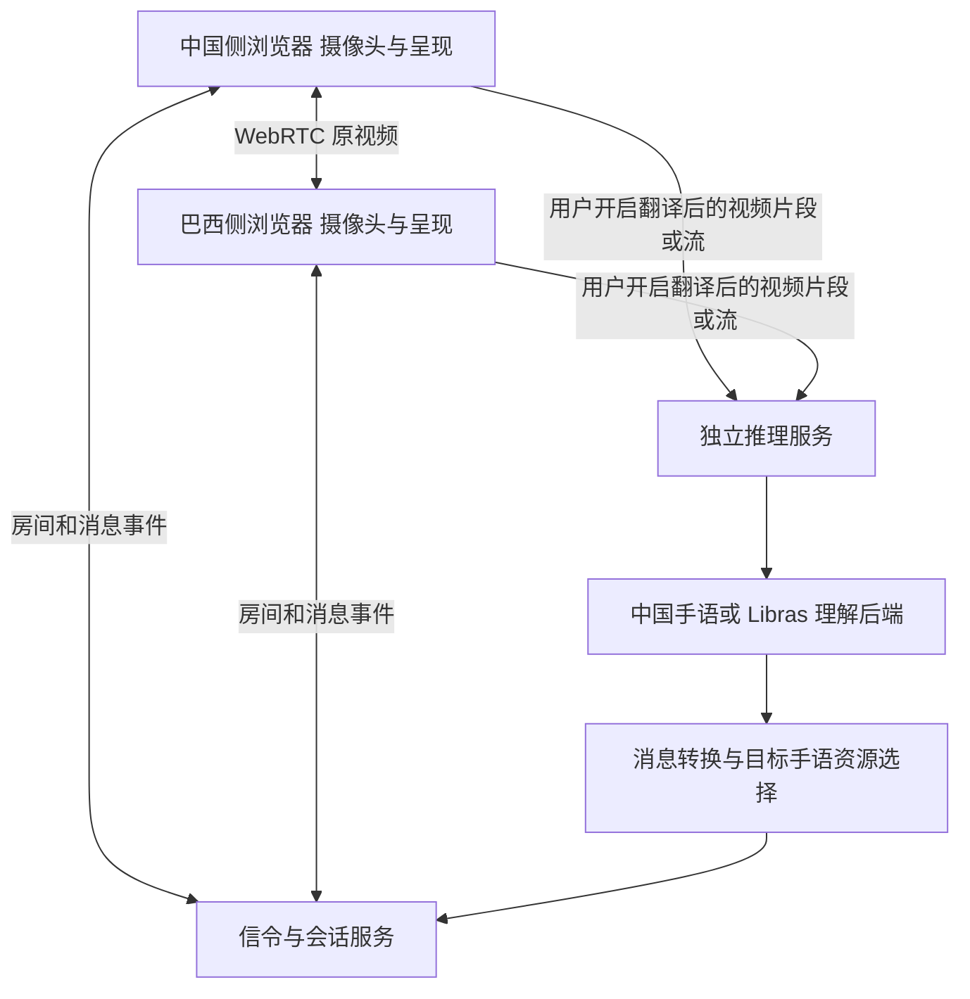

# 中巴手语实时交流：总体架构与路线图

日期：2026-10-09（Asia/Shanghai）。状态：总体规划，尚未实施。

> 最新优先级：用户决定先定核心架构与开发顺序，暂不按具体使用场景推进。近期以 [核心框架设计](核心框架设计_2026-10-09.md) 的 F0–F3 为准；本文的远程视频与场景路线保留为后续产品方向。

## 1. 目标重新定位

最终目标：**让使用中国手语与巴西手语 Libras 的用户，在不同场景下进行双向、低延迟、可纠错的交流，并按个人偏好接收手语、字幕或两者。**

上一版 [Libras 识别 Demo 规划](Libras识别Demo_后续开发规划_2026-10-09.md) 作为早期工程验证子计划保留。它的 12 条目、RF、完整片段识别是第一条验证路径，不限定最终词表、模型、产品形态或输出能力。后续范围与依赖以本总体规划为准。

将长期工作分成四项语言能力和一套共享交流系统：

| 能力 | 输入 → 输出 | 当前定位 |
|---|---|---|
| 中国手语理解 | 中国手语视频 → 源语言含义／文本／可选 gloss | 尚无已核验的相应数据与模型能力，需补数据 |
| Libras 理解 | Libras 视频 → 源语言含义／葡语文本／可选 gloss | 已有 RGB 语料，可先开展基线 |
| 中国手语表达 | 待表达的含义 → 合适的中国手语呈现 | 需审核过的视频资产，后续研究生成 |
| Libras 表达 | 待表达的含义 → 合适的 Libras 呈现 | 识别语料不自动等同于可发布的表达资产 |
| 共享交流系统 | 会话、场景、双语转换、纠错、流式事件、播放与评估 | 可先用明确标识的文本输入／测试事件开发 |

语言配置必须分开：输入手语体系、目标手语体系、界面语言、字幕语言、地区／变体偏好。不能根据国籍自动确定用户手语，也不能把中国手语简单等同于汉语、Libras 等同于葡萄牙语。

现有 `desktop_app.py` 使用 A–D 的静态显示表和单手输入。中文 UI 或中文输出字段不证明权重已经掌握中国手语；旧样本来源仍待确认。将旧模型登记为 `legacy_ad_demo`，保留其可复用流程，不赋予未经验证的语言能力。

## 2. 不同场景如何共用系统

“交流内容场景”和“设备使用方式”是两个独立维度，避免每换一个场景就复制一套应用或从头训练完整模型。

| 内容场景 | 首批表达范围 | 主要难点 | 规划位置 |
|---|---|---|---|
| 日常面对面 | 问候、表达需求、询问位置、重复／澄清 | 表达自然且多样，环境变化较大 | 可作为首个有限场景 |
| 服务窗口／办事咨询 | 请求服务、查询、确认／否定、日期和事项 | 场景术语、关键信息保真、确认流程 | 现有 Libras 电力服务语料可支持部分验证 |
| 出行／购物 | 地点、方向、数量、价格、时间 | 数字实体、遮挡、移动设备 | 有限场景验证后扩展 |
| 教育／工作交流 | 连续解释、多人轮流发言、长上下文 | 长句、专业词、轮次管理 | 连续理解稳定后接入 |

用户已选定第一轮使用方式为 **远程视频交流，双方各用自己的设备**。内容范围暂定简短问答、需求表达与澄清，具体意图在用户访谈／试采时冻结。利用电力客服数据验证算法，并不意味着最终产品只能服务电力场景，也不应把与目标场景不相关的电力词表当作日常交流验收集。

| 设备方式 | 交互设计 | 共享部分／新增部分 |
|---|---|---|
| 面对面、共用一台设备 | 显式切换 A/B 发言方，先轮流输入；必要时使用两个视角 | 复用会话核心；不能假设一个前置摄像头自然同时看清两人 |
| 面对面、各用一台设备 | 每人看到自己的识别反馈和对方的目标语言呈现 | 加入配对／连接与消息同步 |
| 远程双设备 | 原视频与翻译辅助并存，支持重连、重播、纠错 | 增加网络传输、延迟／乱序处理；不依赖人脸识别决定发言者 |
| 弱网／离线 | 本地可用模型与已缓存词汇／手语资产，明确可用范围 | 部署配置切换；不能把云端不可用伪装为“用户手语不正确” |

首个用户验证不预设所有听障用户愿意或能够依靠文字交流；需要记录字幕、手语视频、字号、播放速度、界面布局等偏好。用真实任务理解度检验这些设计。

## 3. 总体技术路线

推荐以**可检查的分层链路**为产品主线，并保留端到端模型实验入口。

| 方案 | 优势 | 代价／适用边界 | 决策 |
|---|---|---|---|
| 分层理解 → 消息 → 跨语言表达 | 可分别训练两种手语，可定位错误，可用有限场景先交付 | 阶段间可能累积错误，需要保留原始证据与不确定性 | 产品主线 |
| 共享视觉编码器＋语言专属解码头 | 可研究知识迁移、减少重复计算 | 对标签定义、训练平衡和迁移效果有额外要求 | 有两侧数据后做对照实验 |
| 直接中国手语 ↔ Libras 的端到端模型 | 可能减少人工中间表示的限制 | 缺可信跨手语对齐数据、流式输出和可理解性评价难度高 | 后续独立实验，验证后接入同一会话接口 |

近期已有同时手语到手语翻译的研究，但其论文结果不能当作本项目已具备中国手语／Libras 双向能力的证据。可将其延迟与质量权衡作为后续实验参考。[Simultaneous Translation between Sign Languages，2026-09-28 预印本](https://arxiv.org/abs/2609.35608)

A→B 与 B→A 都走这套逻辑，分别选择源手语模型与目标表达资源。独立保留每位参与者的流状态、消息顺序、语言偏好和反馈。

### 3.1 中间表示要能演进

有限场景可以使用 `intent + slots`，例如请求某项服务并带日期；开放表达保留完整 source_text、候选解释、引用的视频时间段和上下文。gloss 是可选的语言内标注／模型输出，不要求所有数据集都有，更不把两种手语的 gloss 当作通用编码。

`semantic_id` 只适合经过审核的有限语义目录。它不能独立表达否定、疑问、指代、时态、数量和自由组合句子，也不能替代自然语言语义理解。

场景配置只提供术语、允许操作、实体类型和消歧线索，不强迫把所有输入归到一个已知意图。识别器不知道的内容仍应能返回不确定／词表外。

### 3.2 翻译与对话模型的边界

有限场景优先采用审核过的语义映射和模板；开放文本阶段再比较文本翻译或语言模型。翻译模块只转换表达，不替对话中的用户作答。日期、金额、数量、姓名、否定词等必须保留出处；低置信度片段不能靠上下文编出缺失的关键信息。

视觉置信度、翻译质量分数与输出资产审核状态分别记录，不能简单相乘后声称得到“整体准确率”。一侧识别出错、跨语言转换出错、目标动作表达不清，应当能分别定位。

## 4. 让模型可替换，而不锁死为 RF

RF 是一种分类后端，不是最终系统架构。未来变化可能同时涉及输入模态、视觉 backbone、时间编码器、预测头、损失函数、解码策略和流式能力，不能只设计一个 `predict(flat_array)` 接口。

### 4.1 分层契约

| 层／对象 | 必要信息 | 不应绑定的内容 |
|---|---|---|
| Observation | source_id、时间戳、RGB 或可选关键点／mask、输入手语与质量信息 | 固定 30 帧、固定 63 维、必须仅有骨架 |
| ModelCapabilities | 输入 schema、支持手语、task_type、词表／分词器版本、clip/stream、lookahead、状态格式 | 界面显示文案 |
| UnderstandingHypothesis | 候选分类／gloss 序列／文本、置信信息、视频范围、partial/final、模型版本 | 假设所有模型都有类别概率 |
| ConversationMessage | 会话、发言方、消息 ID、revision、source_text、target_text、可选 intent/slots、证据与状态 | 指定某个深度学习框架 |
| PresentationPlan | 目标手语／文本语言、输出方式、asset_id 或生成任务、审核／可用状态 | 与识别标签相同的文件名 |

核心入口按能力区分完整片段推理与流式会话：支持 begin/feed/end/reset 的模型才能直接加入实时流。RF 适配器可以在片段结束后给出最终分类，但不能将它声明为边看边译。UI 和会话层消费统一事件，不直接调用 estimator.predict_proba。

模型权重、预处理、标签／tokenizer、输入模态和运行配置一起发布；不支持某项能力时返回明确状态。更换为 RGB 模型不应被迫先压成关键点；加入面部特征不能破坏旧缓存。

### 4.2 候选模型路线与实验问题

具体模型优先级、输入适配、首批实验与升级门槛见 [Backbone 模型选型与实验路线](Backbone模型选型与实验路线_2026-10-09.md)。近期先比较 RF、轻量 TCN 和轻量 ST-GCN，中期评估预训练 RGB＋关键点双流；最终型号以本地数据和双路在线测试决定。

| 数据／任务条件 | 候选方案 | 要回答的问题 |
|---|---|---|
| 小词表、完整动作 | RF、轻量 TCN／GRU 等 | 在同一数据与 split 下，时间建模是否值得额外成本？ |
| 孤立词规模扩大 | 骨架时序模型、图结构模型、预训练 RGB 编码器 | 手形细节与身体运动分别贡献多少？ |
| 连续手语识别 | 时间编码器＋序列解码；有 gloss 标注时可评估 CTC | 能否从完整序列识别词序，错误来自分段还是识别？ |
| 手语到自然文本 | RGB／骨架／面部多模态编码器＋文本解码器；有无 gloss 分别设计 | 能否保留否定、数量和完整含义，而非只命中关键词？ |
| 流式理解 | 因果或有限前视的时序模型、明确读入／输出策略 | 在给定延迟预算内，稳定输出质量如何？ |

RGB＋关键点双流已有可参考的研究实现思路，但其发表时的基准成绩不能直接推断本地词表的效果。[Two-Stream Network for Sign Language Recognition and Translation](https://arxiv.org/abs/2211.01367)

实验优先级应是：冻结数据与任务 → 保留简单基线 → 比较一两个有明确动机的模型 → 测质量／延迟／资源 → 决定部署。不能默认 RF→LSTM→Transformer 每次都更适合产品。

### 4.3 原始数据与特征存储

保留原 RGB 和关联标注，关键点仅作为可重建的派生缓存。手、身体、面部、时间戳、可见性、左右手与镜像约定均可版本化。缓存按内容 hash＋提取器／预处理版本寻址，避免模型实验反复破坏原始数据。

上一版完整片段 64 帧重采样与整段肩宽统计可用于 clip 基线；它们依赖动作结束后的信息，**不能原样用于严格流式评估**。流式路径必须另定基于已观测前缀的尺度估计、有限历史缓存和前视上限，并使训练时的信息条件与推理一致。

## 5. 数据统筹：现在有 Libras，怎样推进双向能力

### 5.1 四类数据分别建立台账

| 数据类型 | 用途 | 最低标注／证据 |
|---|---|---|
| 单语言手语理解数据 | 各自训练中国手语／Libras 模型 | 原视频、体系与变体、源语言标注、签者与来源分组、任务类型 |
| 跨语言场景对齐数据 | 保证两边表达的是同一交流需求 | 经双方审核的含义、自然表达、意图／实体、可接受变体 |
| 目标手语表达资产 | 将理解结果呈现给另一方 | 完整视频／动作、目标体系、语义适用范围、审核与使用条件 |
| 真实对话与负例数据 | 测试交流而非离线分类 | 多轮任务、原始流时间、确认／纠错、空闲／未知动作、设备与网络条件 |

不要求第一天获得大量逐帧配对的“中国手语↔Libras”视频。两边先用各自单语言数据训练，再以一小批共同场景含义建立对齐；这种语义对齐不表示动作形态、词序和 gloss 一一对应。

### 5.2 现有数据的用途

现有 Libras RGB 可先验证读取、标注、提取、训练、字幕和会话接入。上一轮审计的 5,347 个文件包含词与句，存在 76 对完全重复内容，198／199 等标签冲突须隔离；本地 INFORMANTE 编号不能作全局签者身份。具体证据见 [审计报告](reports/libras-audit-2026-10-09/README.md)。

它适合部分服务场景的早期验证，不足以代表所有巴西手语日常交流。12 条目／360 条试点用于检查工程流程，不能作为“开放实时交流”完成条件。

旧 A–D 数据只用于 legacy 回归，未核实来源前不填成中国手语训练集，不用翻译标签的方式把 Libras 动作变成中国手语样本。

### 5.3 中国手语数据的准备顺序

1. **按任务选公开数据。** 孤立词识别可评估 SLR500；官方页面也区分了连续句数据及其 RGB、深度和 25 关节表示，不能直接假定与 MediaPipe schema 相同。[官方 CSL／SLR500 页面](https://ustc-slr.github.io/datasets/2015_csl/)
2. **若重点是自然句交流，优先评估连续任务。** CSL-Daily 提供文本翻译及 gloss 标注，主题包含日常出行、购物等，更适合检验手语到句子这一能力。[CSL-Daily 官方页面](https://ustc-slr.github.io/datasets/2021_csl_daily/)
3. **补一个共同场景的小语料。** 邀请相应手语用户与熟悉该体系的审核者，共同定义自然表达、同义表达、否定和数字等关键变化；中国手语与 Libras 分别录制，不要求模仿另一体系的动作。
4. **获得真实泛化评估数据。** 为新采集建立数据集内稳定 global_signer_id、session_id、原视频及衍生关系；在所有场景范围内按真实人隔离训练／验证／测试，而非只按视频随机切分。

公开数据候选的申请条件须按官方页面办理；SLR500 和 CSL-Daily 面向研究用途并有申请协议。当前只完成选型规划，未申请、下载或确认训练权利。现有 Libras 指定发布版的 [LICENSE](https://zenodo.org/records/21398895/files/LICENSE.txt?download=1) 为 CC BY-NC 4.0；研究 Demo、模型训练、输出视频展示及未来产品分发分别记录适用条件。

首轮共同场景采集可按 **10–20 个交流意图、每种手语多位签者、每意图多次自然表达** 设计；实际人数和样本量由预算、试采质量与学习曲线确定。它是有限场景语料，不能用录制次数替代签者多样性，也不能承诺该量足以训练开放域系统。

中国手语数据尚未到位期间，可开发会话、翻译、目标资源检索与 UI，使用“文本输入”或明确的测试事件驱动；中国手语视频理解能力应保持不可用状态。数据申请和场景采集需与 Libras 工程验证同步推进，不能等 Libras 全部做完再开始。

## 6. 首个产品：双设备远程视频房间

### 6.1 客户端与服务划分

推荐首先支持两台电脑的浏览器客户端；手机适配随后验证。浏览器负责摄像头、通话、自我预览、翻译卡片、目标手语播放和纠错。现有 Tkinter 应用保留为本地调试／回归工具，模型核心抽成可复用 Python 包，供推理服务调用。

通话采用 WebRTC；信令／会话服务负责建房、邀请、语言配置和事件同步，部署时验证 STUN/TURN 与真实跨网连通性，不能把同一局域网测试当作跨国可用。[W3C WebRTC 标准](https://www.w3.org/TR/webrtc/)、[MDN 连接说明](https://developer.mozilla.org/en-US/docs/Web/API/WebRTC_API/Connectivity)

第一版推理部署建议采用单个受控服务，便于复用现有 Python 代码和管理模型；这是待部署方案，不代表本轮已经上传视频或开通云服务。后续根据延迟、设备能力和隐私偏好评估端侧提取／端侧推理。不得因通话链路使用了 WebRTC 就宣称服务端推理也具备对服务方不可见的端到端加密；发送给推理服务的内容及保存方式需要清楚展示。

媒体通话、会话消息、推理三条路径独立：推理超时只影响翻译提示，不能关闭视频通话；信令或媒体断开则显示真实连接状态。双方流并发时分别计时和限额，不能用单人离线速度估计双人在线体验。

### 6.2 一轮交流的用户路径

1. A 创建房间，B 加入；各自选择输入手语及期望接收的手语／字幕语言。
2. 双方确认摄像头画面能看清面部、身体和双手；打开翻译功能，看到其处理位置及可用能力。
3. 早期版本由发言者点击开始／结束本次表达；视频通话持续运行，翻译只处理选定片段。
4. 发言者看到自己的识别结果和不确定提示；接收者看到目标语言字幕，若有审核过的匹配资产则可播放目标手语。
5. 接收者可选择“重说”“慢一点”“我理解的是……”等澄清操作；双方可通过文字／可视选项修正，系统保留消息修订关系。
6. 双向模型与资产均可用后，用相同流程反向交流；只有一侧模型可用时，明确标出另一侧为文本辅助输入。

界面建议以对方原视频为主，自己的取景为辅；字幕和目标手语播放器保持可见且不遮挡手部。先验证用户是否愿意在两个手语画面间切换，再决定播放器大小和自动播放策略，不以模型分数替代可用性判断。

### 6.3 消息与故障规则

所有理解／翻译事件携带 room_id、participant_id、stream_epoch、message_id、revision、源视频时间范围、模型版本与 partial/final 状态。每次重连开启新 epoch；旧轮次结果不得写入新消息。幂等处理重发，按 revision 更新字幕，而非重复追加。

正在推测的文字与稳定消息视觉区分。已经播放的手语不能像字幕一样静默改写，首版仅播放 final 或用户确认的完整表达；后续稳定前缀播放必须单独验证语义一致性和修订机制。

缓冲长度有上限；处理跟不上时显示延迟或降低到模型支持的采样档位，不无限排队。采样变化保留实际时间戳；严重掉帧／动作断裂时提示重说，不能拼接不连续片段后当作完整句。

## 7. 目标手语输出需要单独建设

| 阶段 | 呈现方式 | 要完成的证据 |
|---|---|---|
| 文本辅助阶段 | 对方熟悉的字幕＋原视频 | 对选定用户确有帮助；尚不称为完整跨手语表达 |
| 有限场景手语输出 | 由熟练使用者录制并审核的完整短句／对话动作 | 语义、目标手语体系、变体、可理解性与展示条件可追溯 |
| 参数化表达 | 经审核的目标手语模板／可组合资产 | 数字、日期、否定和语序组合仍能被正确理解 |
| 生成式手语 | 目标手语运动／视频生成，含面部与身体信息 | 由目标手语用户验证理解度、自然度、实体与否定保真及流式延迟 |

首个真正的有限场景双向 Demo 应同时准备两种手语的输出短句资产；这条工作应从场景定义时开始，不能等所有识别模型训练结束才考虑。

识别标签查词典只能解决文字显示；逐词拼接视频或把同一骨架贴上另一种语言标签不能保证语法与含义正确。请求超出已审核输出资产范围时显示字幕和“暂无该手语表达资源”，允许澄清，不能用相近动作冒充。

语料中的原始训练视频与产品播放资产使用不同索引和审核流程。明确哪些资产用于训练、哪些可对用户展示；不要在测试时把同一视频同时用于识别训练与“理解度验证”的唯一材料。

## 8. 实时能力分三级推进

| 等级 | 用户感受 | 技术验收 |
|---|---|---|
| R1 实时通话＋片段翻译 | 能实时见到对方；表达结束后出结果 | 双端通话持续，片段边界明确，端到端耗时可测 |
| R2 连续输入＋自动话轮 | 不必每句手动点结束，系统自动确定何时输出 | 分段错误、静默误触发、输出覆盖率、确认延迟单列 |
| R3 边输入边翻译 | 表达尚未结束时已有稳定的部分输出 | 只看当前前缀／允许前视；评估质量、稳定性和语义延迟 |

提高 FPS 或使用更快的分类器不能单独实现 R3。不同语言可能需要等待后续信息才能确定目标表达；流式策略需要定义何时等待、何时提交，而不是每帧都生成最终答案。可参考同时翻译中的边界预测与输出策略，但必须在本项目任务上重做实验。[SimulSLT](https://arxiv.org/abs/2112.04228)

延迟分别测量：捕获／分段等待、上传、排队、视觉模型、跨语言转换、目标表达准备、接收端渲染。服务端计算耗时不是用户端到端延迟。跨设备时间应通过统一 trace、时钟偏差估计或校准回放测量，不能直接相减两台机器的系统时间。

原型可先设“短句结束到稳定字幕 p95 不超过 2 秒”为**待基准验证的工程目标**；两端硬件、模型、跨国网络与视频长度尚未测量，不作当前能力承诺。目标手语开始播放的时间另计。R3 还需记录首个可用部分输出、最终确认、字幕修订次数及目标手语播放是否因修订中断。

## 9. 统筹里程碑：产品、数据、模型同时推进

| 阶段 | 产品／工程 | 数据／模型 | 退出条件 |
|---|---|---|---|
| P0 契约与现状保护 | 从旧 GUI 抽出数据／推理边界，定义消息事件与模型能力；修影响可信训练和数据保存的问题 | 保留旧数据；冻结 Libras 审计、隔离冲突，启动中国手语数据准备 | 源、模型、标签可追溯；语言能力不误标；后续 backend 不依赖 GUI |
| P1 双设备房间 | 浏览器通话、邀请／加入、双方语言配置、文本消息／纠错、推理故障提示 | Libras 60 条提取试点；确定共同场景表达，准备两侧采集与输出资产 | 两台真实设备、不同网络能通话；消息不串人／串轮次；尚未接模型的能力明确标为文本输入 |
| P2 Libras 接入 | Libras 片段→对端中文字幕；源识别反馈和澄清流程；检索已审核输出资产 | 360 条候选基线及替代模型小规模对照，完成相应评估 | 视频→模型→消息→对端呈现走通；逐类指标、拒识与双端延迟有实测；不宣称中国手语识别已完成 |
| P3 有限场景双向交流 | 双方各用自己的手语表达，接收目标字幕／目标手语短句，完成指定对话任务 | 加入真实中国手语模型，补齐双方同一场景的数据与表达资产，冻结测试人群 | 两个方向分别达到约定理解度；任务成功率和纠错开销可接受；此阶段才称有限场景双向手语 Demo |
| P4 连续输入与流式升级 | 自动分段、partial/final、稳定字幕、双方独立流、重连恢复 | 因果／有限前视模型、连续与负例语料；沿用固定测试协议 | 不依赖人工边界的实时流测试通过；质量与延迟同时达标 |
| P5 多场景与表达扩展 | 场景包、地区变体、移动端／弱网策略；扩大目标手语表达 | 连续文本、多模态与生成模型按证据升级，补真实多轮数据 | 新场景上线不破坏旧场景；目标用户理解度与长期使用体验有持续证据 |

P1 的通信开发和中国手语数据准备可在 P0 契约稳定后同步进行；P3 同时依赖两侧理解能力、目标手语资产和共同场景验收集。不能用完成 P2 替代完成 P3，也不把“换成 Transformer”当成阶段完成标准。

资源未知时不承诺日历完成时间。先测 60 条提取、单片段推理和双路并发，得到吞吐／显存／网络数据；再安排扩量。模型资源预算、用户招募、语料获取与审核周期分别记录，避免把数据准备时间隐藏在训练排期里。

## 10. 模块边界与迁移建议

初期使用一个代码库、清晰包边界和少量进程，不需要先建设微服务平台。

| 逻辑模块 | 责任 |
|---|---|
| contracts | Observation、模型能力、消息事件、目标表达计划及版本规则 |
| data／datasets | 原始样本、标签、全局／局部分组、质量与 split；各数据集专用 adapter |
| perception | 视频处理、可选姿态／手／面部、模型专属预处理；clip 与 stream 分离 |
| models／backends | legacy RF、中国手语、Libras、后续 RGB／骨架／多模态模型适配 |
| translation | 源文本／意图到目标语言表达；保留实体、证据与不确定性 |
| conversation | 参与者、房间、流轮次、消息修订、场景和澄清，不处理具体张量 |
| sign_output | 审核资产检索、播放计划、后续生成模型；按目标手语选择 |
| services | 信令／会话服务与独立推理工作进程；可逐步部署 |
| clients／web | 首个远程双设备 UI；摄像头、通话、字幕、手语播放器与反馈 |
| app／desktop_app.py | 保留本地研究工具，调用相同核心逻辑 |
| training／evaluation | 可复现实验、模型 manifest、固定集回归和对话评估 |

抽离顺序：数据契约和预处理 → 模型 adapter → 单片段推理入口 → 会话事件 → 浏览器接入。不要先重写全部桌面 UI，也不要让新 Web UI 复制一套归一化代码。不同设备采集的等价录制文件应能回放到统一测试管线。

场景包包含意图／术语、实体 schema、语言映射、支持表达、目标资产和测试任务。默认复用通用理解模型；只有跨场景评估显示需要时，才引入场景微调或专属 adapter。

## 11. 验收应衡量双方是否交流成功

| 层级 | 必测内容 |
|---|---|
| 数据可信度 | 来源／原视频／重复组隔离、签者／场次隔离、词句类型、标注与许可边界 |
| 理解模型 | 分类任务的 macro-F1／逐类表现；有 gloss 参考的识别 WER；自然文本的语义保真、实体／否定准确性；分别报告两种手语 |
| 目标表达 | 目标手语用户的理解正确率、自然度、关键信息保留；字幕质量不能替代手语输出质量 |
| 实时系统 | 双路并发、首输出／稳定输出／播放延迟 p50/p95、误触发、修订、断网重连、掉帧与队列长度 |
| 对话任务 | 双方是否完成需求传达、澄清轮数、人工修正次数、任务时长、主观负担与偏好 |

先用双方审核的脚本和回放夹具验证功能，再邀请真实手语用户做未见过的表达与对话任务。按签者、场景、网络与设备分别报告；测试脚本、翻译参考及测试人群不能被用于临时调参后仍视为独立测试。

现有 Libras 局部编号协议只能支持相应的局部留出结论。跨人、跨场景和未见句式是三种不同能力，应分别设计数据，不能用一个总体 accuracy 代表所有泛化。

对话原视频和纠错内容默认不自动沉淀为训练集；会话使用、日志保存、人工审核和训练复用采用明确的独立选项。后续加入训练的数据需重新登记来源与用户选择，并从独立评估集合中排除。

## 12. 核心优先后的产品衔接

当前下一步是 [核心框架设计](核心框架设计_2026-10-09.md) 中的 F0–F3：数据／特征／模型契约和训练到独立推理的运行闭环。核心稳定后，下面的 P0／P1 产品切片再进入排期：

1. 定义两侧手语配置、模型能力与消息／修订契约。
2. 把现有特征／推理从桌面 UI 分离，严格校验 legacy schema；保留既有回归夹具。
3. 建立两台设备可加入的浏览器房间，完成原视频通话、文本输入、对端显示与纠错；文本入口明确标识。
4. 实现 Libras manifest／重复隔离和 60 条提取试点，为 P2 的真实模型接入提供数据依据。
5. 确定 10–20 个共同交流意图的草案，列出中国手语数据获取、双方采集和目标手语资产的缺口清单。

届时可审查的结果应是“可运行的双设备交流框架＋可接入的模型边界＋可信的数据试点”。长期目标仍是两个方向均经过真实手语用户验证的实时交流能力。
