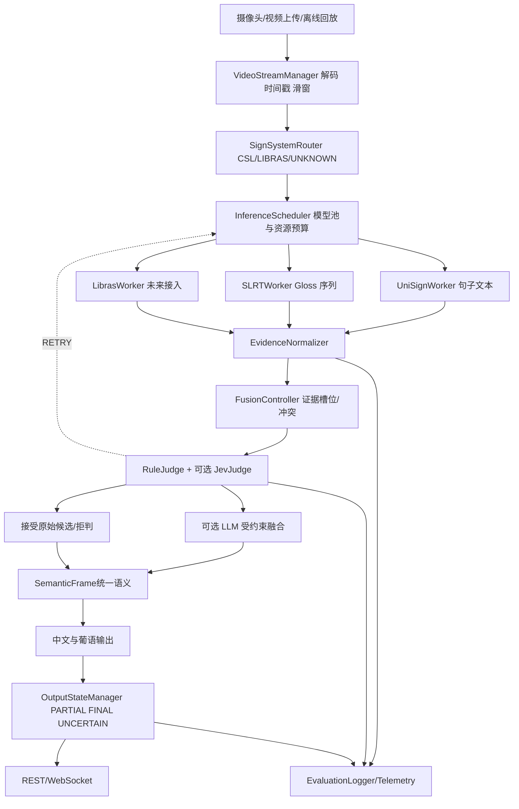
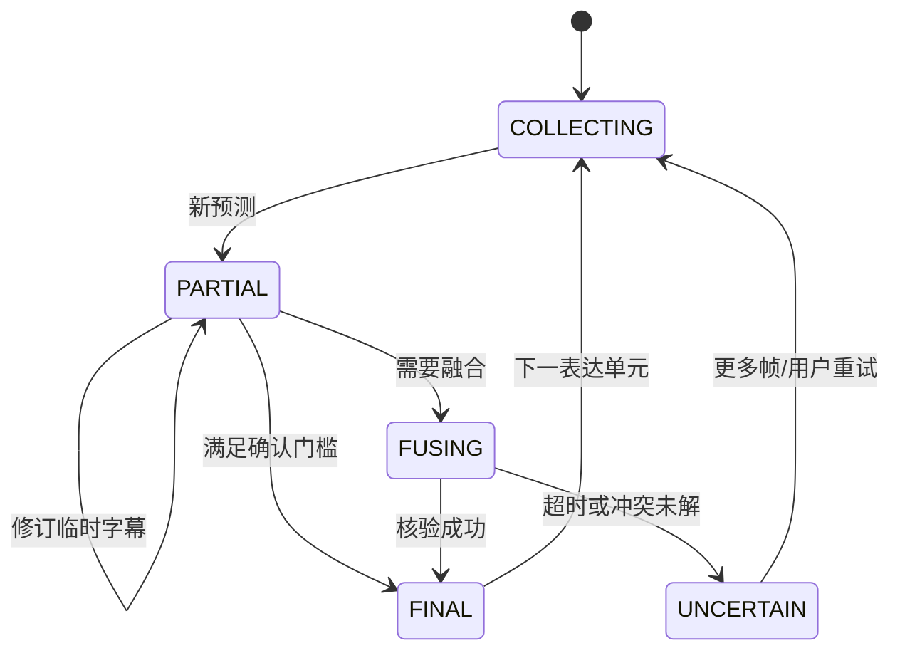

# SignLanguage-Bridge 后端架构设计 V3.0

> 状态：**待实施的技术设计**，不是已部署系统。日期：2026-10-26。适用：CSL-Daily / 中巴手语桥 / Uni-Sign + SLRT + Jev–LLM。
>
> 目标：以现有摄像头手势演示项目为基础，分阶段建设**离线可复验、实时可演进、支持 CSL/Libras 分路**的连续手语识别与翻译后端。

## 0. 证据基线与约束

| 项目 | 当前已知结果 | 约束 |
|---|---|---|
| 测试集 | CSL-Daily，1086 条配对视频 | 只覆盖中国手语，尚未验证 Libras |
| Uni-Sign | 视频输入 BLEU-4 = 24.8157；发布版 Pose 输入 BLEU-4 = 25.5846 | CSLT 句子翻译；BLEU 不可与 WER 横比 |
| SLRT 当前配置 | 语料级 Gloss WER = 30.1825%，完整正确 158/1086 | CSLR 词序列；官方 HRNet 关键点及本地近似对齐，不能直接替换成 MediaPipe 225 维 |
| 互补候选 | Uni 字符编辑相似度 <0.5 且 SLRT WER≤0.2：243；其中 WER=0：75 | 仅为潜在补证样本，非经人工确认的 243/75 条误译 |
| 时延 | 当前 Excel 没有端到端推理时延或设备指标 | 不得声明双模型融合已满足“实时” |
| 既有项目 | README 描述 Streamlit + MediaPipe + RF；此前讨论另有 Tkinter 版本 | 最新 app 源码尚未在此设计中审计；保持 API 独立于前端，不对界面类型作假定 |

**关键防泄漏约束**：1086 条数据已用于错误分析及架构决策，可作开发/回放数据；正式泛化结论必须另留**未参与调参的隔离测试集**。不能把 GT Gloss、GT sentence、逐条 WER/字符相似度输入在线 Jev/LLM，它们仅在带真值的离线评测中可见。若新旧 627/1086 数据可能重叠，应按 sample ID 与视频哈希去重。

## 1. 设计原则与架构决策（ADR）

1. **模块化单体 + GPU 模型进程隔离**：API、编排、证据、融合和评估置于一个 Python 后端代码库；Uni-Sign、SLRT 分别由可替换 Worker 运行。早期不建设大型微服务系统。
2. **离线与在线共用识别内核**：`VideoInput -> Segment/Window -> ModelAdapter -> Evidence -> Decision -> Semantics -> Output`；改变输入、输出传输而非复制业务代码。
3. **模型是证据提供者，不是裁判**：Uni-Sign 输出自然语言候选，SLRT 当前配置输出 Gloss；两个不同任务不合并为“准确率”。
4. **决策和执行分离**：规则/Jev 返回 `ACCEPT|FUSE|RETRY|UNCERTAIN` 意向；只有 `Scheduler` 能依据 GPU、截止时间与策略实际启动/跳过模型。
5. **LLM 受证据约束**：所有具体动作、人物、数字、时间、否定等事实要具备可追溯证据；没有依据时必须可拒判，不以流畅度换取臆造。
6. **输入手语体系与目标口语互相独立**：`sign_system=CSL|LIBRAS|UNKNOWN` 与 `output_languages=[zh,pt-BR]` 分开；绝不可通过目标输出语言推断输入手语。
7. **先精度后效率**：先实现 `parallel_fusion`，确认收益，再实现 `adaptive_cascade`，并保留 shadow full-run 复核。

## 2. 系统逻辑图



**同一 utterance 的模型证据必须有重叠且有效的时间范围**。禁止将上一句话的 Gloss 与下一句话的自然语言候选融合。

## 3. 模块与单一职责

| 模块 | 输入 / 输出 | 最小职责 | 阶段 |
|---|---|---|---|
| `VideoInput` | file / frames → `FramePacket` | 验证媒体、解码、帧率与时间戳；保留原始 PTS | P1 |
| `VideoStreamManager` | FramePacket → `WindowRef` | ring buffer、滑窗、utterance ID、积压丢帧策略 | P2 |
| `SignSystemRouter` | hints、视频特征 → enum | CSL/Libras/Unknown；初期默认显式指定 | P3 |
| `PoseProviderRegistry` | video/window → keyed pose format | MediaPipe225、官方 HRNet、Uni pose 各走独立适配 | P1 |
| `ModelAdapter` | `ModelRequest` → `EvidenceCandidate` | 模型输入、预处理、权重、输出、健康检查、耗时 | P0 |
| `EvidenceNormalizer` | 原始结果 → 标准证据 | 字幕/Gloss、时间轴、模型版本、optional calibrated score | P0 |
| `FusionController` | paired evidence → conflicts | 实体/动作/数量/否定/疑问/时间的冲突与来源映射 | P0 |
| `RuleJudge` | evidence → `DecisionIntent` | 本地可复验确定性决策、兜底 | P0 |
| `JevJudge` | text/JSON → `DecisionIntent` | Choice/Score/Noul 类型化决策；**不处理原始视频** | P1 |
| `LLMFusionEngine` | evidence + policy → `SemanticFrame` | 受约束生成、结构化校验、双语表达 | P0 |
| `InferenceScheduler` | policy + deadline → worker jobs | 并发、取消未启动任务、重试、优先级、GPU 控制 | P1 |
| `OutputStateManager` | candidate → SubtitleEvent | 部分结果修订、最终确认、拒判 | P2 |
| `EvaluationLogger` | per-stage events → records | 记录模型/版本/样本/决策/延迟/错误与审计 | P0 |
| `ExperimentReplay` | 1086预测表 → evidence | 不重新运行视觉模型的文本证据融合回放 | P0 |

`P0` 的 ModelAdapter 可先实现**从 Excel/JSON 读取已存在预测**的 `ReplayAdapter`；真实视觉 Worker 接入是之后的实现步骤。这样优先验证融合假设，而不必先解决大型模型部署。

## 4. 核心数据契约

### 4.1 标识与时间

- `session_id`：用户摄像头连接 ID；离线文件用独立 session。
- `utterance_id`：一句或一个表达单元 ID，不保证与每个定长窗口一一对应。
- `window_id`：切片 ID，绑定 `start_ms`/`end_ms`；携带 `frame_start`/`frame_end`。
- `candidate_id`、`request_id`、`trace_id`：用于证据来源与全链路诊断。
- `start_ms`/`end_ms` 是同一视频流单调的媒体时间轴；服务端处理计时另外使用 monotonic clock，禁止混用。

### 4.2 标准模型证据（示例）

```json
{
  "schema_version": "1.0",
  "candidate_id": "c-002",
  "session_id": "offline-001",
  "utterance_id": "u-001",
  "window_id": "w-001",
  "time_span_ms": {"start": 0, "end": 2500},
  "sign_system": "CSL",
  "model": {
    "id": "slrt-cslr-twostream",
    "revision": "checkpoint-sha256-or-version",
    "task": "CSLR",
    "preprocess_version": "hrnet-alignment-v1"
  },
  "output": {
    "kind": "GLOSS",
    "gloss_tokens": ["我", "赚", "钱", "不", "多", "足够"],
    "text": null
  },
  "quality": {
    "calibrated_confidence": null,
    "status": "ok"
  },
  "timing_ms": {"preprocess": null, "inference": null}
}
```

规则：

- `task=CSLR` 配 `GLOSS`，`task=CSLT` 配 `TEXT`，强类型校验，不混填。
- `calibrated_confidence` 必须允许 `null`；**未经校准的 raw softmax / Jev Choice probability 不能冒充真实翻译正确率**。
- `preprocess_version` 要记录 HRNet / RGB-pose / 225 维 MediaPipe 等具体版本、归一化、缺失值填充策略。**禁止直接把 225 维张量输入预期为其他关键点结构的模型**。
- 离线表里 GT 和样本指标属于 `evaluation.*` 的隔离数据，不属于 `EvidenceCandidate` 请求体。

### 4.3 语义证据表示 `SemanticFrame`

```json
{
  "utterance_id": "u-001",
  "status": "SUPPORTED",
  "slots": [
    {"type":"agent", "value":"我", "sources":["c-002"]},
    {"type":"action", "value":"赚钱", "sources":["c-002", "c-001"]},
    {"type":"quantity", "value":"不多", "sources":["c-002"]},
    {"type":"sufficiency", "value":"足够", "sources":["c-002"]}
  ],
  "conflicts": [],
  "unsupported_additions": [],
  "zh": "我赚的钱不多，但也够用了。",
  "pt_br": "Não ganho muito dinheiro, mas é suficiente."
}
```

`status` 值：`SUPPORTED | PARTIAL | UNCERTAIN`。每个重要槽位的 `sources` 必须指向已有 candidate/token 的证据标识；若视觉模型并未支持一个具体事实，不能仅凭 LLM 自身生成而标记 `SUPPORTED`。中文、葡文均应从**同一个已确认的 SemanticFrame**派生；有必要时翻译模型与融合模型分别维护。

## 5. Jev–LLM 决策门控

### 5.1 动作枚举

- `ACCEPT`：依据已验证门控，接受一个候选并结束本次决策。
- `FUSE`：两个候选信息互补、存在影响含义的冲突，进入受约束融合。
- `RETRY`：视觉证据不足，且预算与可用模型允许，再启动另一 Worker 或等更多帧。
- `UNCERTAIN`：无法证实核心含义，返回有解释的低置信状态，不输出未经验证的具体事实。

### 5.2 优先顺序

1. **硬约束规则优先于 Jev**：时间范围不重叠、非法模型路由、无 Libras 权重、视频太短/坏帧、严重超时、无最少证据时直接拒判或再采样。
2. **安全敏感槽位优先**：否定、数量、人物、时间、关键动作、疑问必须检查；冲突不能因自然语言较流畅就默认相信 Uni-Sign。
3. **Jev 为可选建议者**：只接收结构化文本证据；返回四分类 `Choice` 和可选 `Score/Noul`。如果 Jev 错误、网络异常、超时、非中文表现欠佳，回退至 `RuleJudge`。
4. **融合结果须经过确定性验证**：JSON schema 有效、无未经支持的新事实、中文葡语槽位一致；否则回退原文或 `UNCERTAIN`。
5. **不要用 GT 参与线上路由**：运行时不能读取某个候选的 WER、BLEU 或对参考文本的相似度；这些仅供离线评估。

### 5.3 策略矩阵

| 条件 | 规则建议 | 允许动作 |
|---|---|---|
| 只有一个有效候选且可靠性门控未校准 | `UNCERTAIN` 或标注“单模型候选” | 可提供临时文字，但不得伪称双模型确认 |
| 两个候选对关键槽位一致 | `ACCEPT` | 根据语言自然度择一或最小改写 |
| 两候选关键事实矛盾 | `FUSE` | 限制 LLM 仅在现有候选事实范围内消解；无法解时拒判 |
| 某候选明确缺少关键否定/数字等信息 | `FUSE` | 优先检查另一模型补证，而非直接补全 |
| 全部证据不足、仍可获取时间窗口 | `RETRY` | 等更多帧、重跑已验证预处理或启动可用备用模型 |
| 达到截止时间 / 无更多可靠证据 | `UNCERTAIN` | 返回不确定提示、可人工修正 |

**特别警告**：两个模型一致也可能同时犯错。因此 `ACCEPT` 不是事实证明；需要通过保留测试集校准门槛，并在未来保留抽样双路复核。

## 6. 两种推理模式与调度

### `parallel_fusion`：准确率实验基准

- 同一 utterance、同一视频时段分别准备模型所需输入。
- 两路推理**逻辑并发**；若 GPU 显存不足，实际由资源队列串行执行，但预测对象不变。
- 收齐两侧结果/超时，再统一证据与可选 Jev/LLM。
- 无早退；完整记录每条样本是否有改进、退化与额外调用成本。

### `adaptive_cascade`：经过验证后启用的效率模式

1. 使用硬件基准和质量验证挑选首选模型（**不能凭 BLEU 与 WER 横比决定**）。
2. 首选 Worker 输出候选，RuleJudge 检查输入质量、校准得分及有无敏感语义信号。
3. 若证据不满足**开发集上已确认的接受条件**，启动备用 Worker；结果冲突时才调用 Jev/LLM。
4. 若已达到接受条件，跳过尚未启动的 Worker；已进入不可中断 GPU forward 的计算无法通过“取消协程”收回。
5. 抽取一部分提前接受案例做 `shadow_run`（例如先试 10%，比例由成本和误改率验证调整），记录备用模型本可提供的纠错信息。

建议调度器内部任务状态：`QUEUED -> PREPROCESSING -> RUNNING -> SUCCEEDED|FAILED|TIMED_OUT|CANCELLED`；与**面向字幕的状态机**分离。单 GPU 初期每 Worker 限流 `max_inflight=1`（配置项），测得可并发后再增大。优先完成活跃会话最新窗口，过期窗口可以 drop/supersede，不能让过期结果覆盖新字幕。模型采用延迟加载、预热、权重固定与显存配额。

## 7. 实时视频与字幕状态

### 7.1 输入

- 文件处理：上传 mp4 等允许格式；记录 FPS、PTS、尺寸、编码类型。规范化后的帧引用保留原始媒体时间，避免转码带来的时间偏差。
- 摄像头：WebSocket/其他流媒体输入；服务端收帧后进入有界 ring buffer。不建议每帧运行两个大型模型。
- 滑动窗口：`window_frames / hop_frames / max_wait_ms` 全部可配置，在实际硬件上测试候选值；至少记录帧等待延迟、preprocess、forward、融合与传输耗时。
- Utterance Segmenter：综合手/身体运动边界与语言完结信号。**不能仅以短暂无动作判断整句话结束**。

### 7.2 输出



- `PARTIAL`：客户端允许相同 `utterance_id`、递增 `revision` 替换内容。
- `FINAL`：同一 utterance 只提交一次，不再静默改写；必要更正须新 correction event。
- `UNCERTAIN`：保留视频窗口 ID、冲突字段、原因码，提示是否继续或重试。
- 严格按 `session_id+utterance_id+revision` 排序和去重，迟到的 GPU 输出不能覆盖 FINAL。

### 7.3 时延定义（须分开测量）

`T_visible = T_wait_for_visual_context + T_preprocess + T_queue + T_model + T_decision + T_translation + T_network/render`，为便于排查的近似组成；若并行执行则实际墙钟端到端时延不能直接用各阶段之和代替。

记录 `first_partial_ms`、`first_stable_word_ms`、`final_caption_ms`、P50/P95、RTF、per-stage GPU queue time、peak VRAM。初期只设**测量要求**，不要在未知 GPU 型号下虚报“已达 320 ms”。

## 8. 模型输入兼容性与跨手语路由

1. 现有 MediaPipe 表示为 75 个 3D 关键点/225 维；其他数据集/模型可能有不同骨架数、排列、置信度与归一化。必须建 `PoseSchema`，包括 `keypoint_order`、`coordinate_system`、`missing_mask`、`normalization`、`fps` 和 `extractor_revision`。
2. SLRT 当前 1086 评测依赖视频 + 官方 HRNet 关键点；缺少官方裁剪包导致部分近似对齐。要建立 `reference_preprocess` 与 `deployment_preprocess` 两套版本标记，并用相同子集评估迁移性能，而不是假定无损可替换。
3. `sign_system` 路由：P0/P1 由用户明确选择 CSL；Libras 未接训练权重时返回 `MODEL_UNAVAILABLE`，不要偷偷使用 CSL 权重。
4. P3 使用 CSL/Libras 的 signer-disjoint 数据训练/评测独立视觉分类器；低置信或 Unknown 时允许用户手动切换，谨慎跨模型探测。
5. `target_language` 为 zh-CN、pt-BR，与输入手语路由完全独立。
6. 若将来要直接处理 Libras，至少建 Libras 模型专属 `LabelMap/GlossTokenizer/PoseSchema`；跨语言共享的是后处理接口与通用语义字段，并非未经验证的视觉模型权重。

## 9. 推荐的代码目录（保留现有 Demo）

```text
SignLanguage-Bridge/
├── app/                         # 原有 Streamlit/Tkinter/采集训练脚本，按实际代码保留
├── backend/
│   ├── api/
│   │   ├── main.py
│   │   ├── routes/{health,models,videos,experiments}.py
│   │   └── websocket.py
│   ├── domain/
│   │   ├── enums.py
│   │   ├── schemas.py            # Frame, Evidence, Decision, SemanticFrame, Events
│   │   └── errors.py
│   ├── video/{decoder,frames,windowing,segmenter}.py
│   ├── routing/{sign_system,model_registry}.py
│   ├── adapters/{base,replay,uni_sign,slrt,libras_stub}.py
│   ├── preprocessing/{pose_registry,mediapi_adapter,hrnet_adapter}.py
│   ├── orchestration/{scheduler,resource_budget,worker_client}.py
│   ├── fusion/{evidence,semantic_slots,conflicts,validator}.py
│   ├── judges/{base,rules,jev}.py
│   ├── translation/{llm_fusion,gloss_to_text,language_output}.py
│   ├── streaming/{session_manager,subtitle_state}.py
│   ├── evaluation/{replay,metrics,experiments,logger}.py
│   ├── storage/{models,repositories}.py
│   └── settings.py
├── workers/{uni_sign_worker,slrt_worker}/
├── contracts/                    # versioned JSON Schema / OpenAPI / protobuf (if needed)
├── tests/{unit,contract,integration,regression,performance}/
├── datasets/{raw,processed,metadata,splits}/
├── config/{models,policies,experiments}/
└── docs/
```

真实运行前必须审计 `app/` 当前源码，不能假设 README 一定与工作区一致。模块路径仅是建议命名，并非当前已有文件。

## 10. 对外 API（V1 草案）

| 方法 | 路径 | 用途 |
|---|---|---|
| `POST` | `/v1/videos/infer` | 上传完整视频，返回 `job_id`；参数：sign_system、targets、mode |
| `GET` | `/v1/jobs/{job_id}` | 查询处理状态、字幕、证据引用、时延摘要 |
| `WS` | `/v1/stream/{session_id}` | 摄像头流输入与 subtitle partial/final/uncertain 事件 |
| `GET` | `/v1/models` | 列出可用模型、模型任务、语言、检查点、健康状态 |
| `GET` | `/health/live` | 仅进程存活 |
| `GET` | `/health/ready` | 模型依赖与 Worker 可用性 |
| `POST` | `/v1/experiments/replay` | 授权的离线回放实验，禁止公开无认证使用 |

```json
{
  "event": "subtitle.partial",
  "schema_version": "1.0",
  "session_id": "s-123",
  "utterance_id": "u-7",
  "revision": 2,
  "time_span_ms": {"start": 1840, "end": 3400},
  "sign_system": "CSL",
  "text": {"zh-CN": "我想去……", "pt-BR": "Quero ir..."},
  "evidence_ids": ["c-101", "c-102"],
  "status": "PARTIAL"
}
```

实时流推荐先采用**JSON 控制消息 + 带序号的二进制帧消息**；前后端应在连接初始化阶段协商 `codec/fps/width/height/timebase`，禁止无界积累浏览器 Base64 图片。Video WS 的完整帧协议需要在技术实现前进行单独性能测试。

## 11. 资源管理、持久化与观测

- 开发阶段：SQLite 保存实验元数据及引用、文件系统保存少量获授权的离线素材；不要求一开始就上 Redis/Kubernetes。
- 并发阶段：PostgreSQL 存作业和实验、Redis 仅用于队列/短期会话状态；媒体放对象存储或卷，数据路径不可作为 API 外部身份。
- 日志：记录 request/session/utterance/window/candidate ID、Worker revision、预处理 hash、耗时、决策规则版本、融合 prompt 版本、是否修改原文、fallback 原因。
- 模型健康：CUDA OOM、超时、依赖不兼容、权重缺失、GPU peak memory、队列长度。错误采用明确错误码（`MODEL_UNAVAILABLE`, `OUT_OF_VRAM`, `INVALID_POSE_SCHEMA`, `INFERENCE_TIMEOUT`, `JUDGE_UNAVAILABLE`, `LOW_EVIDENCE`）。
- 对外 Jev/LLM：先确认外部 API 使用条款、脱敏、是否允许上传预测文本，密钥只放服务端；未经授权不要上传视频、脸部骨架、私人内容或原始 GT。
- 缺省：不开启原始摄像头视频持久化；调试时由用户明确开启并设保留期限；实验数据集按其许可使用。
- 推理错误不能向用户泄露堆栈、API key 或云端访问令牌。

## 12. 实验矩阵与科学验收

| 组 | 处理过程 | 核心用途 |
|---|---|---|
| A | Uni-Sign 原始句子 | 端到端基线 |
| B | SLRT Gloss → 固定 Gloss-to-Text | Gloss 翻译基线 |
| C | Uni-Sign → LLM | 排除“仅靠 LLM 润色”收益 |
| D | SLRT Gloss → LLM | 观察 Gloss 的语义恢复能力 |
| E | 双模型 → LLM | 纯融合收益 |
| F | 双模型 → 冲突/来源约束 → LLM | 证据约束收益 |
| G | 双模型 → Jev/规则（无 LLM） | 判别本身的效果 |
| H | 双模型 → Jev/规则 → 按需 LLM | LLM 调用节约与质量保持 |
| I | 动态级联视觉模型 → Jev/规则 → 按需 LLM | GPU 工作量与质量联合优化 |

**对照关系**：C 对 E（双模型补证 vs 语言润色），E 对 F（约束效果），F 对 H（Jev 分流节约），H 对 I（少运行视觉模型的开销和质量风险）。在 B/C/D 之间需固定 LLM 和解码配置、温度、prompt 版本，避免不公平比较。

评估指标分层：

- CSLR：语料级 WER、S/D/I、按签手分组的 WER。
- CSLT：同一 reference 和统一预处理的 BLEU-4、chrF、人工盲审语义准确性；对中文分词/字符级处理必须固定规则。
- 关键事实：人物、时间、否定、数字、疑问、动作的槽位准确率；新增虚构事实比例、遗漏率、**原本正确被改错率**。
- 决策：Jev Choice 与规则的正确升级率、错误接受率、拒判率、校准可靠性曲线；错误接受率设置为质量红线。
- 效率：每句使用的视觉模型数、Jev/LLM 调用率、平均与 P95 GPU compute/显存、排队时延、端到端 P50/P95、实时因子 RTF。
- 动态：`shadow_run` 与全模型路径比较，计算错跳“本可纠正样本”的比例。评估应给出成对 bootstrap 置信区间，按 signer/语句重采样处理相关性。
- 中巴：手语体系路由 Macro-F1、Unknown/未见签手表现；Libras 独立翻译质量。

**不要把 per-sample WER 或 BLEU 作为线上决策输入**，因为在线摄像头没有真实答案。当前 1086 条表格也**不能用于确定实时系统是否快**，必须对 GPU 运行重新埋点测量。

## 13. 自动化测试与质量闸门

**P0 需要可重复完成的检查**：

1. `contracts`：不同 model task 的输出必须符合 Schema，版本字段和时间范围必须存在。测试 None 置信度、空字符串、空 Gloss、坏 JSON、迟到输出。
2. `fusion`：覆盖关键反例（“儿子/女儿”“吸烟/烟花”“赚得少但够用/没赚到钱”），要求不能引入无证据新事实；LLM 输出须经规则校验。
3. `replay`：1086 行完整入库，sample ID 唯一且 1086 条均有双候选；GT 只允许 evaluation 模块读取；比较结果可重复导出。
4. `judge`：断网、Jev 429/500、LLM JSON 无效、超时均应 fallback；调度动作必须在白名单内。
5. `scheduler`：队列超过限流、GPU 失效、超时、取消已排队任务、取消已运行任务、跨 session 错配与迟到覆盖。
6. `stream`：partial 可修订、final 不可被旧消息覆盖、断流释放显存/缓存、会话重连幂等。

**建议上线质量门槛**：门槛数值不要凭直觉定死；首先冻结一组开发/测试分割，统计比基线的绝对劣化率、关键语义误改率、P95 时延，再决定业务接受值。**即使 BLEU 有提升，如果严重误译率明显上升，也不得直接替换基线。**

## 14. 依赖与实施顺序（兼顾资源）

### P0 · 离线证据回放与融合核心（第一优先级）

- `EvidenceCandidate` / `SemanticFrame` / `DecisionIntent` Pydantic schema。
- 1086 Excel importer，去重、GT 隔离、版本化、回放。
- `EvidenceNormalizer`, `FusionController`, `RuleJudge`, `LLMFusionEngine`, `EvidenceValidator`, `EvaluationLogger`。
- 实验 A-F；重点 C/E/F 及保留原本正确译文的能力。
- **验收**：不用任何 GPU 视觉前向即可重跑离线融合；每句能追踪“原预测→冲突→LLM→语义→最终译文”，无 GT 泄露。

### P1 · 模型 Worker、异步调度、Jev

- `UniSignWorker`、`SLRTWorker` 接真实模型及权重；每个 Worker 独立环境/进程。
- 官方预处理复现与 MediaPipe 实时版本对比；模型注册表与检查点哈希。
- HTTP 上传/查询、队列、GPU 预算、超时及 fallback；Jev 作为可开关插件。
- 实验 G/H，计量 Jev 的正确升级率、额外请求时延及成本。
- **验收**：同一个文件在同一模型版本下可复现预测，错误可定位到对应模型/预处理；Jev 离线不可用时仍能通过规则流程工作。

### P2 · 实时连续视频与字幕

- 摄像头流、ring buffer、窗口策略、utterance 切分、PARTIAL/FINAL 修订逻辑。
- 基于真实硬件记录窗口等待、首个稳定输出、P50/P95、GPU/VRAM；添加积压丢弃与后压。
- **验收**：连续两句不会跨句融合；慢 Worker 的迟到结果不覆盖新字幕；断线与 OOM 有可恢复行为。

### P3 · 自适应级联与巴西手语

- 实验 I，可靠性阈值校准、shadow full-run、早退率 vs 损伤率。
- 接入经过 Libras 训练/测试的 Worker；`CSL|LIBRAS|UNKNOWN` 路由由手动选择逐步升级自动判断。
- 增加跨签手、跨视角、跨设备 Libras/CSL 数据和独立保留测试。
- **验收**：在不显著增加关键语义误译的前提下，报告 GPU 与尾延迟节省；中巴双体系均具独立测试证据。

## 15. 需要明确为“尚未验证”的关键事项

- Uni-Sign、SLRT 当前特定 checkpoints 对**任意摄像头流**的实时推理能力与耗时。
- Jev 在中文、葡语及 Gloss 混合结构输入上的实际正确分流率、延迟与价格。
- 新旧测试是否完全重叠、是否有签手泄漏、有没有足够独立的 blind holdout。
- 即使保留正确的 Gloss，也不意味着可以简单机械拼词得到语义正确的自然语言。
- MediaPipe225 与 SLRT/Uni-Sign 预训练输入之间的性能差异；不能未经验证共用关键点。
- Libras 当前尚无已验证的模型权重或完整系统性能，不能承诺开箱即用。

## 16. 建议的开发优先级总结

**应立即开发**：1086 数据回放、统一证据 Schema、规则/LLM 融合、追踪与实验评估。

**其次开发**：真实双模型 Worker、Jev 插件、GPU 调度和 HTTP API。

**最后开发**：实时状态机、动态早退、自动手语体系识别和 Libras 模型池。

## 17. 既有 Demo 兼容策略与双向能力边界

项目原有 `MediaPipe + Random Forest` 摄像头静态/短动作识别与 `文本 -> 预置骨架动画` 两条功能，应作为**兼容插件**而不是删除或强行塞进连续手语的 CSLR/CSLT 管线：

- `LegacyGestureAdapter`：继续加载已有 `gesture_model.pkl`，维持当前 225 维 `MediaPipe` 输入格式及词表，面向原 UI 的孤立手势演示。
- `LegacyAnimationRenderer`：读取已有动作片段并播放骨架动画；此功能只是**词条/动画检索播放**，不等同于真正的任意中文/葡语到 CSL/Libras 手语生成。后续若做文本到手语，需独立的生成模型和动作语言学评测。
- 老接口可保留或增加适配层路由，不要让旧 `data/sequences/` 文件命名直接决定新系统的 `semantic_id`；提供显式词条映射表并写迁移脚本。
- 是否为 Streamlit、Tkinter 或其他前端，由核实后的最新源码决定；后端协议不依赖界面框架。

## 18. 关键存储实体与防重复策略

| 表/集合 | 主要字段 | 理由 |
|---|---|---|
| `model_registry` | model_id, revision, task, supported_sign_systems, pose_schema_hash | 能复现哪个权重/预处理给了证据 |
| `jobs` | job_id, owner, status, created_at, deadline, input_ref | 异步作业和安全隔离 |
| `utterances` | session_id, utterance_id, start/end, final_revision | 防止跨句错配 |
| `evidence_candidates` | candidate_id, utterance_id, window_id, model_revision, prediction, timing | 可追溯视觉模型贡献 |
| `decisions` | decision_id, candidate_ids, action, judge, policy_revision, reason | 分析错误接受与升级 |
| `semantic_frames` | semantic_id, utterance_id, slots, sources, validation_result | 约束语义事实及双语一致性 |
| `subtitle_events` | utterance_id, revision, state, text, emitted_at | 处理实时字幕修订、回放 |
| `experiment_runs` | experiment_id, split_hash, model/prompt versions, metrics | 保证各对照组可重复 |

基于 `job_id + utterance_id + window_id + model_revision` 设计幂等键，防止 Worker 网络重试产生重复候选；输出以 `utterance_id + revision` 单调推进，FINAL 应由数据库或会话状态机中的原子状态转移锁定。原始视频与人脸骨架数据不能在没有授权的情况下长期保留。

## 19. 参考调度伪代码（仅说明职责分离）

```python
async def process_utterance(utterance, policy):
    # 1. Only route to models whose sign system and input schemas match.
    plan = scheduler.plan(utterance, policy)
    raw_candidates = await scheduler.execute_initial(plan, utterance)
    evidence = normalizer.validate_and_normalize(raw_candidates)

    # 2. Deterministic gates are authoritative; Jev is advisory.
    decision = rule_judge.evaluate(utterance, evidence, policy)
    if decision.may_ask_jev and policy.use_jev:
        decision = await jev_with_rule_fallback(evidence, decision, policy)

    # 3. Run another visual worker only if permitted by budget.
    if decision.action == "RETRY":
        extra = await scheduler.execute_next(plan, utterance)
        evidence = normalizer.merge(evidence, extra)
        decision = rule_judge.evaluate(utterance, evidence, policy)

    if decision.action == "FUSE":
        proposed = await llm_with_timeout(evidence, policy)
        semantic = validator.verify_grounding(proposed, evidence)
    elif decision.action == "ACCEPT":
        semantic = semantic_from_supported_candidate(evidence, decision)
    else:
        semantic = uncertain_semantic(reason=decision.reason_codes)

    # 4. Generate both spoken-language outputs from the SAME semantic frame.
    return output_manager.emit(utterance, semantic, policy.languages)
```

此伪代码不等于可运行实现，实际系统还需处理候选异步到达、取消与并行互斥、断线、事务、Worker 进程生命周期和有界队列。

### 参考与核查入口

- Jev 官方产品说明（仅文本/JSON、Choice/Score/Noul）：https://github.com/jevmodel/typesafe-ai
- Uni-Sign 官方实现：https://github.com/ZechengLi19/Uni-Sign
- Uni-Sign 演示说明：https://github.com/ZechengLi19/Uni-Sign/blob/main/demo/README.md
- SLRT 开源实现：https://github.com/FangyunWei/SLRT
- SLRT 在线 CSLR：https://github.com/FangyunWei/SLRT/tree/main/Online

