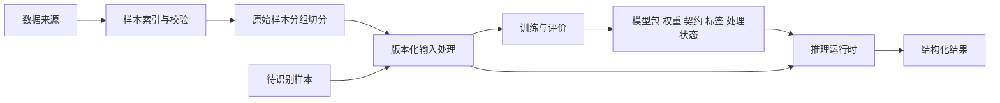

# 核心框架设计与开发顺序

日期：2026-10-09（Asia/Shanghai）。状态：F0–F4 首轮实现已完成，使用真实 NPY 及 Libras RGB 数据贯通训练、模型包和独立进程推理。见[核心开发与使用](核心开发与使用_2026-10-09.md)、[RGB 开发与使用](巴西手语训练与验证_2026-10-09.md)及[真实实验报告](reports/libras-rf-pilot-2026-10-09.md)。

> 输入与字幕实现更新：F5桌面接入部分已完成，文件与摄像头手动片段复用核心并显示中葡字幕；旧采集／训练脚本迁移仍待完成。见[执行方案](视频摄像头输入与字幕_执行方案_2026-10-09.md)与[验收报告](reports/video-camera-captions-2026-10-09.md)。

## 1. 当前工作目标

用户最新决定：先退回核心框架，不按具体场景推进。

当前目标是建立一个 **数据可追溯、特征可复用、模型可替换、训练可复现、推理可独立调用** 的手语处理内核。远程视频房间、业务场景、具体深度模型竞赛和目标手语生成留在后续阶段，不再作为当前开发前置条件。

长期中巴双向交流目标保留。本文是近期开发的主依据；之前的总体路线图用于长期方向，Backbone 文档用于模型候选，Libras Demo 文档用于某个数据来源的验证。

核心框架完成的判断不是目录或抽象类数量，而是这条链路真实可运行：

**原始样本 → 校验与索引 → 合法切分 → 统一处理 → 训练／评价 → 独立模型产物 → 新进程加载 → 单样本推理与可追溯结果。**

## 2. 框架形态的选择

| 方案 | 代价与收益 | 决定 |
|---|---|---|
| 继续在四个脚本各自增加功能 | 改动小，但归一化、路径、标签和模型加载继续分散 | 只作为过渡入口 |
| 一个可独立调用的 Python 核心包＋薄入口 | 能集中契约和处理逻辑，支持 CLI、桌面及未来 Web 复用 | 当前采用 |
| 提前做分布式平台／全面插件系统 | 增加部署和接口维护成本，实际实现尚不足以验证抽象 | 后续有明确需求时再拆 |

先使用一个仓库、一个核心包、本地文件索引和版本化产物。不要求引入数据库、服务端部署或新 UI。配置先服务真实已有的差异：数据来源、特征格式、模型类型与模型版本。

## 3. 两条链路，共享同一套处理



训练与推理必须使用相同的确定性处理逻辑和训练时保存的处理状态。增强仅作用于训练样本；标准化统计量、词表等需要拟合的内容只从训练集学习。推理从模型包恢复配置，不能靠 UI 中另一个默认值猜测输入方式。

部分输入已经是关键点，部分输入是 RGB。核心包不能要求所有模型都先经过 MediaPipe，也不能把所有输入强制展平为同一个数组。具体模型的输入要求由其契约声明。

## 4. 五个核心模块与一个公共契约模块

### 4.1 contracts：少量稳定的数据对象

contracts 定义共同语言，不存放训练、媒体解码或 UI 逻辑。首轮只为实际贯通的任务实现完整字段；未来任务只登记能力类型，不伪造实现。

| 对象 | 必须表达的内容 |
|---|---|
| SampleRecord | sample_id、dataset_id、输入类型、相对资源引用、内容 hash、源样本／派生关系、标签引用、语言体系、分组身份、质量状态 |
| InputSpec | representation_id、结构／模态、dtype、点序／坐标、时间策略、mask、归一化、镜像约定、版本 |
| PreparedInput | 符合 InputSpec 的实际数据、长度／时间信息、质量结果、来源引用；不是任意字典 |
| ModelManifest | task_type、backend、输入／处理版本、标签／分词器引用、训练数据和 split hash、参数、依赖、能力及产物校验和 |
| RecognitionResult | task_type、成功／拒识状态、对应任务的预测内容、分数含义、质量信息、sample/request ID、模型版本与时间范围 |

字段名与显示文本分开。`sign_language` 表示手语体系，字幕／词条语言使用独立字段。`semantic_id` 可空；未经核验的 A–D 数据保留语言未知。未知签者也保持为空，不能为了满足 schema 编造身份。

classification、gloss_sequence、text 的结果应有各自明确结构。第一版只实现 classification；序列／文本任务暂不声明支持，不返回空字段冒充有效输出。

### 4.2 data：来源、索引、校验和切分

对调用者提供“建立／读取一个已校验数据视图”和“按指定协议生成切分”两个入口；模块内部承担目录解析、幂等 ID、重复检测、路径检查、来源追溯与报告。

已有两种真实来源：legacy NPY 与 Libras RGB。分别由具体 adapter 解析，输出共同 SampleRecord；核心训练逻辑不能包含 `INFORMANTE` 或某个数据集的目录规则。

不把 CSV 视为随便追加的文件：规定版本、字段、主外键、空值、重复行、原子更新和中断恢复。原视频和旧 NPY 只读引用，导入不复制或改名原数据。

切分先于增强、裁剪派生与拟合处理。原视频、重复内容和已声明的签者／场次分组形成不可拆分关系；传递相关的样本不能通过换文件名进入不同集合。标签冲突先隔离。如果约束下无法形成有足够类别覆盖的切分，报告不可行，不能自动退回随机按行切分。

Libras 局部 INFORMANTE 与全局 signer_id 分列；legacy 无签者数据只能使用明确标注限制的演示协议。官方 split 和本项目实验 split 分开保存。

### 4.3 features：输入处理与派生缓存

对外提供“按已声明的 pipeline 准备输入”，统一管理读取、可选提取、归一化、重采样、mask 和质量检查。离线训练与推理共享这条路径。

现有 hand63_v1 和 pose_hands225_legacy 分开登记。禁止 `宽度>=63 就取前63维`；未知格式拒绝。新坐标表示与旧 -999 编码通过显式转换处理，保留缺失信息。

对旧 NPY 不能再次默认执行原始手部归一化，因为它可能已归一化；其历史真实 fps／时间戳未知时不能从 30 帧猜成 1 秒。新的媒体输入保存实际时间与帧索引。

缓存键包括内容 hash、处理图／参数／版本，以及适用时的已拟合状态 hash。把只由单样本决定的提取缓存与依赖训练折拟合状态的处理结果分开，避免折间复用造成泄漏。处理失败记录原因，重试不留下“文件已完成但索引未完成”的假状态。

模型允许直接使用 RGB 时，pipeline 可只负责解码、变换与打包，不强制产生关键点。clip 和 stream 使用不同时间契约；整段重采样不能被无声用于只看到前缀的流式推理。

### 4.4 models：算法、能力与模型包

models 负责具体训练实现、预测、状态保存／恢复。RF 的训练实现可以调用 sklearn；以后深度模型可以使用自己的批处理和优化循环。训练编排模块不假设所有模型都具有 sklearn 的 `fit`、`predict_proba` 方法。

调用者只需知道：该 backend 支持的任务／输入、如何按配置训练、如何加载其产物，以及如何获得类型明确的预测。内部 estimator 或神经网络不泄露到 GUI。

第一版仅注册真实可用的 RF backend。预留实际可替换的位置；第二个模型接入时验证接口是否足够，不现在为空的 TCN／Transformer 创建成套继承树。不同模型可以声明不同 InputSpec，替换模型意味着切换已验证的模型包，而非把新权重塞进旧数组接口。

一个模型包包括：

```text
models/{run_id}/
  manifest.json
  resolved_config.json
  labels.json
  preprocessing_state/    # 无拟合状态时按契约注明
  weights/                # 格式由 backend 管理
  splits/
  metrics.json
```

运行时先读取并验证 manifest，再加载相应 backend 和可信产物。输入 schema、标签版本、处理状态、权重 hash 不匹配时明确失败。失败训练不覆盖旧包；只有完整验证通过的目录才发布为可用版本。

### 4.5 training：实验编排和任务对应的评价

training 负责选择已校验数据、执行／载入冻结 split、限定拟合与增强范围、调用 backend、评价和生成完整模型包。它不重新实现数据集解析或 GUI 特征处理。

配置经解析与校验后保存为 resolved_config；记录种子、数据／split hash、代码与依赖版本。配置覆盖有明确优先级，未知字段报错；加载一个模型时不得再被全局训练默认值覆盖。

第一版实现分类评价：accuracy、macro-F1、逐类 precision/recall/support、混淆矩阵及拒识覆盖情况。新增序列任务时新增相应 evaluator，不强行复用分类 accuracy。阈值与超参数通过 validation 决定，test 用于冻结后的评价。

### 4.6 inference：独立推理入口

对外只需加载一个 ModelBundle，并识别一个来源明确的输入。模块负责能力检查、共享处理、质量拒识、模型调用与结构化返回。

低质量／词表外与程序故障分开：前者返回 rejected 和具体原因；损坏产物、schema 不兼容等返回明确错误。没有中文释义不等于识别失败，标签结果不得被显示字典过滤掉。

第一版完成 clip 推理。stream 能力只在有 begin/feed/end/reset 真实实现、缓存隔离和相关测试后开启。模型不支持流式时返回 capability unavailable，不能重复调用片段预测后声称具备连续理解。

## 5. 核心与外部调用的依赖方向

```text
CLI／现有桌面／未来 Web
            ↓
training 或 inference
            ↓
data、features、models
            ↓
contracts
```

这是对外依赖方向；data/features/models 之间通过明确输入对象或注入的实现协作，不能形成反向依赖到 GUI。训练无需安装 UI 依赖，读取样本索引也不应触发摄像头、模型下载或应用启动。

语言显示词典放在调用层可使用的独立资源中。核心保留语言内稳定标签和可选语义引用，但当前不实现跨语言大模型翻译、会话状态机或手语动作生成。未来这些模块消费 RecognitionResult，不反向改变数据／训练逻辑。

## 6. 建议目录：只为真实功能建立文件

```text
slbridge/
  contracts.py
  data/          # 索引、校验、来源 adapter、分组切分
  features/      # 表示、处理与缓存
  models/        # backend 注册、RF 实现、模型包
  training.py
  inference.py
  cli.py
app/             # 现有入口逐步变薄，兼容运行方式
configs/         # 数据来源／实验配置，不是业务场景目录
tests/           # 对外接口与真实闭环验收
data/            # 保留原始数据和旧资产；新派生物分版本
```

实现时先采用最少文件数量；某个职责还没有实际实现，就不为空目录或一行转发类增加层级。MediaPipe、视频解码、深度学习框架放在使用它们的实现中按需依赖，核心 import 不要求一次安装全部后端。

## 7. 按可验证结果分步开发

| 阶段 | 实际交付 | 验收条件 |
|---|---|---|
| F0 契约与遗留格式 | contracts、严格 loader、legacy adapter、最小标签表 | 80 个单手／80 个全身文件分别识别；不隐式混格式；原文件不变 |
| F1 可信数据 | 样本索引、validator、重复／冲突处理、显式分组 split、Libras adapter | 全部来源可追溯；幂等导入；冲突隔离；各集合来源／hash／指定组无交叉 |
| F2 训练与产物 | 共享 NPY 输入 pipeline、RF backend、实验编排、评价、ModelBundle | 从旧 NPY 真实训练一个新包；参数和 split 固定；失败不覆盖旧模型 |
| F3 独立推理 | 模型包加载、统一预处理、结构化输出、CLI | 新进程加载 F2 产物并完成推理；错误输入被拒绝；换模型包无需改调用方 |
| F4 RGB 输入闭环 | 视频读取、时间戳、实际提取器、质量统计、恢复缓存 | Libras 视频→派生特征→同样训练／推理接口完成；不能只产 metadata |
| F5 旧入口接入 | train_model／collect_data／desktop_app 复用核心，修复补录保存与状态问题 | 命令与桌面输入走相同逻辑；新标签显示；重启加载正确；采集不覆盖 |

F2/F3 用现有 NPY 验证的是框架行为，报告必须写明旧数据语言／签者未知；它不证明 Libras 或中国手语识别效果。F4 才验证真实 RGB 来源。12 个 Libras 条目只是可选试点配置，不写死在核心代码中。

优先完成 **F0→F3 的首个运行闭环**，再接 RGB。当前环境默认 Python 已有 NumPy、scikit-learn、joblib 和测试工具；cv2／mediapipe 未在该解释器发现，视频阶段需另行准备并锁定合适环境。不能将依赖缺失包装成提取成功。

## 8. 必须通过的核心验证

1. 新进程能够执行“读取冻结清单→训练→保存→加载→预测”，而不是只在同一进程引用内存中的模型。
2. 相同样本经训练输入路径与推理输入路径得到相同的确定性处理结果；已拟合处理状态来自同一模型包。
3. 63／225／新 schema 不互相误读；长度、dtype、NaN/Inf、缺失编码与不兼容版本有明确处理。
4. 同源增强、重复内容、衍生窗口、已声明分组不跨集合；标签冲突与不可行 split 不会静默放行。
5. 迁移／导入／缓存重跑幂等；不覆盖原数据；中断后可恢复；产物半写入不会成为活动模型。
6. 分数类型、类别顺序和标签表一致；缺翻译仍返回合法识别结果；概率不能被冒称为已校准置信度。
7. 模型包与处理配置变化后，错误组合被拒绝；调用者不需要理解 RF 参数或具体权重文件格式。
8. 核心模块导入不启动摄像头、GUI、训练或下载；无 GUI 环境可运行数据校验和推理测试。

第二个真实 backbone 接入时，增加一次“替换模型实现但不改数据索引、CLI 结果结构和调用入口”的集成验收。第一版不会仅靠模拟类测试就宣称所有未来模型已适配。

## 9. 与既有规划的关系

- [总体路线图](中巴手语实时交流_总体架构与路线图_2026-10-09.md)：保留双向交流的长期目标；远程通话和场景建设暂停作为近期排期依据。
- [Backbone 路线](Backbone模型选型与实验路线_2026-10-09.md)：保留候选与评价方法；核心先用一个真实 backend 跑通，不要求同时完成三组模型实验。
- [Libras Demo 规划](Libras识别Demo_后续开发规划_2026-10-09.md)：保留数据证据与试点建议；不把词表、Tkinter 或时间长度固化成框架限制。
- [本地数据审计](reports/libras-audit-2026-10-09/README.md)：继续作为数据 adapter 与校验规则的证据。

上述模块契约及 F0–F4 已完成首轮实现；下一步通过第二个模型的接入经验调整抽象。模型包校验单独放在 bundle.py，RGB 解码／提取放在 media.py，来源保留与恢复缓存放在 extraction.py；数据与特征仍先用单个文件。
